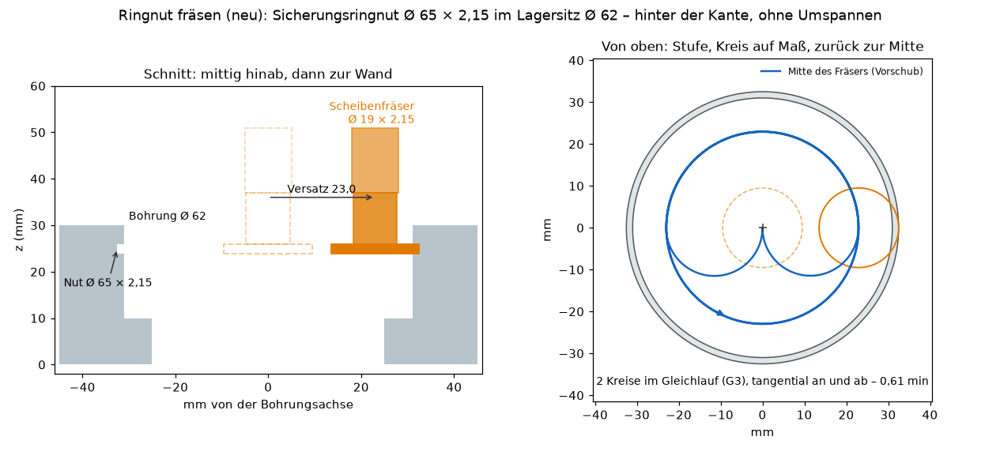

# Offene Fragen an Manuel

Hier steht jede Frage, die **nur Manuel** beantworten kann – mit dem Grund, warum Claude sie
nicht selbst beantwortet, und dem, was die Antwort ändert. Beantwortet: Eintrag raus, die Antwort
kommt in den Verlauf (`archiv/DEV_PROMPT_HISTORY.md`) oder in die Spezifikation. Nichts davon wird
durch Prüfläufe ersetzt: Was Manuel entscheiden muss, wird hier gefragt, nicht nachgemessen
(Arbeitsregeln, Abschnitt 0; Manuel, 2026-10-10).

Je Frage: **die Frage** – *Warum nur Manuel* – *Was die Antwort ändert* – seit wann.

## 1. Soll „Weiter bearbeiten“ das letzte Aufmaß in zwei gleichen Schnitten nehmen – mit Messen dazwischen?

**Die Frage:** „Weiter bearbeiten“ schlägt je Gang 1 mm weniger Aufmaß vor (3 → 2 → 1 → 0, dein Beispiel vom
31.10.). Nach dem Schruppen mit 0,3 heißt das: gleich auf 0. Gemessen wird davor am geschruppten Maß, und
der Fertiggang nimmt die 0,3 auf einmal. Für eine Passung lässt man an der Maschine die Hälfte stehen:
0,3 → 0,15 → 0, beide Gänge mit demselben Fräser, derselben Tiefe, demselben Vorschub. Der Fräser wird dann
beide Male gleich weit abgedrängt – was der Taster (oder du) nach dem ersten Gang misst, ist genau das, was
der zweite ausgleichen muss. Das kostet den Wandzug ein zweites Mal (am Testteil „Kontur T1“: 0,41 min,
gemessen am 12.11.) und das Messen (nicht gemessen).

- **a)** Als Haken in „Weiter bearbeiten“: „in zwei gleichen Schnitten“ – angehakt, sobald das Aufmaß davor
  1 mm oder weniger ist. Dann steht 0,15 im Feld statt 0, der Messstopp kommt vor den Fertiggang.
  *Claudes Vorschlag.*
- **b)** Derselbe Haken, aber nicht angehakt.
- **c)** Bleibt wie heute (0,3 → 0); wer vorschlichten will, tippt 0,15 selbst ein.

*Warum nur Manuel:* Es ist dein Vorgehen an der Maschine, und es kostet je Wand einen Schlichtgang.
*Was die Antwort ändert:* bei a) und b) kommt der Haken, bei a) ändert sich, was das Fenster nach dem
Schruppen vorschlägt. Später möglich: Messen in zwei Höhen (oben und knapp über dem Boden), damit eine Wand
gerade wird. Seit 2026-11-12.

## 2. Soll das Addon dir die Drehkontur geben und dann nur noch fräsen, was nicht rund ist?

**Die Frage:** Am Ring (Ø 65 aus der Stange Ø 70, Planzugabe 1 mm) fräst „Rundum schruppen“ heute alles mit
dem Ø 4: **12,9 min**, 11,0 km (vf 859, ohne Eilgang). Zwei Dinge davon würdest du an der CLX drehen. Bild:
[frage3_vorgedreht_ring.png](bilder/vorschlaege/frage3_vorgedreht_ring.png).

- **Stirn:** Die 0,7 mm vorn fräst er heute mit – 3,8 km Weg vor dem Teil und rund 130 Umdrehungen der
  C-Achse im Eilgang für 1,9 cm³. Plan gedreht: **9,8 min**.
- **Durchmesser:** dazu längs Ø 65,6 gedreht (Hülle des Teils + 0,3): **6,9 min**, 5,5 km.

Mit dem Antrieb der Beispielmaschine (4000 1/min, vf 360): 30,7 → 23,3 → 15,8 min. Gedreht werden zusammen
9,2 cm³; die Drehzeit ist nicht gerechnet. Nichts geht ins Teil. Die Kontur ist am Ring ein Durchmesser, an
einer Welle mit Absätzen wäre sie eine Maßliste (Ø … von Z … bis Z …). Innen ist nicht gerechnet: Durch die
Bohrung fährt er heute 3,4 km und nimmt 8 cm³ – bohrst du vorher, fällt davon auch etwas weg.

- **a)** Ein Haken „vorgedreht“ im 4-Achs-Assistenten, angehakt, wenn das Teil auf der Drehmaschine liegt:
  Das Einrichtblatt nennt die Kontur als Maße, das Fräsen rechnet mit der gedrehten Stange. Du drehst wie
  gewohnt in ShopTurn. *Claudes Vorschlag.*
- **b)** Derselbe Haken, nicht angehakt.
- **c)** Nur die Stirn: Das Addon nimmt an, dass plan gedreht ist (so steht es in der Spezifikation), den
  Durchmesser fräst es weiter.
- **d)** Bleibt wie heute.

*Warum nur Manuel:* Es setzt voraus, dass du vorher drehst, und es ändert, was das Addon ohne Vorgabe fräst.
*Was die Antwort ändert:* bei a) bis c) der Haken, die Maße im Einrichtblatt und ein Materialstand
„vorgedreht“; dabei fährt die oberste Lage nicht mehr im Freivorschub auf dem gedrehten Ø entlang (ist er ein
paar Hundertstel dicker, schnitte der Ø 4 dort mit 5000 mm/min). Drehzyklen im Programm bleiben draußen. Seit
2026-11-12.

## 3. Darf das 3D-Schlichten neben dem Teil unter den Teilboden fahren?

**Die Frage:** Reicht eine gewählte Freiformfläche bis an die Unterkante des Teils (eine Schräge oder
Rundung, die außen am Teilboden endet), fährt die Kugel über die Kante hinaus – und ihre Spitze dabei neben
dem Teil **bis 1,7 mm unter den Teilboden** (gemessen am 13.11. mit der Kugel Ø 6: je nach Richtung 1,2 bis
1,7 mm). Nur so wird die Fläche bis an ihre Unterkante fertig. Die Operation zeigt als Endtiefe aber den
Teilboden an, und dort unten stehen bei dir vielleicht Backen oder Unterlagen. Ins Teil geht dabei nichts.

- **a)** Nie unter den Teilboden: Die Spitze bleibt auf der Endtiefe; an der Unterkante der Fläche bleibt
  dann ein schmaler Rest (so breit, wie die Kugel nicht hinkommt). *Claudes Vorschlag* – sicher, und die
  angezeigte Endtiefe stimmt.
- **b)** Bleibt wie heute (bis zur Kante fertig, Spitze darunter) – dafür sagt das Prüffenster und das
  Einrichtblatt, wie tief neben dem Teil gefahren wird.
- **c)** Ein Haken „bis unter die Kante“ beim 3D-Schlichten, aus.

*Warum nur Manuel:* Ob neben dem Teil unter seinem Boden Platz ist, hängt davon ab, wie du spannst.
*Was die Antwort ändert:* bei a) und c) hebt die Bahn die Spitze auf die Endtiefe (bei c) abschaltbar).
Seit 2026-11-13.

## 4. „Ringnut fräsen“ (neu, 0.372.0): So fährt es – passt das für deine Sicherungsringnuten?

**Die Frage:** In deiner Pumpe sitzt im Lagerschild eine Sicherungsringnut (Ø 65,1 × 2,13 im Lagersitz
Ø 62). So eine Nut blieb bisher unbearbeitet. Jetzt schlägt der Assistent „Ringnut fräsen“ vor, sobald ein
Scheiben-/T-Nutenfräser passt (fehlt er, steht da, womit es ginge, mit Knopf zum Anlegen): mittig in die
fertige Bohrung, tangential an die Wand, Kreise im Gleichlauf, zurück zur Mitte. Gebaut ist es mit diesen
Vorgaben – alle stehen unter „Werte ändern“, aber was ohne Zutun gilt, entscheidest du:

- **Radiale Stufe je Kreis:** höchstens 0,1 · Scheiben-Ø (Ø 19: 1,9 mm).
- **Ein Kreis auf Maß:** davor bleiben 0,1 mm radial stehen (Haken, angehakt).
- **Breite Nut** (breiter als die Scheibe): von oben nach unten, 20 % Überlappung.
- **Von selbst angehakt**, wenn ein passender Fräser in der Werkzeugliste ist.

- **a)** So lassen. *Claudes Vorschlag.*
- **b)** Anbieten, aber nicht von selbst anhaken (du hakst es an, wenn du die Nut nicht lieber drehst).
- **c)** Andere Werte – welche?

*Warum nur Manuel:* Wie du Sicherungsring- und O-Ring-Nuten wirklich machst (fräsen oder auf der
Drehmaschine einstechen, mit welchem Schlichtrest), weiß nur der Zerspaner.
*Was die Antwort ändert:* die Vorbelegung der vier Punkte. Am Beispielteil (`beispiele/ringnut_lagersitz.FCStd`)
heute: Lagernut 2 Kreise, 0,60 min; O-Ring-Nut Ø 24 × 3 in zwei Höhen, 0,49 min. Noch nicht gebaut: Nuten mit
Radien im Grund, Außennuten an Zapfen, T-Nuten, rückwärts senken. Seit 2026-11-14.
