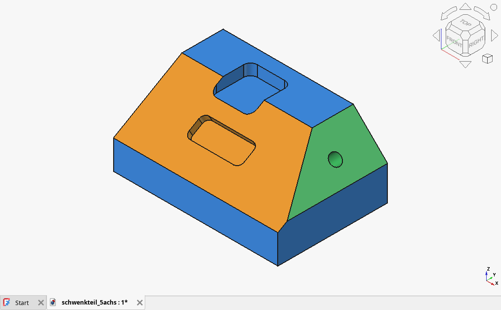

# Offene Fragen an Manuel

Hier steht jede Frage, die **nur Manuel** beantworten kann – mit dem Grund, warum Claude sie
nicht selbst beantwortet, und dem, was die Antwort ändert. Beantwortet: Eintrag raus, die Antwort
kommt in den Verlauf (`archiv/DEV_PROMPT_HISTORY.md`) oder in die Spezifikation. Nichts davon wird
durch Prüfläufe ersetzt: Was Manuel entscheiden muss, wird hier gefragt, nicht nachgemessen
(Arbeitsregeln, Abschnitt 0; Manuel, 2026-10-10).

Je Frage: **die Frage** – *Warum nur Manuel* – *Was die Antwort ändert* – seit wann.

(Die Fragen 1–3 hat Manuel in P-2026-10-10-08 beantwortet, Frage 4 in P-2026-10-10-36, 5 und 7–9
in P-2026-10-11-30, 6 in P-2026-10-11-40, 10 und 11 in P-2026-10-11-46, 12 in P-2026-10-11-86 – siehe Verlauf.)

## 13. Bahnvarianten nach der gewählten Maschine wählen? (seit 2026-10-11 abends)

**Sollen Räumen und Planfräsen ihre Varianten mit Eilgang und Beschleunigung der im Job gewählten
Maschine vergleichen statt mit den festen Vorgaben (10 m/min, 1 m/s²)?** Manuel fragte (Forum
t=107911, Herbert): „beschleunigungswerte und speeds sollte das addon kennen, um zeiten richtig
berechnen zu können und vll werkzeugwege so zu gestalten, dass sie schön knapp fahren können … auf
der speziellen maschine dann??“ Heute rechnet „Auf der Maschine prüfen“ die Zeit mit den Werten
der Maschine (`abfahren.py`), die Wahl zwischen Bahnvarianten aber mit den Vorgaben
(`bahn.zeit`, aufgerufen in `raeumen_bahn`, `planfraesen_bahn`) – damit sich alle Strategien
gleich vergleichen.

*Warum nur Manuel:* Es ändert, was das Addon ohne Vorgabe wählt (Arbeitsregel „Strategiewahl erst
besprechen“): Auf einer schnellen Maschine gewännen Varianten mit mehr Eilgängen, auf einer
langsamen Portalfräse die mit weniger Richtungswechseln – dieselbe Datei gäbe je Maschine andere
Bahnen.

*Was die Antwort ändert:* Ja – `bahn.zeit` bekommt Eilgang und Beschleunigung der gewählten
Maschine (langsamste Achse), ohne Maschine bleiben die Vorgaben; vorher an seinem Testteil die
Zahlen beider Wege zeigen. Nein – bleibt, wie es ist.

## 14. Aus der Aufspannung: alles Erreichbare nach Richtungen (seit 2026-10-11 abends)

**Ist das der Ablauf, den du meinst?** Manuel (2026-10-11): „ich gebe eine Fläche an, die in dem
Spannmittel ist .. und dann wird bearbeitet … vll kann man ja so machen, dass man Flächen anklicken
kann im zweiten Auswahlfenster, welche man bearbeitet haben will … oder Bereiche“. Vorschlag:

1. Schritt 1 des Assistenten „Bearbeitung“ wie heute: „Unten liegt: Fläche anklicken …“ – die Fläche
   im Spannmittel.
2. Das Addon sucht jede Fläche, die in dieser Aufspannung erreichbar ist, und ordnet sie einer
   Richtung zu: Stirnflächen ihrer Normalen, Wände der Richtung, aus der sie der Mantel fräst
   (senkrechte Wände von oben – kein Schwenk), Bohrungen ihrer Achse; nie ins Spannmittel; jede
   Fläche mit freier Sicht längs der Werkzeugachse. Gewählt wird oben zuerst, dann die Richtung, die
   die meisten übrigen Flächen nimmt.
3. Im zweiten Fenster das Teil eingefärbt nach Richtung (Bild); ein Klick nimmt eine Fläche heraus
   oder wieder hinein, vorbelegt sind alle erreichbaren. Was nicht geht, steht rot mit Grund
   („Maschine schwenkt nicht so weit“, „liegt im Spannmittel“, „keine freie Sicht“).
4. Je Richtung legt das Addon eine Ebene an (wie „Ebene schwenken“), darin die Strategien wie heute.

Am Schwenkteil (Face6 unten im Spannmittel) sind alle 27 übrigen Flächen erreichbar, aus drei
Richtungen – eine Aufspannung:

| Richtung | Flächen | Tisch/Tisch A/C | Kopf/Tisch B/C | Kopf/Kopf A/B | G550 A/B | 3-Achs |
|---|---|---|---|---|---|---|
| oben (blau) | 14 – Oberseite, vier Außenwände mit dem Mantel, Tasche (Boden, Wände, Ecken) | A0 C0 | B0 C0 | A0 B0 | A−90 B0 | ja |
| 30°-Schräge (orange) | 10 – Fläche, Tasche darin (Boden, Wände, Ecken) | A30 C0 | B−30 C90 | A30 B0 | A−60 B0 | nein |
| 45°-Fase (grün) | 3 – Fläche, Bohrung mit Bohrspitze | A45 C90 | B45 C0 | A0 B45 | A−45 B90 | nein |

Auf der 3-Achs-Fräse bleiben orange und grün rot: „braucht eine andere Aufspannung (30° bzw. 45°
gekippt)“ – eine zweite Aufspannung vorzuschlagen wäre der nächste Schritt.

*Warum nur Manuel:* Es ändert, was das Addon ohne Vorgabe wählt (Arbeitsregel „Strategiewahl erst
besprechen“): Richtungen und Ebenen legt es dann selbst an.

*Was die Antwort ändert:* Ja – so bauen (erst die Erkennung mit dem Bild im zweiten Fenster, dann
das Anlegen der Ebenen). Anders – was anders soll (etwa Wände lieber von der Seite, Bereiche statt
Flächen).
