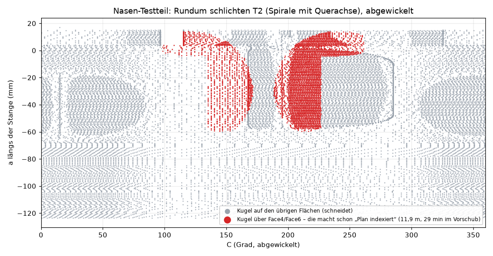

# Offene Fragen an Manuel

Hier steht jede Frage, die **nur Manuel** beantworten kann – mit dem Grund, warum Claude sie
nicht selbst beantwortet, und dem, was die Antwort ändert. Beantwortet: Eintrag raus, die Antwort
kommt in den Verlauf (`archiv/DEV_PROMPT_HISTORY.md`) oder in die Spezifikation. Nichts davon wird
durch Prüfläufe ersetzt: Was Manuel entscheiden muss, wird hier gefragt, nicht nachgemessen
(Arbeitsregeln, Abschnitt 0; Manuel, 2026-10-10).

Je Frage: **die Frage** – *Warum nur Manuel* – *Was die Antwort ändert* – seit wann.

(Die Fragen 1–3 hat Manuel in P-2026-10-10-08 beantwortet, Frage 4 in P-2026-10-10-36, 5 und 7–9
in P-2026-10-11-30, 6 in P-2026-10-11-40, 10 und 11 in P-2026-10-11-46 – siehe Verlauf.)

### 12. Die Kugel nach „Plan indexiert“: rundum mit Y, die fertigen Flächen überspringen?

Seit deiner Antwort auf Frage 10 ist „Plan indexiert“ rundum vorbelegt; die Kugel lässt die ebenen
Flächen dann aus. Dabei kam heraus: Mit einer Flächenliste fährt das Schlichten nicht die Spirale,
sondern **Zeilen hin und her – ohne Y** (die Querachse galt dort nie; der Haken blieb angehakt –
jetzt ist er dann grau, mit dem Grund, P-2026-10-11-59). Am Nasen-Testteil, die Kugel T2:

| | Zeit Kugel | Y | über Face4/Face6 (rot im Bild) |
| --- | --- | --- | --- |
| (a) nur die übrigen Flächen, Zeilen (heute mit Plan) | 157,8 min | nein | fährt sie nicht |
| (b) rundum, Spirale mit Querachse (ohne Plan) | 177,7 min | ja | 11,9 m, 29 min im Vorschub durch Luft |
| (c) rundum mit Querachse, Face4/Face6 übersprungen | etwa 150 min | ja | herausfahren oder angehoben im Freivorschub |

Für (c) müsste die Spirale über den fertigen Flächen abheben und dahinter wieder einsetzen – je
Umdrehung zweimal (an der Nase etwa 250 Umdrehungen), oder angehoben darüber im Freivorschub. Was
dort noch stehen kann: das Aufmaß des Schruppens an den Nachbarflächen und Kämme bis etwa 0,7 mm.
**Die Frage:** So bauen – (c), und bis dahin (a) oder (b)? Und beim Überspringen lieber heraus und
wieder hinein (sicher, etwas langsamer) oder angehoben im Freivorschub (schneller, ein paar
Millimeter Abstand)?
*Warum nur Manuel:* Strategiewahl – wie die Kugel fährt und mit welchem Vorschub über fertigen
Flächen.
*Was die Antwort ändert:* `vierachs_bahn.schlichten` mit Bereich (die Spirale statt der Zeilen),
der Haken „Mit der Querachse (Y)“ mit „Plan indexiert“.
Seit 2026-10-11.
