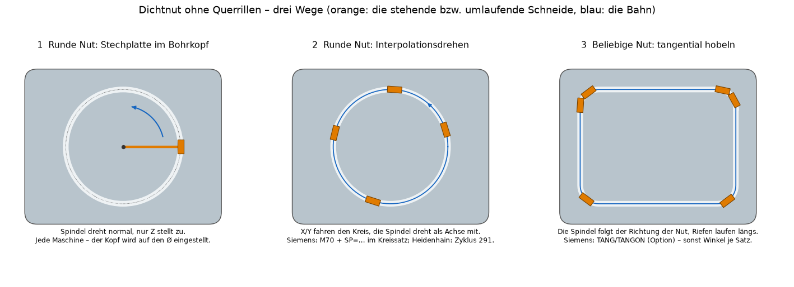

# Offene Fragen an Manuel

Hier steht jede Frage, die **nur Manuel** beantworten kann – mit dem Grund, warum Claude sie
nicht selbst beantwortet, und dem, was die Antwort ändert. Beantwortet: Eintrag raus, die Antwort
kommt in den Verlauf (`archiv/DEV_PROMPT_HISTORY.md`) oder in die Spezifikation. Nichts davon wird
durch Prüfläufe ersetzt: Was Manuel entscheiden muss, wird hier gefragt, nicht nachgemessen
(Arbeitsregeln, Abschnitt 0; Manuel, 2026-10-10).

Je Frage: **die Frage** – *Warum nur Manuel* – *Was die Antwort ändert* – seit wann.

Die Fragen 1 bis 4 vom 12. bis 14.11. hat Manuel am 2026-11-14 beantwortet (Verlauf P-2026-11-14-06).

## 1. Dichtnut ohne Querrillen: Wie verläuft sie bei dir, auf welcher Maschine, mit welchem Werkzeug?

**Die Frage:** Du willst eine Dichtnut im Deckel „rauskratzen“, damit die Riefen am Grund längs der Nut
laufen. Nachgelesen (Quellen in der Spezifikation Strategien 13.10): Das gibt es, es heißt Hobeln
(Horn: „Speed-Forming“, bis 0,3 mm je Hub), bei runden Nuten Interpolationsdrehen oder Planstechen mit
einer Stechplatte im Bohrkopf. Dein Grund stimmt: Dichtungshersteller schreiben, dass Riefen längs auch
bei rauer Fläche dichten und Fräsriefen quer zum O-Ring das Problem sind. Kein CAM, das ich finden konnte,
zieht ein stehendes Werkzeug längs einer **nicht runden** Nut – das wäre neu. Was ich baue, hängt an drei
Dingen, die nur du weißt:

- **a) Verlauf:** meist kreisrund – oder beliebig (Rechteck mit Radien, der Kontur des Deckels nach)?
  Rund geht ohne jede Steuerungsoption (Bild 1 und 2); beliebig braucht die mitgedrehte Spindel (Bild 3).
- **b) Maschine:** die 5-Achs mit der alten 840D oder die 3-Achs (welche Steuerung hat sie)? Für Bild 3
  braucht die 840D die Option „Tangentialsteuerung“ (TANG) und die Spindel als Achse (M70). Ein
  Probelauf im MDA ohne Werkzeug zeigt es in einer Minute: `SPOS=0` / `M70` / `TANG(C,X,Y)` /
  `TANGON(C,0)` / `G1 X10 F100` – kommt ein Alarm, gibt es den Weg nicht (dann rechnet das Programm den
  Winkel je Satz selbst).
- **c) Werkzeug:** Stechplatte quer im Halter (z. B. Horn Supermini), Planstech-Bohrkopf, oder eine eigene
  Klinge – ungefähr wie breit und wie lang hinter der Schneide? Davon hängt der kleinste Radius ab, den die
  Klinge in der Nut fahren kann (bei 3 mm Länge und R 10 schon rund 0,45 mm Eindringen der Innenflanke).

*Warum nur Manuel:* Verlauf, Maschine und Werkzeug sind deine Werkstatt; ob TANG freigeschaltet ist, steht
nur in deiner Steuerung. *Was die Antwort ändert:* rund → ein kleiner Block „Dichtnut planstechen“ (jede
Maschine) oder Interpolationsdrehen; beliebig → „Dichtnut hobeln“ mit nachgeführter Spindel: vorher mit dem
Fräser schruppen, dann Grund und Flanken in Umläufen mit kleiner Zustellung, mit Leerumläufen und Messstopp
wie beim Schlichten. **Vorsicht, nicht belegt:** wie viel die stehende Spindel aushält – dazu gibt es keine
Herstellerangabe, nur Forenmeinungen in beide Richtungen; das würde ich vor dem ersten Span beim
Maschinenhersteller erfragen lassen (nach außen nur mit deinem Ja). Seit 2026-11-14.
