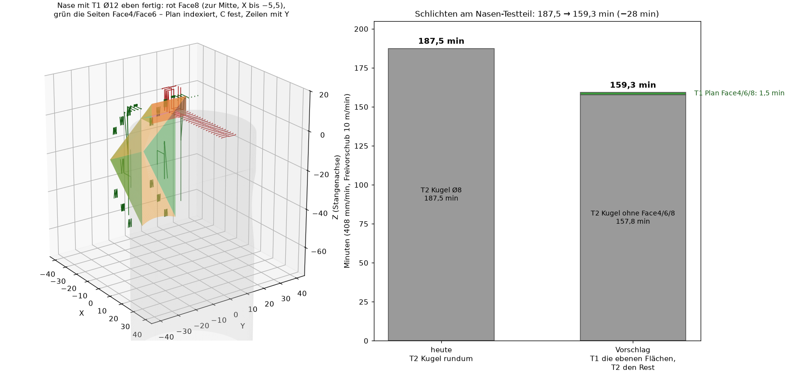

# Offene Fragen an Manuel

Hier steht jede Frage, die **nur Manuel** beantworten kann – mit dem Grund, warum Claude sie
nicht selbst beantwortet, und dem, was die Antwort ändert. Beantwortet: Eintrag raus, die Antwort
kommt in den Verlauf (`archiv/DEV_PROMPT_HISTORY.md`) oder in die Spezifikation. Nichts davon wird
durch Prüfläufe ersetzt: Was Manuel entscheiden muss, wird hier gefragt, nicht nachgemessen
(Arbeitsregeln, Abschnitt 0; Manuel, 2026-10-10).

Je Frage: **die Frage** – *Warum nur Manuel* – *Was die Antwort ändert* – seit wann.

(Die Fragen 1–3 hat Manuel in P-2026-10-10-08 beantwortet, Frage 4 in P-2026-10-10-36, 5 und 7–9
in P-2026-10-11-30, 6 in P-2026-10-11-40 – siehe Verlauf.)

### 10. Die Nase mit dem Schaftfräser fertig – so, wie im Bild?

Manuels Antwort auf Frage 5 (11.10.): C so, dass die flache Seite der Nase zur Mitte (Face8) quer
zum Schaftfräser steht, mit Y abzeilen – „auch wenn das unter 0 ist“ –, die Seiten Face4/Face6
ebenso mit dem Schaftfräser, die Kugel dann nur noch Face9 (und Face5). Durchgerechnet am
Nasen-Testteil (Prototyp, 11.10. morgens): „Plan indexiert“ mit T1 Ø 12 (Stirn), C fest, Zeilen
längs mit Y –
- Face8: X bis −5,5 (5,5 mm unter der Mitte), zwei Zeilen bei Y ±4, die Mitte des Fräsers längs
  ab 6,2 mm vor der Stirn des Schafts (sonst stieße er in den Schaft) – 0,55 min; die roten
  Linien nach außen sind das Planaufmaß vorne an der Stange (1 mm), das dort mitfällt;
- Face4/Face6: X 10, Y bis ±36,7 – 0,94 min;
- die Kugel T2 ohne diese drei Flächen: 157,8 statt 187,5 min (sie lässt dort auch die Luft aus).
Zusammen **159,3 statt 187,5 min** (gerechnet vor „C dreht nicht zurück“, P-2026-10-11-37 – damit
sind beide Zeiten kürzer, heute 177,8 min). Die Seiten mit der Stirn (Fräserachse quer zur Fläche) gibt es
schon („Plan indexiert“); neu ist nur, dass eine Fläche, die zur Achse schaut, auch geht, wenn der
Weg von außen frei ist – bis zur Grenze von X der Maschine (das prüft „Auf der Maschine prüfen“).
**Die Frage:** So bauen – im 4-Achs-Assistenten ein Haken „Ebene Flächen mit dem Schaftfräser
fertig“, vorbelegt an, der „Plan indexiert“ mit dem Schruppfräser für die ebenen Flächen anlegt
(auch die zur Mitte) und die Kugel diese Flächen auslassen lässt? Und die Seiten mit der Stirn
(wie im Bild) – oder angestellt mit dem Schaft, wie du es auch beschrieben hast?
*Warum nur Manuel:* eine neue Wahl ohne Vorgabe (Strategiewahl), und wie weit X unter 0 an seiner
CLX550 darf, weiß er.
*Was die Antwort ändert:* der Haken im Schritt 2, `vierachs_planbahn.ebenen` mit Flächen zur
Achse, die Flächen der Kugel ohne die fertigen.
Seit 2026-10-11.

### 11. „C dreht nicht zurück“ auch beim Rundum-Schruppen mit der Querachse?

Beim Schlichten ist es gebaut (P-2026-10-11-37: die Kugel fährt dieselbe Fläche, nur das Werkzeug
steht weniger quer). Beim Schruppen schneidet die Stirn des Schaftfräsers mit – steht er weniger
quer, bleibt etwas anderes stehen. Am Nasen-Testteil (T1 Ø 12, 11.10. gerechnet, Voxel 1 mm):

| Schruppen T1 mit Querachse | heute | C dreht nicht zurück |
| --- | --- | --- |
| Zeit (Freivorschub 10 m/min) | 15,4 min | 15,3 min |
| C-Weg | 38 545° | 31 063° |
| C dreht zurück | 266-mal, 3 741° | nie |
| danach noch Material | 804 781 cm³/1000 | 805 443 (+0,08 %) |
| die Kugel T2 nimmt beim Schlichten weg | 12 118 | 12 775 (+5 %) |

**Die Frage:** Auch beim Schruppen – als Haken „C dreht nicht zurück“, vorbelegt an wie beim
Schlichten, oder aus (die Kugel hat danach 5 % mehr zu tun)? Oder gar nicht?
*Warum nur Manuel:* Es ändert, wie geschruppt wird (Strategiewahl), und ob die ruhigere C-Achse die
5 % wert ist, weiß er von seiner Maschine.
*Was die Antwort ändert:* die Eigenschaft „Stetig“ auch an „Rundum schruppen“ und der Haken im
Schritt 2 – oder nichts.
Seit 2026-10-11.
