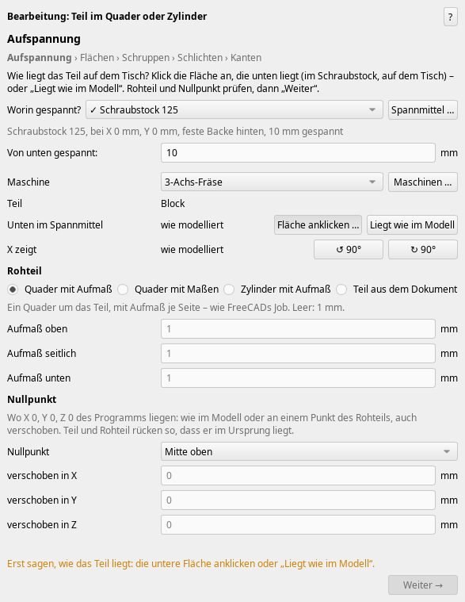
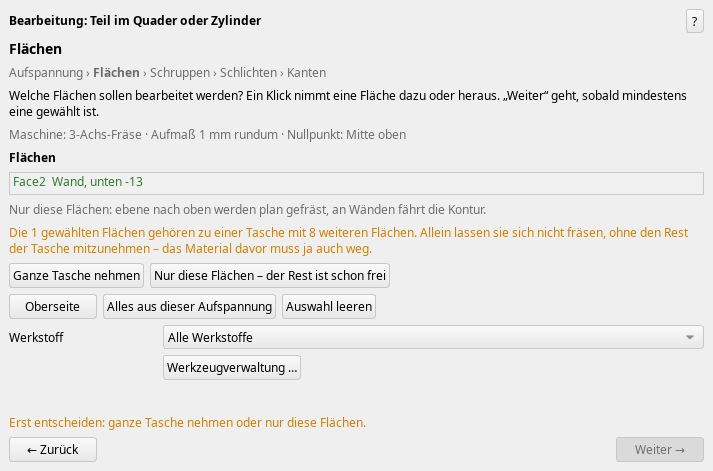
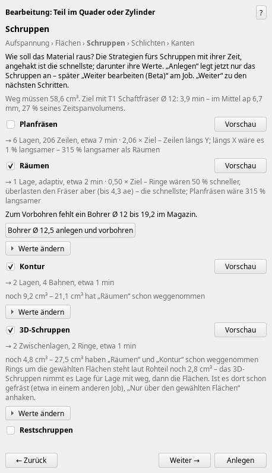

# Konzept: „Bearbeitung in Schritten“ (Beta)

Stand 2026-10-31 früh, 0.318.0. Auftrag von Manuel, 2026-10-30 abends:

> „Ich finde, dass das Gewachsene, dieses Bearbeitungsfenster, … zu groß geworden ist. Ich finde,
> wir sollten die Einzelschritte besser abfragen, und zwar einzeln abfragen. Immer mit einem
> Weiter und immer nur dann weiter, wenn auch wirklich alles ausgewählt ist und alles klar ist.“

> „Arbeitet da heute Nacht mal bitte dran an Ideen und an Vorschlägen, wie man das lösen könnte.
> Vielleicht machst du noch einen Beta-Knopf rein, … dass wir erstmal das Alte behalten, was jetzt
> jeder gewohnt ist“.

Teil A beschreibt, was die Beta schon kann (zum Ausprobieren). Teil B enthält die Vorschläge für
die nächsten Stufen. Teil C nennt, was nur Manuel entscheiden kann; diese Fragen stehen auch in
[OFFENE_FRAGEN.md](OFFENE_FRAGEN.md).

## A. Was die Beta 0.315.0 kann

**Einschalten:** Bearbeiten → Einstellungen → CAM-Addon → Gruppe „Updates“ → „Beta-Funktionen
zeigen“. Danach gibt es die Werkzeugleiste „CAM-Addon Beta“ mit den Beta-Befehlen, und dieselben
Befehle stehen im Menü „CAM-Addon → Beta“. Seit 0.318.0 sind es drei, dazu kam „Neue Aufspannung
(Beta)“ (siehe B5). Ist der Haken aus, bleibt alles wie gewohnt.

**„Bearbeitung in Schritten (Beta)“**: derselbe Assistent mit denselben Rechnungen, Vorschauen und
Strategien wie „Bearbeitung“, nur auf sechs Schritte verteilt. Oben steht der Schritt, darunter
grau die ganze Folge („Aufspannung › **Flächen** › Schruppen › Schlichten › Kanten“). Ein Schritt,
in dem es für die gewählten Flächen nichts gibt (hier „Löcher“), fehlt in der Folge und wird
übersprungen.

1. **Aufspannung.** Der nächste Klick ins Teil ist gleich die Fläche, die unten liegt. Alternativ
   gibt es den Knopf „Liegt wie im Modell“. Vorher bleibt „Weiter“ grau, und darüber steht orange,
   warum.
   
2. **Flächen.** Ein Klick nimmt eine Fläche dazu oder heraus. „Weiter“ geht erst, wenn mindestens
   eine gewählt ist. Gehören die gewählten Flächen zu einer **Tasche, von der nur ein Teil gewählt
   ist**, kommt ein Satz mit zwei Knöpfen: „Ganze Tasche nehmen“ oder „Nur diese Flächen – der
   Rest ist schon frei“. Erst nach der Antwort geht „Weiter“.
   
3. **Schruppen.** Zu sehen sind nur die Strategien des Schruppens, je mit Zeit und Vorschau,
   dazu die Frage zum Eintauchen (vorbohren oder schraubend), wo sie passt. Die Werte jeder
   Strategie stehen eingeklappt hinter „Werte ändern ▸“; der Fräser steht gleich in der Zeile. **„Anlegen“** legt jetzt nur das
   Schruppen an. Gerechnet wird trotzdem mit dem Schlichten danach, deshalb lässt das Schruppen
   sein Aufmaß stehen.
   
4. **Löcher** (Zentrieren, Bohren, Bohrung fräsen, Senken, Reiben, Gewinde), 5. **Schlichten**
   (Wände, Böden, Freiform, Restmaterial, Bleistift) und 6. **Kanten** (Fase, Entgraten). In
   jedem dieser Schritte gibt es „Anlegen“. Angelegt wird, was in den bis dahin gezeigten
   Schritten angehakt ist.

Über „Anlegen“ steht, was es in diesem Schritt anlegt, mit Zeit, und was für später angehakt ist.
Klickt man vor dem Befehl mehrere Flächen an, kommen alle mit. Kommen gewählte Flächen in einer
eigenen Ebene dran (schräg, oder an der G550 von oben), sagt das der Schritt Schruppen. An
Manuels Teil „tief“ ist das der Boden: Er wird in der Ebene „von oben“ geräumt.

**„Weiter bearbeiten (Beta)“**: Job im Baum anklicken, dann den Befehl. Das Fenster beginnt beim
Schritt nach dem zuletzt angelegten, mit denselben Flächen. Die Aufspannung ist fest, und vor
den Startschritt geht „Zurück“ nicht. Am Job stehen dafür zwei verborgene Eigenschaften
(`CamAddonBetaFlaechen`, `CamAddonBetaAbschnitt`).

**Die Tasche erkennen** (`camaddon/taschen_wahl.py`): Boden und Wand einer Tasche treffen sich an
einer hohlen Kante, Wand und Oberseite an einer Außenkante. Von den gewählten Flächen aus
sammelt sie alles ein, was über hohle oder glatte Kanten zusammenhängt. Über eine glatte Kante
geht sie nur in Flächen, die nicht nach außen gewölbt sind. So bleibt die Rundung am oberen
Rand draußen, und die Oberseite ebenso. An Manuels Teil „tief“ ergeben zwei angeklickte Wände
genau die 17 Flächen der Tasche (Rechenzeit 0,07 s).

Geprüft: `tests/test_taschen_wahl.py`, `tests/gui/szenario_beta_schritte.py` (der ganze Weg).

## B. Vorschläge für die nächsten Stufen

Reihenfolge nach Nutzen. Was die Wahl des Addons ändert, kommt erst mit Manuels Ja (Teil C).

### B1. Die Tasche: ein dritter Knopf „Ganze Tasche schruppen, nur diese Wände schlichten“

Der häufigste Fall bei zwei angeklickten Wänden ist vermutlich dieser: Die Tasche muss ohnehin
raus, aber nur diese zwei Wände brauchen die gute Oberfläche oder das genaue Maß. Der Knopf würde
fürs Schruppen alle Flächen der Tasche nehmen und fürs Schlichten nur die gewählten. Technisch:
zwei Flächenlisten im Fenster, das Schruppen bekommt die ganze Vertiefung, das Schlichten die
Wahl. *Frage 1.*

### B2. Schruppen als Frage „Wie soll das Material raus?“ statt Haken

Heute haken Wettbewerb und Zeit die schnellste Strategie an. Manuel will das Vorgehen wählen
können: „ob ich es vorbohren will, bohrfräsen möchte und, und“. Vorschlag: Im Schritt
„Schruppen“ oben eine Frage mit einer Zeile je Weg. Jede Zeile bekommt einen Satz, die Zeit und
einen Knopf „Vorschau“, wie die vorhandenen Fragen (W-039). Vorbelegt ist der schnellste Weg.

| Weg | Wann sinnvoll | Gibt es schon? |
| --- | --- | --- |
| Räumen adaptiv, schraubend eintauchen | Standard für Taschen | ja (Räumen + Helix) |
| Vorbohren, dann räumen | harte Werkstoffe, Fräser ohne Mittenschnitt | ja (Haken „Vorbohren“) |
| Bohrfräsen (zirkular, Helix im Kreis) | runde Taschen und Bohrungen bis Ø 40 | ja (Bohrung fräsen) |
| Tauchfräsen (senkrecht, Stoß an Stoß) | tiefe Taschen mit langem Werkzeug, schwache Maschine | **nein** |
| 3D-Schruppen in Lagen | Freiformtaschen wie „tief“ | ja |
| Schrägen zuerst mit dem Schaftfräser („Flanke grob“) | schräge Wände | ja (Frage „Wände“) |

Neu zu bauen wäre nur Tauchfräsen. Alles andere ist vorhanden und müsste nur als eine Frage
gezeigt werden. *Frage 2.*

### B3. Das Werkzeug sichtbar in der Zeile – *gebaut, 0.316.0*

Manuel: „Wie willst du schruppen? Mit welchem, … welches Werkzeug“. Unter jeder angehakten
Strategie steht jetzt die Zeile „Fräser [T1 VHM 12 …] ▸ Werte ändern“. Es ist dieselbe Liste wie
in den Werten, und eine Wahl in der einen Liste gilt auch in der anderen. Das ändert keine Wahl
des Addons, nur die Anzeige.

### B4. Nach „Anlegen“: gleich weiter?

Heute schließt „Anlegen“ das Fenster, und zum Schlichten klickt man den Job an und dann „Weiter
bearbeiten“. Zwei Möglichkeiten:
- (a) Nach „Anlegen“ fragt ein kleines Fenster: „Schruppen ist angelegt. Weiter mit Schlichten?“
  mit den Knöpfen „Weiter“ und „Fertig“.
- (b) Das Fenster bleibt offen, und „Anlegen“ heißt dann „Schruppen anlegen“. Danach geht es mit
  „Weiter“ zum Schlichten, das gleich mit dem Material rechnet, das nach dem Schruppen übrig ist.

(b) ist näher an Manuels Wortlaut („Wenn er für den Schruppen fertig ist, kann man weiter drücken
oder auf Anlegen drücken“), braucht aber einen Umbau beim Anlegen. Die Operationen kommen dann
schrittweise in den Job, nicht alle auf einmal. *Frage 3.*

### B5. Neue Aufspannung („anders eingespannt“) – *zum Teil gebaut, 0.318.0*

Manuel: „wenn ich eine weitere Operation haben möchte, das heißt irgendwie anders eingespannt,
muss ich einfach eine neue Operation oder sowas … einfügen“. Vorschlag: Im letzten Schritt (und
in „Weiter bearbeiten“) ein Knopf „Teil umspannen …“. Er legt einen neuen Job für dasselbe Teil an
(das gibt es schon als „Neuer Job …“) und beginnt bei Schritt 1, der Aufspannung. Vorgewählt sind
die Flächen, die in der ersten Aufspannung nicht erreichbar waren; das rechnet „Alles aus dieser
Aufspannung“ schon aus. *Frage 4.*

Gebaut ist der erste Teil, der keine Wahl des Addons ändert: der Befehl **„Neue Aufspannung
(Beta)“** in der Beta-Leiste. Man klickt einen Job an, dann den Befehl. Er legt für dasselbe Teil
einen neuen Job an, und die Schritte beginnen bei der Aufspannung, mit „Weiter“ gesperrt, bis klar
ist, was unten liegt. Noch offen (Frage 4): der Knopf im letzten Schritt und die vorgewählten
Flächen.

### B6. Schritt „Prüfen“ am Ende

Nach „Kanten“ ein letzter Schritt, der zeigt, was im Job ist, mit Gesamtzeit und den Knöpfen
„Auf der Maschine prüfen“ und „Programm schreiben“. Das ändert keine Wahl.

### B7. Wenn die Beta trägt

Sobald Manuel und die Tester zufrieden sind, wird „Bearbeitung“ zur Schrittfassung. Das alte
Fenster bleibt dann als „Alles auf einer Seite“ (für Geübte) noch eine Weile in der Beta-Leiste.

## C. Manuels Antworten (2026-10-31) und was daraus folgt

Die Fragen 1–4 (hier) und 5–8 ([konzept_spannmittel.md](konzept_spannmittel.md)) hat Manuel am
2026-10-31 beantwortet. Seine Worte, gekürzt, und der Plan:

1. **Tasche, nur zwei Wände angeklickt** – „dann muss eine auswahl geschehen .. und di ekann nur der
   nutzer treffen ... wenn wir vorher keinerlei bearbeitung haben .. muss halt erstmal etwas
   rausgeschruppt werden ... wenn vorher schon eine schrupp operation stattgefunden hat ... vll will
   er wirklich nur die wände geschlichtet haben ... das muss irgendwie unterschieden werden“.
   *Plan C1:* Der Schritt „Flächen“ schaut nach, ob in der Tasche noch Material steht (Rohteil und
   die Operationen davor, `materialstand`). Ist sie voll: „Die Tasche ist noch zu – erst die ganze
   Tasche schruppen, dann diese Wände schlichten“ (vorgewählt) oder „ganze Tasche fertig“. Ist sie
   schon ausgeräumt (mit welcher Operation): „Nur diese Wände schlichten“ vorgewählt.
2. **Wie das Material raus soll** – vorbohren mit dem größten Bohrer, der passt, dann mit dem
   größten Spanvolumen räumen, dann schlichten; geht kein Bohrer: Helix mit einem Fräser, der tief
   genug ist, dann die schnellste Bahn; oder bohrfräsen/stechend mit Wendeplattenbohrer oder
   Messerkopf. „alles möglichkeiten die der benutzer haben muss wenn er die richtigen werkzeuge hat
   oder eben vorschläge für werkzeuge bekommt .. darum müssen wir auch die hersteller datenbank
   aufpumpen bis zum geht nicht mehr … das solltest du als erstes eigentlioch machen“.
   *Plan C2:* (a) zuerst die Kataloge mit Fähigkeiten füllen (Format: `werkzeugkiste_json.md`,
   Abschnitt 3a – mittenschneidend, Bohrfräsen, Tauchfräsen, Bohrtiefe × D, Wendeplatten); (b) dann
   im Schritt „Schruppen“ die Frage „Wie soll das Material raus?“ mit je einer Zeile: Vorbohren (der
   größte passende Bohrer aus Magazin oder Werkzeugverwaltung) + Räumen; Helix + Räumen; Bohrfräsen;
   Tauchfräsen (neu). Je Zeile Zeit, Vorschau und das Werkzeug – fehlt eins, ein Vorschlag aus dem
   Katalog („mit einem … ginge es in … min“).
3. **Nach dem Schruppen** – „wir sollten da wirklich einen knopf "weiter bearbeiten" einrichtchten
   wo dann die selbe ausgewälte kontor nochmal … entgratet … geschlichtet oder nochmal geschlichtet
   oder vorgeschlcihtet ... 3 mm aufmass beim schruppen … schlichten auf 2mm … nochmal … auf 1 mm …
   und jedes mal dazwischen messschritte … auf der maschine zu verwirklichen ist mir sehr wichtig“.
   *Plan C3:* „Weiter bearbeiten“ bleibt der Weg (B4 a/b entfällt) und bekommt auf derselben Kontur:
   weiteren Gang mit eigenem Aufmaß (Vorschlichten, Schlichten, noch einmal), Entgraten – und
   **Messschritte** dazwischen: heute gibt es den Messstopp (M0, `messstopp.py`); dazu Messzyklen
   mit Taster je Steuerung (Siemens CYCLE977/978, Heidenhain 4xx, Fanuc/Renishaw), die das Aufmaß
   prüfen und den nächsten Gang korrigieren.
4. **Umspannen** – „ja das find ich irgendwie sinnvoll … ich glaub das sollten wir austesten“.
   *Plan C4:* der Knopf „Teil umspannen …“ im letzten Schritt, vorgewählt die Flächen, die nicht
   gingen.
5. **Spannmittel im ersten Schritt** – „die aufspannung sollte man schon irgendwie sinnvoll wählen
   ja am besten vor dem man die unten fläche auswählt und wie tief das teil eingespannt ist“.
   *Gebaut (0.322.0):* In der Beta beginnt „Aufspannung“ mit „Worin gespannt?“ (Sammlung, Knopf
   „Spannmittel …“) und der Spanntiefe, dann die Unterseite. Die Wahl ist gleich die Aufspannung
   am Job (Backen, Nullpunkt, Kollision, Einrichtblatt).
6. **Vorschläge, worin es passt** – „sinnvoll … aber halt eine auswahl geben“, und die Datenbank der
   Spannmittel „extrem gross“. *Gebaut (0.322.0):* Die Auswahl zeigt zuerst mit ✓, was das Rohteil
   nimmt (Spannweite, Höhe; in der Lage, in der es passt), die anderen mit ✗ und dem Grund im
   Tooltip. Passt nichts aus der Sammlung, nennt der Satz bis zu drei Größen aus dem Katalog der
   Hersteller, die das Rohteil nähmen (die kleinsten, je Hersteller eine).
7. **Wie der Schraubstock steht** – „ich habe keine idee … denk dir was aus mach nen vorschlag“.
   *Gebaut (0.321.0):* „Feste Backe: hinten / vorn / links / rechts“, vorbelegt hinten; im Bild von
   oben „Bediener“ unten, „Maschine“ oben.
8. **Daten** – „ALLE daten aus dem internet nicht nur hoffmann … auch die dazugehörigen cad dateien
   .. einfach holen oder nachbauen .. im freecad nachbauen ist eh sinnvoller“. *Gebaut (0.321.0):*
   alle gesammelten Hoffmann-Größen im Katalog (282 Spannmittel, 353 Halter); sieben Sammler holen
   weitere (Werkzeuge mit Fähigkeiten, Spannmittel, Halter). CAD wird aus den Maßen in FreeCAD
   nachgebaut (die CAD-Downloads verbieten die Weitergabe).

Reihenfolge: C2a (Kataloge) läuft; derweil C7/C8 (fertig), C5/C6, C1, C4; dann C2b und C3.
