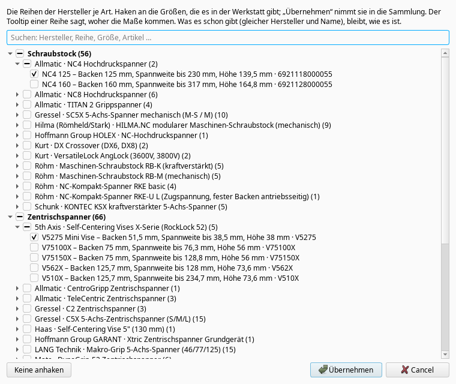
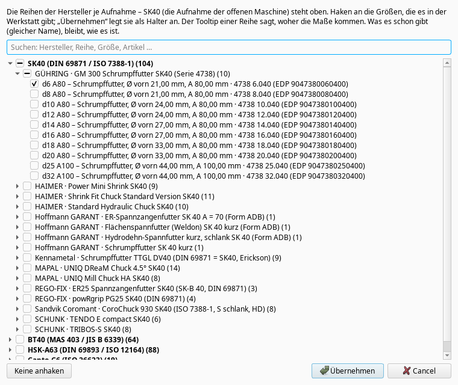
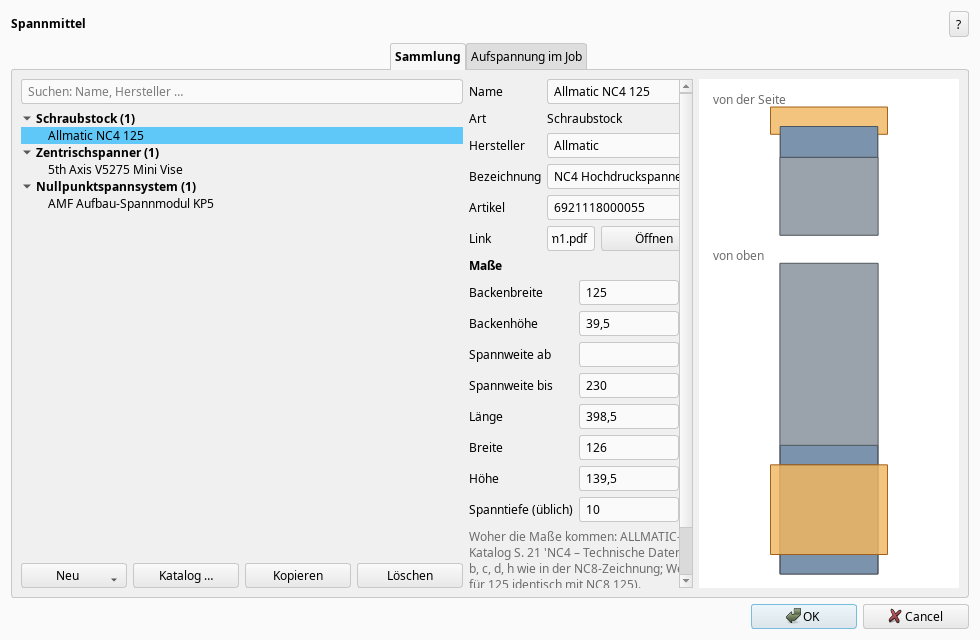
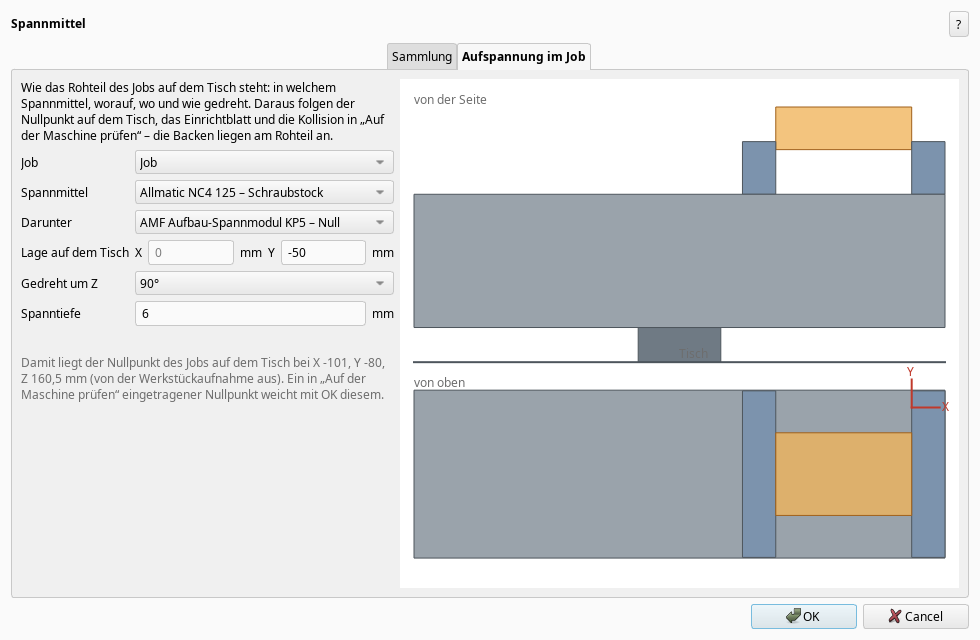

# Konzept: Halter und Spannmittel mit eigenem Knopf (W-042)

Stand 2026-10-31. Auftrag von Manuel, 2026-10-31:

> „aktuell haben wir die halter ja in der werkzeug verwaltung integriert ... hätte ich gerne
> seperiert das man die halter oder aufnahmen einen eigenen knopf hat genau so spannmittel ... eine
> übersicht von spannmitteln die vorhanden sind und ich hätte auch gerne das beides gut vorgefüllt
> ist oder das halt wie bei den werkzeugen du schon von sehr vielen herstellern die sachen erstellst
> ... das die datenbanken schon voll sind ... bei den spannmittteln müsste man sich noch die gedanken
> machen wie man es macht das man definiert wie er auf dem tisch aufgespannt ist ... denk dir was
> aus !“

Teil A beschreibt, was gebaut ist. Teil B nennt die nächsten Stufen. Was nur Manuel entscheiden
kann, steht in [OFFENE_FRAGEN.md](OFFENE_FRAGEN.md).

## A. Was gebaut ist

### Zwei neue Knöpfe in der Leiste „CAM-Addon“

Gleich hinter „Werkzeugverwaltung“ stehen zwei neue Knöpfe, auch im Menü:

- **„Halter und Aufnahmen …“** öffnet das Fenster „Halter“ ohne den Weg über die
  Werkzeugverwaltung. Ist die Werkzeugverwaltung offen, geht das Fenster über sie auf, und ihre
  ungespeicherten Änderungen bleiben erhalten. Sonst liest es die Bibliothek und speichert sie
  mit OK. Der Knopf „Halter …“ in der Werkzeugverwaltung bleibt, wie er ist.
- **„Spannmittel …“** ist neu. Es gibt eine Übersicht über die Spannmittel der Werkstatt und
  zeigt, wie das Rohteil eines Jobs auf dem Tisch steht.

### Vorgefüllt: der Katalog der Hersteller

Beide Fenster haben „Katalog …“ (auch unter „Neu“), so wie die Werkzeugkiste. Der Katalog ist
ein Baum: je Gruppe die Reihen der Hersteller, darin die Größen, jede mit eigenem Haken. Am
Anfang ist nichts angehakt. Eine Suche geht über Hersteller, Reihe, Größe und Artikelnummer.
„Übernehmen“ legt die angehakten Größen an. Was es schon gibt, bleibt, wie es ist: bei den
Spannmitteln gilt dafür gleicher Hersteller und Name, bei den Haltern gleicher Name. Der Tooltip
einer Reihe sagt, woher die Maße kommen.

- **Spannmittel** sind nach Art gruppiert: Schraubstock, Zentrischspanner (5-Achs),
  Dreibackenfutter, Spannpratzen, Nullpunktspannsystem und Spannplatte (Vakuum, Magnet).
- **Halter** sind nach Aufnahme gruppiert (SK40, HSK-A63 …). Die Aufnahme der offenen Maschine
  steht oben. Aus den Katalogmaßen wird die Kontur gebaut: der Flansch der Aufnahme (wie bei den
  Normreihen), der Körper und vorn die Nase, beim Schrumpffutter als Kegel, beim
  Spannzangenfutter als Mutter. Fehlt ein Maß, gilt das der Normreihe, und die Bezeichnung sagt
  „Kontur zum Teil geschätzt“.

Die Daten liegen als JSON in `camaddon/spannmittel_daten/` und `camaddon/halter_daten/`, im
Format von [katalog.py](../camaddon/katalog.py). Jede Reihe nennt ihre Quelle. Werte, die der
Katalog nicht nennt, bekommen den Beispielwert der Art, und die Quelle sagt, welche das sind.
Artikelnummern stehen nur dort, wo der Hersteller sie zeigt. Aus dem Hoffmann-Katalog ist je Spannart (bei
Haltern je Aufnahme und Typ) nur eine Größe als Vorbild drin, wie bei den Halter-Vorlagen
(Datenbankschutz, *Frage 8*); alles von den Seiten der Hersteller selbst ist ganz drin.

### Das Fenster „Spannmittel“

**Seite „Sammlung“:** Links stehen die Spannmittel nach Art, mit Suche, „Neu“ (leer je Art oder
aus dem Katalog), „Katalog …“, Kopieren und Löschen. Rechts stehen Name, Art, Hersteller,
Bezeichnung, Artikel, Link mit „Öffnen“, die Maße der Art und die Quelle. Daneben ist das Bild,
von der Seite und von oben, mit einem Beispiel-Rohteil in den Backen. Die Sammlung ist eine eigene
Datei neben der Werkzeugverwaltung (`spannmittel.json`).

| Art | Maße |
| --- | --- |
| Schraubstock | Backenbreite, Backenhöhe, Spannweite ab/bis, Länge, Breite, Höhe (Tisch bis Oberkante Backen), übliche Spanntiefe |
| Zentrischspanner | dieselben – beide Backen fahren zur Mitte |
| Dreibackenfutter | Ø, Höhe des Körpers, Backenhöhe, Backenbreite, Spannbereich, Spanntiefe |
| Spannpratzen | Anzahl (2 oder 4), Länge, Breite, Dicke, Spannhöhe bis, Auflage am Rohteil |
| Nullpunktspannsystem | Ø (rund) oder Länge × Breite, Höhe |
| Spannplatte | Länge, Breite, Höhe |

### „Wie es auf dem Tisch aufgespannt ist“: die Aufspannung im Job

Die zweite Seite beschreibt die Aufspannung mit den Angaben, die man beim Einrichten an der
Maschine auch macht:

1. **Spannmittel:** worin das Rohteil steckt, aus der Sammlung. Eine Kopie kommt in den Job, so
   geht die Datei mit auf einen anderen Rechner. „keins“ lässt alles wie bisher.
2. **Darunter:** direkt auf dem Tisch, oder auf einem Nullpunktspannsystem bzw. einer Platte.
   Der Unterbau hebt das Spannmittel um seine Höhe.
3. **Lage auf dem Tisch:** X und Y von der Werkstückaufnahme der Maschine aus, meist der
   Tischmitte, und die Drehung um Z in 90°-Schritten. Gemessen wird beim **Schraubstock an der
   Mitte der festen Backe**, denn sie bleibt stehen, wenn ein breiteres Teil kommt. Bei allen
   anderen Arten ist es die Mitte. Bei 0° spannen die Backen in Y, und die feste Backe liegt vorn
   (−Y). Bei 90° spannen sie in X.
4. **Spanntiefe:** so viel vom Rohteil steckt in den Backen. Leer gilt die übliche des
   Spannmittels, bei 5-Achs-Spannern mit Spannzähnen sind das wenige Millimeter.

Daraus folgt alles Weitere:

- **Die Backen liegen am Rohteil an** (W-020). Die feste Backe steht an der Seite des Rohteils,
  die bewegliche an der anderen. Beim Zentrischspanner sitzt das Rohteil mittig, beim Futter
  greifen drei Backen am Umfang. Die Pratzen liegen auf dem Rand, so weit wie „Auflage“.
- **Der Nullpunkt auf dem Tisch:** Die Unterseite des Rohteils liegt auf der Auflage, also
  Unterbau + Höhe − Spanntiefe. Seine Mitte liegt dort, wo das Spannmittel sie hält. Das Fenster
  zeigt, wo der Nullpunkt dann liegt. Mit OK gilt diese Lage, und ein von Hand eingetragener
  Nullpunkt („Auf der Maschine prüfen“) weicht ihr; das Fenster sagt das.
- **Die Kollision** in „Auf der Maschine prüfen“ rechnet mit dem echten Spannmittel statt mit
  den angenommenen Backen.
- **„Von unten gespannt“** ist die Spanntiefe der Aufspannung, so meldet die Prüfung jede Bahn,
  die ins Spannmittel fährt.
- **Das Einrichtblatt** schreibt zum Beispiel: „Gressel C2 125, auf Schunk VERO-S NSE plus 138,
  bei X 0 mm, Y −50 mm, um 90° gedreht, 6 mm gespannt“.

Ohne gewähltes Spannmittel bleibt alles, wie es war. Das Addon wählt nichts von selbst.

Geprüft: `tests/test_spannmittel.py` und `tests/gui/szenario_spannmittel.py`.

## B. Nächste Stufen (Vorschläge)

1. **Im Assistenten „Bearbeitung“ fragen, worin gespannt wird.** Im ersten Schritt, wo heute
   „von unten gespannt … mm“ steht, käme eine Auswahl „Spannmittel“ aus der Sammlung. Mit ihr
   wird dann gleich die Aufspannung eingetragen. In der Beta „Bearbeitung in Schritten“ würde der
   Schritt „Aufspannung“ zu „Wo liegt es, und worin?“. *Frage 5.*
2. **Vorschlag „passt hinein“:** Bei einem neuen Job schlägt das Addon aus der Sammlung das
   kleinste Spannmittel vor, dessen Spannweite das Rohteil nimmt. Damit wählt das Addon etwas,
   also kommt es nur mit Manuels Ja (*Frage 6*).
3. **Der Tisch der Maschine:** Mit T-Nuten und Größe aus der Maschine könnte das Bild „auf dem
   Tisch“ den echten Tisch zeigen, und eine Lage außerhalb des Tisches würde gemeldet. Dafür
   bräuchte die Maschine Tischmaße. Das ist erst sinnvoll, wenn Manuel es will.
4. **Spannmittel aus einer CAD-Datei:** wie bei den Haltern (STEP/STL des Herstellers). Der Körper
   käme dann aus der Datei statt aus den Maßen, für Bild und Kollision.
5. **Mehrfachaufspannung:** zwei Schraubstöcke nebeneinander oder ein Spannturm mit mehreren
   Teilen. Das braucht mehrere Aufspannungen je Job und kommt erst, wenn es gebraucht wird.
