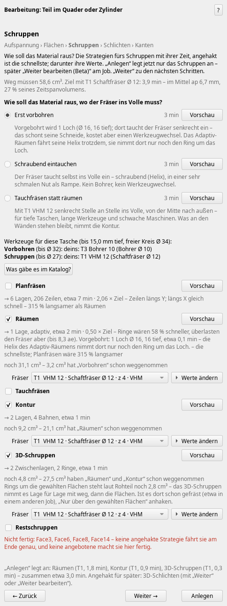
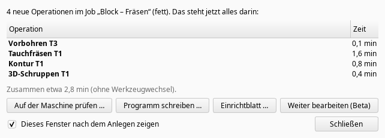
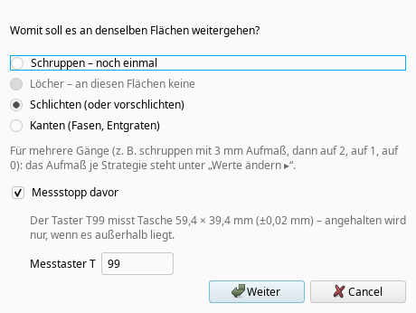
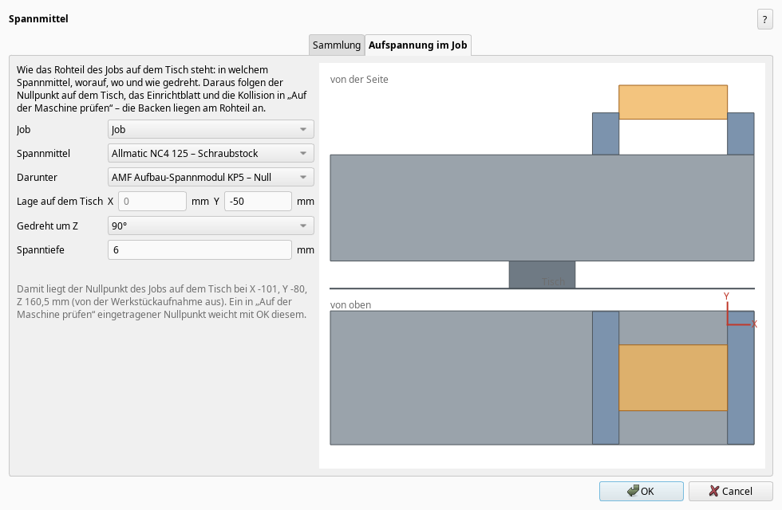
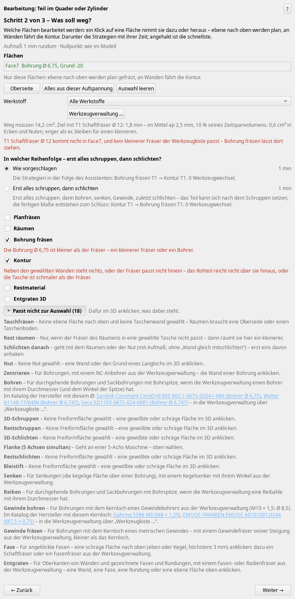

# Wochen-Update: Bearbeitung in Schritten, Messen auf der Maschine, Kataloge der Hersteller (0.313 … 0.345)

*2026-11-01*
Aktuelle Version 0.345.5 („Nach Updates suchen“ bietet sie an). Seit dem letzten Update (0.312) gab es rund 80 Versionen; hier die, auf die es ankommt.

## 1. „Bearbeitung in Schritten“ (Beta)
Das Bearbeitungsfenster war zu groß geworden. Neben dem gewohnten gibt es jetzt eine Fassung, die Schritt für Schritt fragt und erst „Weiter“ erlaubt, wenn alles klar ist: *Aufspannung → Flächen → Schruppen → Löcher → Schlichten → Kanten*. Einschalten unter Einstellungen → CAM-Addon → „Beta-Funktionen zeigen“; das alte Fenster bleibt, wie es ist.

- **Aufspannung:** erst „Worin gespannt?“ (die passenden Spannmittel zuerst, mit Grund im Tooltip) und wie tief, dann die Fläche, die unten liegt.
- **Flächen:** Sind nur zwei Wände einer Tasche angeklickt und steht darin noch Material, fragt es: „Ganze Tasche schruppen, diese Wände schlichten“ – oder nur diese Flächen.
- **Schruppen:** „Wie soll das Material raus, wo der Fräser ins Volle muss?“ – erst vorbohren, schraubend eintauchen oder neu: **Tauchfräsen** (senkrecht Stelle an Stelle, von der Mitte nach außen; auch mit einem Wendeplattenbohrer, wenn der Hersteller die Brillenbohrung freigibt). Je Weg die Zeit und eine Vorschau der Bahnen.
- **„Weiter bearbeiten (Beta)“** am Job: an denselben Flächen weiter – schlichten, noch einmal vorschlichten, entgraten. Das Aufmaß geht in Stufen (3 → 2 → 1 → 0 mm), davor auf Wunsch ein Messstopp.
- **„Anlegen und Teil umspannen …“**: legt an und öffnet dasselbe Teil in der nächsten Aufspannung, vorgewählt ist, was in der ersten nicht zu erreichen war.
- Nach „Anlegen“ zeigt ein kleines Fenster, was jetzt im Job steht, mit Zeiten und Werkzeugwechseln, und die nächsten Schritte als Knöpfe.

## 2. Messen auf der Maschine
Der Messstopp kann jetzt mit dem Taster messen statt nur anzuhalten: Tasche, Zapfen, Bohrung oder Welle, das Sollmaß nach dem Aufmaß des Gangs. Die Zyklen je Steuerung kommen aus den Handbüchern: Siemens CYCLE977, Heidenhain 421–424, Fanuc/Haas mit Renishaw G65 P9812/P9814. Außerhalb der Toleranz hält die Maschine an; ohne Taster bleibt es beim Halt mit einer Meldung, was zu messen ist.  
Fährt der nächste Gang mit **Radiuskorrektur der Steuerung** (neuer Haken an „Kontur“ und „Schlichten danach“: die Kontur des Teils mit G41/G42 bzw. RL/RR, wie von Hand programmiert), korrigiert der Messzyklus den Radius des Schlichtfräsers selbst (Siemens Werkzeugkorrektur, Renishaw T, Heidenhain Q330).

## 3. Spannmittel und Halter
Eigene Knöpfe „Spannmittel …“ und „Halter und Aufnahmen …“, je mit Katalog. Unter „Aufspannung im Job“ steht, worin das Rohteil auf dem Tisch steht (auch Schraubstock auf Nullpunktspannsystem, gedreht, wie tief gespannt) – daraus folgen Nullpunkt, Einrichtblatt und die Kollision in „Auf der Maschine prüfen“.

## 4. Die Kataloge der Hersteller
Die Werkzeugkiste kennt jetzt rund 260 000 Werkzeuge, dazu 12 000 Halter und 2 700 Spannmittel – aus den öffentlichen Katalogen und Webshops der Hersteller (Sandvik, Seco, Walter, Iscar, Kennametal, Mitsubishi, Kyocera, Gühring, MAPAL, CERATIZIT, Emuge-Franken, OSG, YG-1, Moldino, Sumitomo, Dormer, LMT, ZECHA, Union Tool, Fraisa, Hoffmann …; Halter von HAIMER, BIG DAISHOWA, REGO-FIX, SCHUNK, NIKKEN …; Spannmittel von HAINBUCH, Kitagawa, LANG, Allmatic, Gressel …). Wo ein Hersteller sie nennt, mit Schnittwerten und dem, was ein Werkzeug kann (mittenschneidend, Bohrfräsen, Tauchfräsen, Bohrtiefe …).

- Die Kataloge kommen nicht mehr mit dem Update, sondern auf Wunsch: Nach dem Start fragt das Addon „Ja, laden / Später / Nein“ (gepackt etwa 4,5 MB, sie bleiben bei jedem Update).
- Fehlt für eine gewählte Bohrung der Bohrer, der Gewindebohrer, die Reibahle oder der Gewindefräser, nennt der Assistent passende aus dem Katalog mit Link – ebenso, wenn der Fräser fürs Bohrungsfräsen zu dick ist. Für Taschen gibt es „Was gäbe es im Katalog?“.
- Stößt der Halter an, sucht die Empfehlung jetzt auch unter den Haltern der Hersteller den schlanksten, der passt.

Bitte beachten: Die Daten sind aus den Katalogen übernommen und automatisch geprüft, aber nicht jeder Wert von Hand. Bei Haltern ist die Kontur teils aus den Hauptmaßen gerechnet. Vor dem Fräsen mit dem echten Werkzeug vergleichen – und wenn euch ein Fehler auffällt, sagt es mir.

## 5. Sonst noch
- Vorschlichten unter dem Rand (Kugel als Spirale), Flanke mit „Schaft frei“.
- Heidenhain-Klartext mit RL/RR an der Kontur.
- Das Fenster bleibt frei, während die Kataloge geprüft werden (das rechnet ein Nebenrechner), und die großen Kataloge belegen erst Speicher, wenn man sie braucht.

Die Beta ist zum Ausprobieren da: Wer mag, schaltet sie ein und schreibt mir, wo sie hakt oder was er anders erwarten würde. Wer einen Taster an Siemens, Heidenhain oder Fanuc/Haas hat, darf gern einen Messzyklus in der Simulation der Steuerung ansehen.

Gruß Manuel
