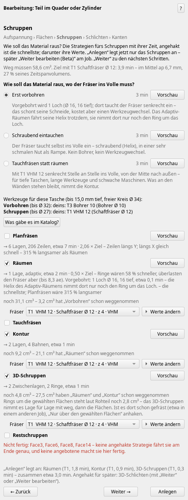
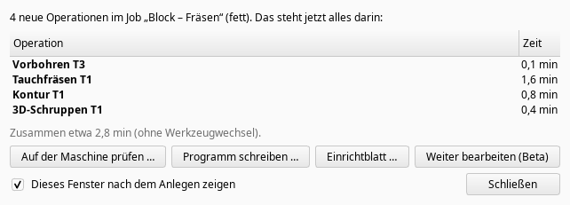
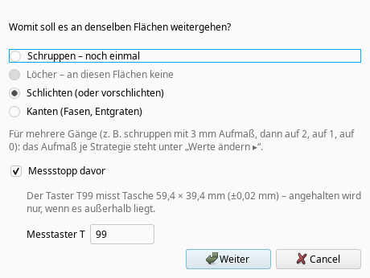
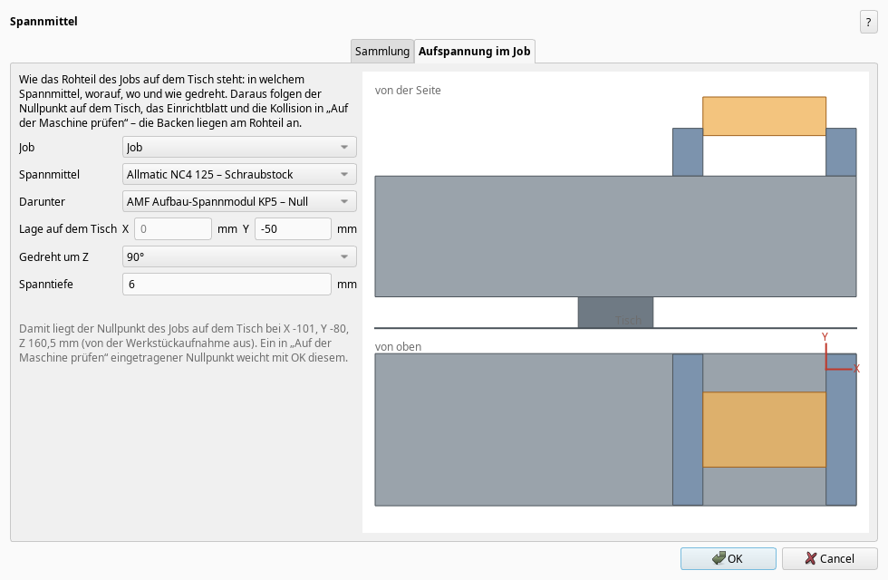
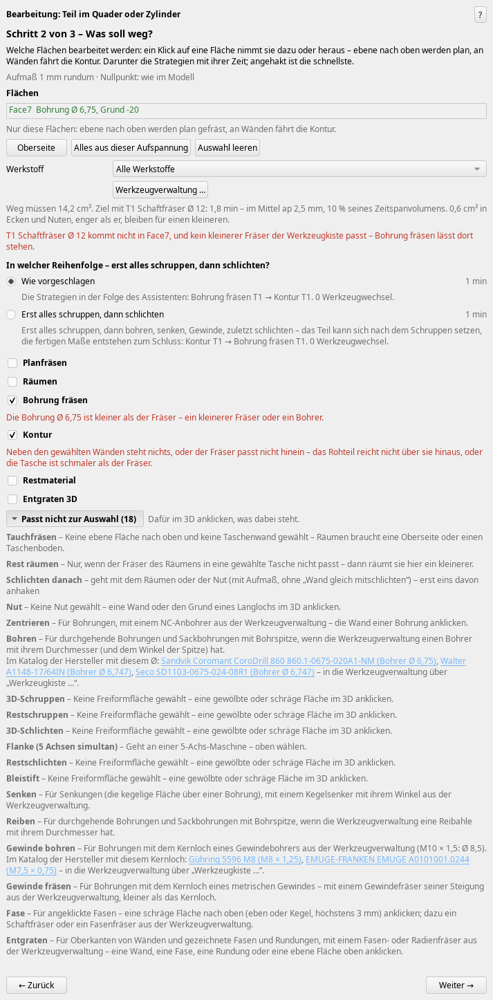

# Weekly update: step-by-step machining, measuring on the machine, manufacturers' catalogues (0.313 … 0.345)

*2026-11-01*
Current version 0.345.5 (“Check for updates” offers it). Since the last update (0.312) there were about 80 versions; here are the ones that matter.

## 1. “Machining in steps” (beta)
The machining window had grown too big. Next to the familiar one there is now a version that asks step by step and only allows “Next” when everything is clear: *Setup → Faces → Roughing → Holes → Finishing → Edges*. Turn it on in Preferences → CAM Add-on → “Show beta functions”; the old window stays as it is.

- **Setup:** first “Clamped in what?” (the fitting workholding first, the reason in the tooltip) and how deep, then the face that lies at the bottom.
- **Faces:** if only two walls of a pocket are picked and there is still material in it, it asks: “Rough the whole pocket, finish these walls” – or only these faces.
- **Roughing:** “How should the material come out where the cutter has to go into solid stock?” – pre-drill, helical entry or new: **plunge milling** (straight down, spot next to spot, from the centre outwards; also with an indexable drill if the manufacturer allows partial-engagement drilling). Each way with its time and a toolpath preview.
- **“Continue machining (beta)”** on the job: on the same faces – finish, semi-finish once more, deburr. The stock allowance goes in steps (3 → 2 → 1 → 0 mm), optionally with a measuring stop before.
- **“Create and re-clamp the part …”**: creates the operations and opens the same part in the next setup, with the faces preselected that could not be reached in the first one.
- After “Create”, a small window shows what is in the job now, with times and tool changes, and the next steps as buttons.

## 2. Measuring on the machine
The measuring stop can now probe instead of only stopping: pocket, boss, bore or shaft, the nominal size after the allowance of that pass. The cycles per control come from the manuals: Siemens CYCLE977, Heidenhain 421–424, Fanuc/Haas with Renishaw G65 P9812/P9814. Out of tolerance the machine stops; without a probe it stays a stop with a message saying what to measure.  
If the next pass runs with **cutter compensation by the control** (new option on “Contour” and “Finish afterwards”: the part contour with G41/G42 or RL/RR, as programmed by hand), the measuring cycle corrects the finishing cutter's radius itself (Siemens tool offset, Renishaw T, Heidenhain Q330).

## 3. Workholding and tool holders
Own buttons “Workholding …” and “Holders and tapers …”, each with a catalogue. “Setup in the job” says how the stock sits on the table (also a vise on a zero-point system, rotated, clamping depth) – the work offset, the setup sheet and the collision check in “Check on the machine” follow from it.

## 4. The manufacturers' catalogues
The tool box now knows about 260,000 tools, plus 12,000 holders and 2,700 workholding devices – from the manufacturers' public catalogues and web shops (Sandvik, Seco, Walter, Iscar, Kennametal, Mitsubishi, Kyocera, Gühring, MAPAL, CERATIZIT, Emuge-Franken, OSG, YG-1, Moldino, Sumitomo, Dormer, LMT, ZECHA, Union Tool, Fraisa, Hoffmann …; holders from HAIMER, BIG DAISHOWA, REGO-FIX, SCHUNK, NIKKEN …; workholding from HAINBUCH, Kitagawa, LANG, Allmatic, Gressel …). Where a manufacturer gives them, with cutting data and what a tool can do (centre cutting, helical drilling, plunge milling, drilling depth …).

- The catalogues no longer come with the update but on request: after start the add-on asks “Yes, load / Later / No” (about 4.5 MB compressed; they survive every update).
- If the drill, tap, reamer or thread mill for a selected hole is missing, the assistant names fitting ones from the catalogue with a link – also when the cutter is too thick for helical boring. For pockets there is “What would the catalogue have?”.
- If the holder collides, the recommendation now also searches the manufacturers' holders for the slimmest one that fits.

Please note: the data are taken from the catalogues and checked automatically, but not every value by hand. For holders the contour is partly computed from the main dimensions. Compare with the real tool before cutting – and if you spot a mistake, tell me.

## 5. Also
- Semi-finishing under the rim (ball as a spiral), flank with “shank clear”.
- Heidenhain conversational with RL/RR on the contour.
- The window stays responsive while the catalogues are checked (a worker process does it), and the big catalogues only use memory when they are needed.

The beta is there to be tried: if you like, turn it on and tell me where it gets stuck or what you would expect differently. If you have a probe on a Siemens, Heidenhain or Fanuc/Haas control, please look at a measuring cycle in the control's simulation.

Manuel
