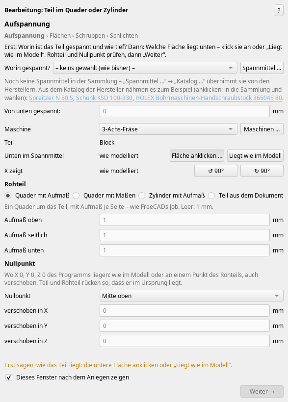
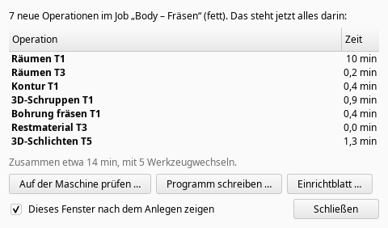

# Wochen-Update: Bearbeitung in Schritten ist Standard, weniger Luftfräsen, Wendeplattenbohrer (0.350.3)

*2026-11-08*

Aktuelle Version 0.350.3 („Nach Updates schauen“ bietet sie an).

## Bearbeitung in Schritten ist jetzt der Standard
„Bearbeitung“ öffnet jetzt den Assistenten in Schritten: Aufspannung › Flächen › Schruppen › Löcher › Schlichten › Kanten – je Schritt nur seine Strategien, „Weiter“ erst, wenn der Schritt klar ist. „Weiter bearbeiten“ und „Neue Aufspannung“ stehen jetzt in der normalen Leiste und im Menü CAM-Addon (nicht mehr „Beta“). Wer lieber das alte Fenster mit allem auf einer Seite will: Einstellungen → CAM-Addon → Gruppe „Updates“ → Haken „„Bearbeitung“ im alten Fenster“. Beide rechnen dasselbe. Eine bestehende Operation ändern öffnet weiter das Fenster auf einer Seite mit nur dieser Operation.

Das Fenster „Angelegt“ (auf der Maschine prüfen, Programm schreiben, Einrichtblatt, weiter bearbeiten) kommt jetzt erst, wenn die letzte Ebene einer Aufspannung durch ist – an einer Maschine mit waagerechter Spindel kommt alles, was von oben gefräst wird, in eine eigene Ebene, deren Assistent sich gleich nach „Anlegen“ öffnet.

## Weniger Luftfräsen
An der tiefen 5-Achs-Testtasche fuhr die Flanke rund ein Drittel ihres Vorschubwegs durch die Luft: je Umlauf 45 mm im Eintauchvorschub durch die schon geräumte Tasche. Jetzt geht es im Eilgang bis kurz vor das Material, und Zufahrten und die Umläufe, die nur den Keil unter dem Rand nehmen, fahren im Freivorschub, wo nichts mehr steht – geprüft gegen das Material im Raum, auch das, was die Ebene geräumt hat. Vorschubweg 3350 → 1837 mm, Luft 1122 → 217 mm, 5:50 → 4:06 min. Die Umläufe an der Wand selbst bleiben immer im Schnittvorschub. Bei den anderen Strategien zählen fertige Wände neben dem Werkzeug nicht mehr als Material, und auch der freie Teil eines Bogens geht im Freivorschub.

**Sicherheit:** Das 3D-Schlichten unter dem Rand (Kugel) prüfte seine schnellen Wege nur gegen das Teil. Seine erste Anfahrt ging mit 10 m/min in den Keil, den das Schruppen von oben stehen lässt. Jetzt endet der schnelle Weg vor dem Material, der Rest taucht im Eintauchvorschub ein. Flanke und Schlichten unter dem Rand rechnen außerdem von selbst neu, wenn sich davor etwas ändert (etwa das Räumen gelöscht wird) – so bleibt kein Eilgang, wo wieder Material steht.

## Empfehlungen: was du hast, und was besser wäre
Wo ein Werkzeug fehlt oder zu kurz ist, stehen jetzt zwei Vorschläge nebeneinander: zuerst, was mit dem Vorhandenen geht (Werkzeugliste, eigene Halter, Wegkippen, eine andere Strategie), daneben „besser, wenn du bestellst“ aus den Herstellerkatalogen – oder „du musst bestellen“, wenn nichts Vorhandenes geht. Längere Fräser aus den Katalogen zählen mit.

## Vorbohren mit Wendeplattenbohrern
Die Zeile „Vorbohren“ schlug lange HSS-Bohrer mit Morsekegel vor. Jetzt zählen Wendeplattenbohrer mit, bei gleichem Ø zuerst. Neu in den Katalogen: Wendeplatten- und Wechselkopfbohrer von Kennametal, ISCAR, Ingersoll, KOMET, Kyocera und Sumitomo (rund 5300 Größen); Sandvik CoroDrill 880 wird gerade gesammelt. Außerdem neu: Fräser von Harvey Tool, Helical, Inovatools und Nachi, Halter von Gühring, Seco, Walter, Diebold und BILZ, Spannmittel von Röhm, SCHUNK, Erowa, Mate, LANG und Orange Vise – in Schritt 1 „Worin gespannt?“ mit einem Klick aus dem Katalog, für Rundmaterial die Futter zuerst.

## Kleineres
- STL im 4-Achs-Assistenten: Das Fenster steht nicht mehr 5 s; „Anlegen“ am Geist-STL 5,8 → 1,1 s.
- Tauchfräsen rechnet mit dem Materialstand: kein Tauchen durch Luft.
- Die Installationszeile: Ein abgebrochener Git-Klon (nur ein `.git`-Ordner) gilt nicht mehr als installiert – sie installiert, statt „schon installiert“ zu melden.

## Geprüft
Mit FreeCAD 27.1 dev, Wochen-Build 2026.11.04: auf 0.350.0 alle 143 Prüfdateien und 182 Oberflächen-Szenarien (FreeCAD unsichtbar gestartet, jedes Fenster durchgeklickt) – ein 4-Achs-Szenario scheitert nur unter hoher Last; die Korrekturen danach mit ihren eigenen Prüfungen.
