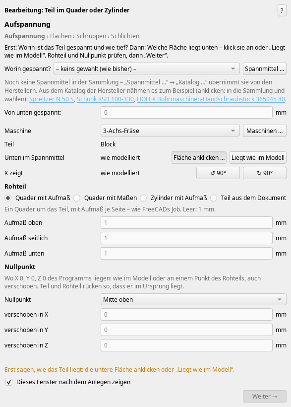
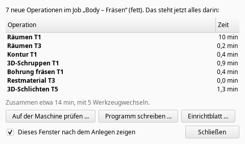

# Weekly update: step-by-step machining is now the default, less air cutting, indexable drills (0.350.3)

*2026-11-08*

Current version 0.350.3 (“Check for updates” offers it).

## Machining in steps is now the default
“Machining” now opens the wizard in steps: setup › faces › roughing › holes › finishing › edges – each step shows only its own strategies, and “Next” only works once the step is clear. “Continue machining” and “New setup” are in the normal toolbar and the CAM-Addon menu now (no longer “beta”). If you prefer the old window with everything on one page: Preferences → CAM-Addon → group “Updates” → tick ““Machining” in the old window”. Both compute the same. Editing an existing operation still opens the one-page window with just that operation.

The “Created” window (check on the machine, write program, setup sheet, continue) now only appears when the last work plane of a setup is done – on a machine with a horizontal spindle, everything milled from above goes into its own work plane, and its wizard opens right after “Create”.

## Less air cutting
On the deep 5-axis test pocket the flank milling cut through air for about a third of its feed path: on every pass it plunged 45 mm at plunge feed through the already cleared pocket. Now it rapids down to just before the material, and the approaches and the passes that only remove the wedge under the rim run at the free feed wherever nothing is left – checked against the material in 3D, including what the work plane cleared. Feed path 3350 → 1837 mm, air 1122 → 217 mm, 5:50 → 4:06 min. The passes on the wall itself always stay at cutting feed. In the other strategies, finished walls next to the tool no longer count as material, and the free part of an arc runs at free feed too.

**Safety fix:** the undercut 3D finishing (ball under the rim) checked its fast moves only against the part. Its first approach went at 10 m/min into the wedge that roughing from above leaves. Now the fast move ends before the material and the rest plunges at plunge feed. Flank and undercut finishing also recompute by themselves when anything before them changes (for example the clearing is deleted), so no rapid stays where material is again.

## Recommendations: what you have, and what would be better
Where a tool is missing or too short, there are now two suggestions side by side: first what works with what you have (tool list, your holders, tilting away, another strategy), next to it “better if you order” from the manufacturers' catalogues – or “you need to order”, if nothing you have works. Longer cutters from the catalogues count too.

## Pre-drilling with indexable drills
The “Pre-drill” line suggested long HSS drills with Morse taper. Indexable drills now count, at equal diameter first. New in the catalogues: indexable and exchangeable-tip drills from Kennametal, ISCAR, Ingersoll, KOMET, Kyocera and Sumitomo (about 5300 sizes); Sandvik CoroDrill 880 is being collected. Also new: cutters from Harvey Tool, Helical, Inovatools and Nachi, holders from Gühring, Seco, Walter, Diebold and BILZ, and workholding from Röhm, SCHUNK, Erowa, Mate, LANG and Orange Vise – in step 1 “Clamped in” a catalogue item is taken with one click, for round stock the chucks first.

## Smaller things
- STL in the 4-axis wizard: the window no longer stalls for 5 s; “Create” on the ghost STL 5.8 → 1.1 s.
- Plunge milling uses the material state: no plunging through air.
- The installer line: a broken Git clone (only a `.git` folder) no longer counts as installed – it installs instead of saying “already installed”.

## Tested
Against FreeCAD 27.1 dev, weekly build 2026.11.04: on 0.350.0 all 143 test files and 182 GUI scenarios (FreeCAD started invisibly, every window clicked through) – one 4-axis scenario only fails under heavy load; the fixes after that with their own checks.
