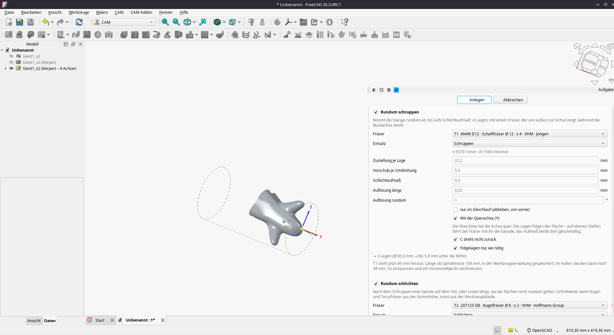
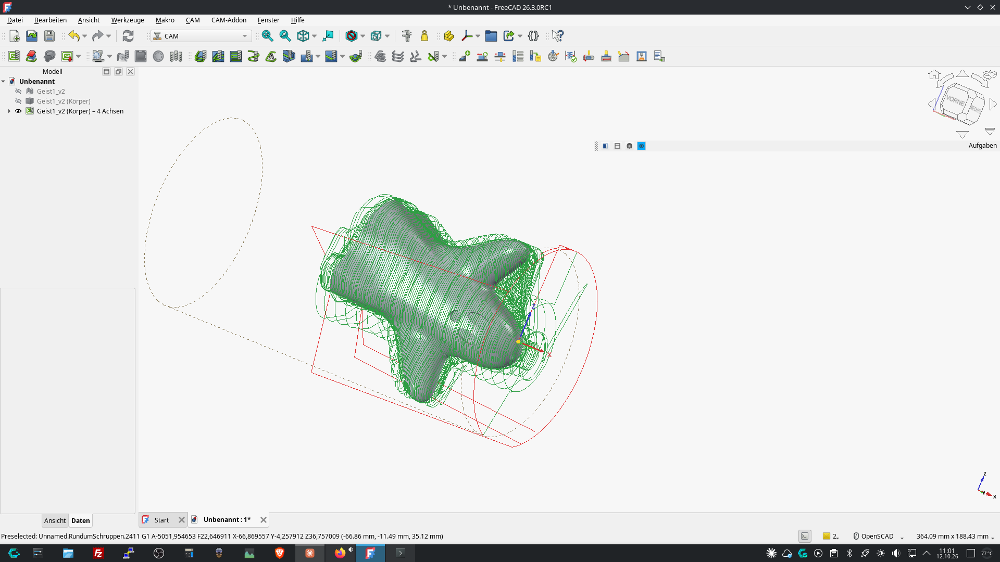
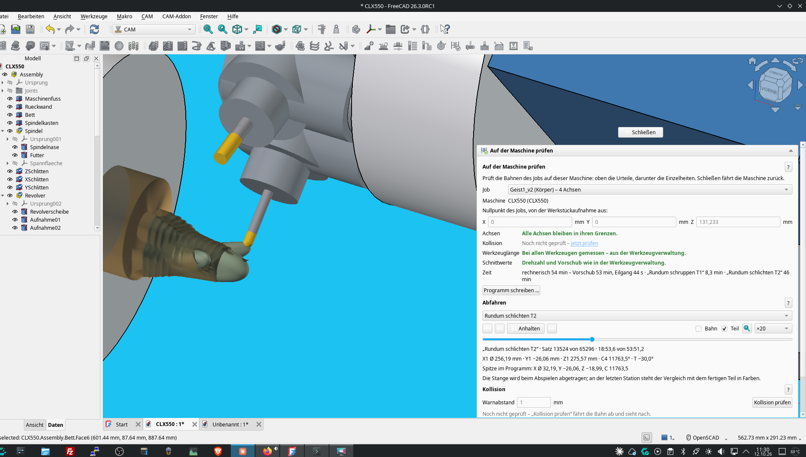
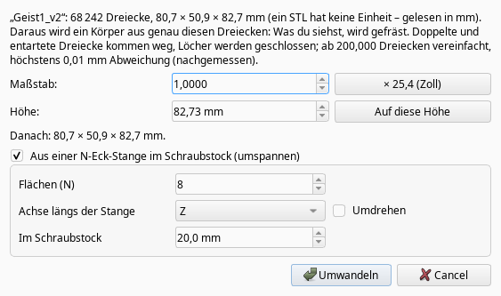
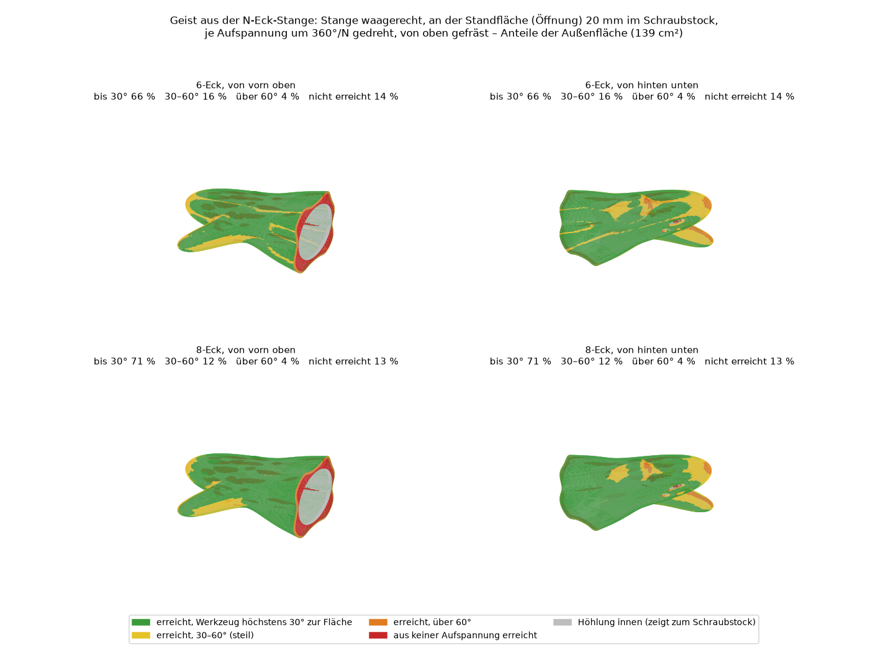
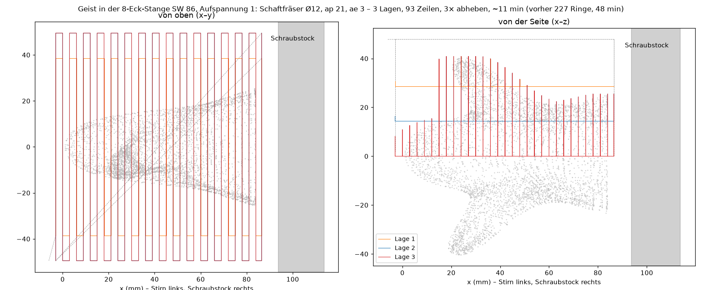
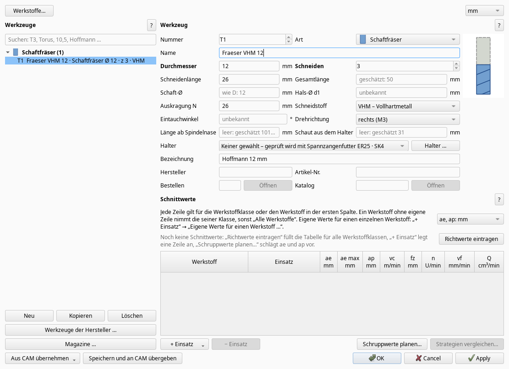

# Wochen-Update 2026-10-12

Kurzes Update, was seit dem letzten Mal passiert ist – vor allem STL-Teile, ein neuer Weg, sie auf einer 3-Achs-Fräse zu machen, und viel Arbeit daran, alle Kerne zu nutzen. Aktuelle Version: 0.257.1 („Nach Updates schauen“ bietet sie an).

## 1. STL-Dateien als Teil
Ein Netz (ein eingelesenes STL) anklicken und „4-Achs-Bearbeitung“ oder „Bearbeitung“ starten. Ein kleines Fenster fragt nach dem Maßstab (ein STL hat keine Einheit), dann baut das Addon einen Körper aus genau diesen Dreiecken – ohne neu zu vernetzen: Doppelte und entartete Dreiecke fliegen raus, Löcher werden geschlossen, erst ab 200.000 Dreiecken wird vereinfacht (höchstens 0,01 mm Abweichung, nachgemessen). Ist nichts gewählt, aber ein STL im Dokument, fragt der Assistent jetzt, ob es das sein soll.  
Das Testteil ist ein kleiner Geist (CC0, 68.242 Dreiecke), im Repository unter [beispiele/geist_stl](https://github.com/manuelhofer/freecad-cam-addon/tree/main/beispiele/geist_stl).  
Auf 4 Achsen: Seine ebene Unterseite kommt ans Futter (oder man wählt eine Achse des Teils), dann Rundum schruppen und schlichten wie bei jedem anderen Teil:

… und im Prüffenster am Modell meiner DMG CLX 550 nachgefahren (Simulation, gefräst habe ich ihn noch nicht): rechnerisch Schruppen 8,3 min, Schlichten 46 min. Die Kollisionsprüfung rechnet dabei gegen das STL selbst.

An einer 5-Achs-Fräse legt „Alles aus dieser Aufspannung“ eine Kette von 3+2-Ebenen an, jede nimmt, was die davor übrig ließen.

## 2. Keine 4. Achse? Eine N-Eck-Stange im Schraubstock
Eine Idee aus der Werkstatt: eine gerade N-Eck-Stange (Vorgabe 8 Flächen) waagerecht in den Schraubstock, 20 mm tief, von oben fräsen, um 360°/N weiterdrehen, auf den nächsten zwei Flächen neu spannen – eine „vierte Achse von Hand“ an der 3-Achs-Fräse. Das perfekte Teil wird es nicht, aber ein gutes Teilergebnis (und den Rest kann man schleifen).  
Das Fenster fürs STL bietet es direkt an:

Das Addon legt das Teil in die Stange (Schlüsselweite auf ganze mm aufgerundet), legt je Aufspannung einen Job an, und jede Aufspannung fräst nur, was die davor übrig ließen. Wie viel vom Geist jede Aufspannung erreicht, beim 6- und beim 8-Eck:

Geschruppt wird in der Stange wie „Rundum schruppen“ bei 4 Achsen, nur ohne die 4. Achse: je Lage Zeilen quer zur Stange, von der Stirn zum Schraubstock, über das Teil klettern statt abheben – einmal abheben je Lage. Am Geist (8-Eck SW 86, Schaftfräser Ø 12) braucht Aufspannung 1 so etwa 11 min statt 48 min mit den Ringen vorher; Aufspannung 7 und 8 finden nichts mehr zu schruppen und nehmen dem Schruppen selbst den Haken.

Die Backen des Schraubstocks sind in der Kollisionsprüfung, und jede Aufspannung bekommt ihr eigenes Programm, oben ein Kommentar, wie gespannt wird („Aufspannung 3 von 8: Stange um 90° gegen die erste gedreht, die Flächen 3 und 7 an den Backen …“).

## 3. Das 4-Achs-Testteil mit der Nase
Fertig ist es noch nicht. Die Lagen werden jetzt gleich aufgeteilt (20 mm bei ap 15 sind 2 × 10 statt 15 + 5), das Schlichten ist von 3 h 18 min auf etwa 2 h 40 min herunter, und das Schruppen fährt im Freivorschub, wo die Lagen davor schon alles genommen haben (14,8 → 12,1 min). Als Nächstes: Vorschlichten dort, wo der Assistent warnt, dass die Kugel nach dem Schruppen zu viel Material bekommt, und „Plan indexiert“ als erste Operation. Schon da (0.257.1): In „Plan indexiert“ kann man statt der Zeilen mit Rampen jetzt Stiche von der offenen Seite wählen („D's“, Gleich- oder Gegenlauf) – an der Nase 2,5 statt 3,8 min, ohne Rampen ins Material.

## 4. Alle Kerne, kein eingefrorenes Fenster
Vorschau, Kollision, Materialsimulation und die meisten Bahnen rechnen jetzt in eigenen Prozessen, und das Fenster bleibt dabei bedienbar. An der Geist-Kette mit 8 Aufspannungen dauert „Anlegen“ jetzt 9–22 s je Aufspannung statt 51–89 s – gemessen auf meinem Rechner (Ryzen 9 7900X, 12 Kerne); mit weniger Kernen entsprechend länger. Das Schruppen des Geists auf 4 Achsen rechnet jetzt in 3½ statt 11 Minuten. Solange gerechnet wird, dreht sich neben „Anlegen“ ein Rad, und der Knopf ist so lange grau.

## 5. Werkzeugverwaltung
– „Schaut aus dem Halter“ je Werkzeug (danke Herbert): wie weit der Fräser aus dem Halter herausschaut – in einer Spannzange steckt jeder anders tief. Daraus folgt die Länge ab Spindelnase (Halter + freie Länge); wer am Voreinstellgerät misst, trägt weiter die Länge ab Spindelnase ein. Eins der beiden Felder genügt, im anderen steht grau, was folgt, und ist keins eingetragen, steht dort „geschätzt“. Im Bild des Halters steht das Maß der freien Länge.  
– Zu kurz ausgespannt? Der 4-Achs-Assistent rechnet schon vor dem Anlegen nach, ob Hals, Schaft oder Halter ans Teil stoßen („T1 steht 44 mm heraus, bräuchte mindestens 49 mm“), „Kollision prüfen“ sieht sich dafür die ganze Operation an. Beide bieten „T1 auf 50 mm ausspannen“ an: Ein Klick setzt den Wert in der Werkzeugverwaltung und prüft neu.  
– 4-Achs-Schlichten: Die Schrittweite von Kugel- und Torusfräser folgt jetzt aus der Kammhöhe (Feld im Assistenten, Vorgabe 0,02 mm wie bei Gühring) statt fest 0,4 mm – das gab 0,005 mm Kammhöhe. In den Schnittwerten gibt es dafür die Spalte „ae max“ für die Grenze des Herstellers, etwa „ae max = 0,05 × D“ beim HOLEX-Kugelfräser; mehr schlagen die Assistenten nicht vor, außer die Kugel fährt angestellt.  
– „Entladen“ ist weg: Welches Werkzeug in welcher Maschine steckt, steht nur noch in den Magazinen der Maschinen. Die Nummer in der Werkzeugverwaltung ist die Vorgabe für den Job.  
– „Werkzeuge der Hersteller …“ öffnet ohne Haken – man fügt nicht mehr aus Versehen alle hinzu.  
– Oben aufgeräumt: „Werkstoffe…“ und mm/inch in einer Zeile, ohne die alte Überschrift mit den zwei Fragezeichen.

## 6. Aus euren Rückmeldungen
– Abspieler: Die Schritt-Knöpfe laufen weiter, solange man draufbleibt.  
– Ein 4-Achs-Job ohne Maschine angelegt (Rundachse A) lässt sich in „Auf der Maschine prüfen“ mit einem Knopf auf die Achse der Maschine umstellen (hier C).  
– Behoben: „PropertyLink does not support external object“, wenn das Dokument der Maschine aktiv war; die Flut von DEBUG-Meldungen, wenn ein anderes Addon das Logging auf DEBUG stellt; das Schlichten beginnt nicht mehr mit Umdrehungen in der Luft vor dem Teil.

Wie immer: Rückmeldungen, Testteile und Bilder von dem, was schiefgeht, sind sehr willkommen.

Gruß Manuel
