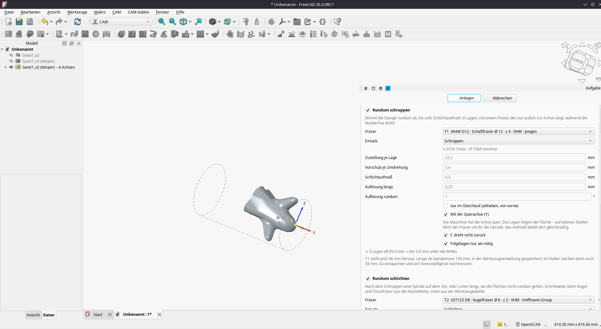
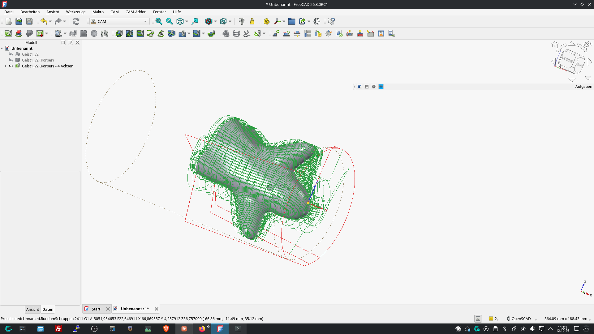
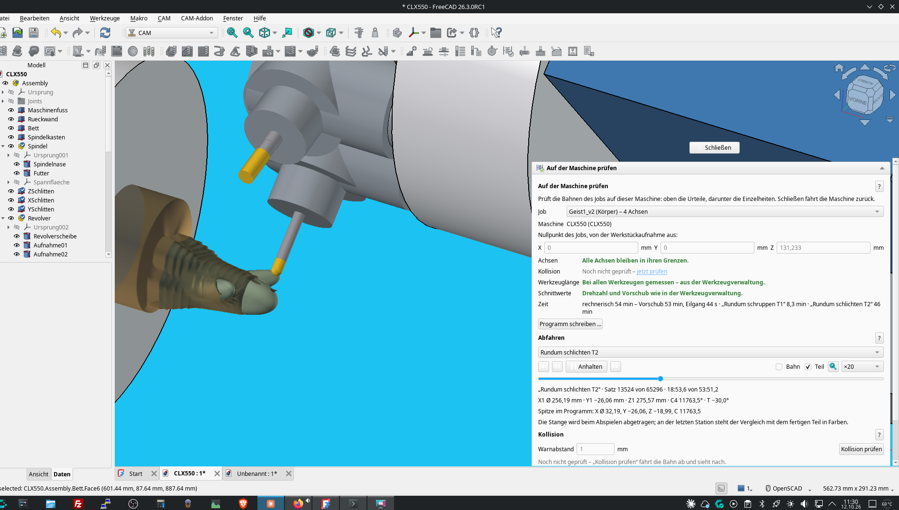
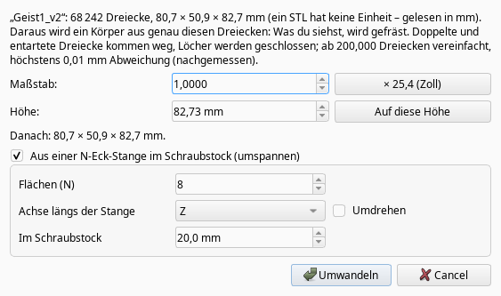
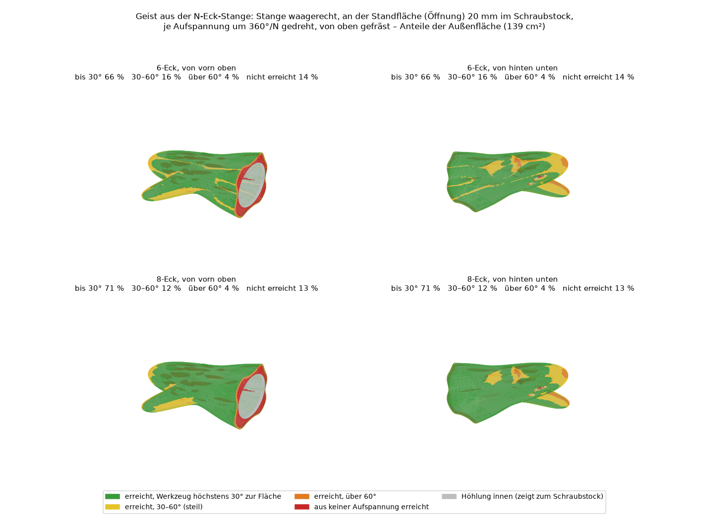
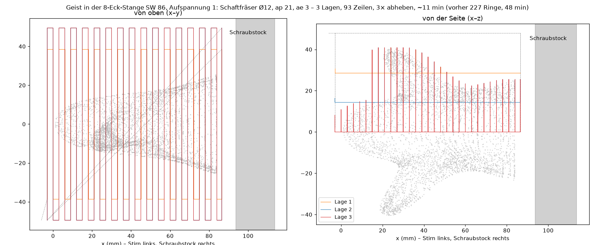
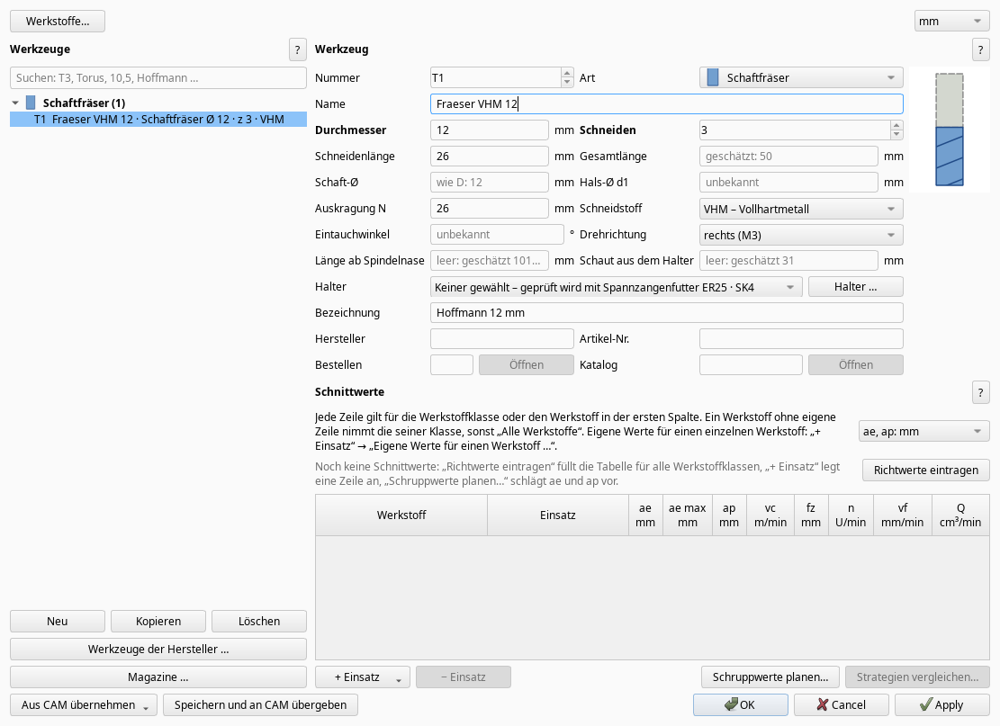

# Weekly update 2026-10-12

A short update on what happened since my last post – mostly STL parts, a new way to machine them on a 3-axis mill, and a lot of work on using all CPU cores. Current version: 0.257.1 ("Check for updates" offers it). The screenshots show the German interface; English is available.

## 1. STL files as parts
Select a mesh (an imported STL) and start "4-axis machining" or "Machining". A small dialog asks for the scale (STL has no unit), then the add-on builds a solid from exactly these triangles – no remeshing: duplicate and degenerate triangles are removed, holes are closed, and only above 200,000 triangles it simplifies (max. 0.01 mm deviation, measured). If nothing is selected but the document contains one STL, the assistant now asks whether to use it.  
The test part is a little ghost (CC0, 68,242 triangles), in the repository under [beispiele/geist_stl](https://github.com/manuelhofer/freecad-cam-addon/tree/main/beispiele/geist_stl).  
On 4 axes: its flat bottom goes to the chuck (or you choose an axis of the part), then all-round roughing and finishing as for any other part:

… and run through in the check window on the model of my DMG CLX 550 (simulation – I haven't cut it yet): calculated roughing 8.3 min, finishing 46 min. The collision check works against the STL itself.

On a 5-axis machine "Everything from this setup" creates a chain of 3+2 planes, each taking what the planes before left.

## 2. No 4th axis? A polygon bar in the vise
My idea from the shop floor: put an even-sided polygon bar (default 8 faces) horizontally into the vise, 20 mm deep, mill from above, turn it by 360°/N, clamp again on the next two faces – a "manual 4th axis" on a 3-axis mill. You won't get the perfect part, but a good result (and what is left can be ground).  
The STL dialog offers it directly:

The add-on puts the part into the bar (width across flats rounded up to whole mm), creates one job per setup, and each setup only machines what the setups before left. How much of the ghost each setup reaches, for a 6- and an 8-sided bar:

Roughing in the bar works like 4-axis all-round roughing, only without the 4th axis: per layer, rows across the bar from the free end towards the vise, climbing over the part instead of retracting – one retract per layer. On the ghost (8-sided bar, AF 86, Ø12 end mill) setup 1 takes about 11 min instead of 48 min with the ring strategy before; setups 7 and 8 find nothing left to rough and switch roughing off by themselves.

The vise jaws are part of the collision check, and every setup gets its own program with a comment at the top on how to clamp it ("Setup 3 of 8: bar turned 90° against the first, faces 3 and 7 at the jaws …").

## 3. The 4-axis test part with the nose
Not finished yet. The layers are now split evenly (20 mm with ap 15 gives 2 × 10 instead of 15 + 5), finishing went from 3 h 18 min to about 2 h 40 min, and roughing uses the free feed where the layers before already took everything (14.8 → 12.1 min). Next on the list: pre-finishing where the assistant warns that the ball end mill would get too much material after roughing, and "Plan indexed" as the first operation. Already in (0.257.1): "Plan indexed" can now use stitches from the open side instead of rows with ramps ("D" loops, climb or conventional) – on the nose 2.5 instead of 3.8 min, no ramps into the material.

## 4. All cores, no frozen window
Preview, collision, material simulation and most path calculations now run in worker processes, and the window keeps responding while they work. On the 8-setup ghost chain "Create" now takes 9–22 s per setup instead of 51–89 s – measured on my computer (Ryzen 9 7900X, 12 cores); with fewer cores it takes longer. Roughing the ghost on 4 axes now computes in 3½ instead of 11 minutes. While something is computing, a spinning wheel sits next to "Create" and the button is greyed out.

## 5. Tool manager
– "Stick-out" per tool (thanks Herbert): how far the tool sticks out of the holder – in a collet every tool sits at a different depth. The length from the spindle nose follows from it (holder + stick-out); if you measure on a presetter, you keep entering that length. One of the two fields is enough, the other one shows in grey what follows, and with neither it says "estimated". The holder picture shows the stick-out dimension.  
– Clamped too short? The 4-axis assistant checks before "Create" whether neck, shank or holder hit the part ("T1 sticks out 44 mm, it would need at least 49 mm"), and "Check for collisions" looks at the whole operation for it. Both offer "Clamp T1 at 50 mm stick-out": one click sets the value in the tool manager and checks again.  
– 4-axis finishing: the stepover of ball and torus end mills now follows from the cusp height (a field in the assistant, default 0.02 mm as Gühring recommends) instead of a fixed 0.4 mm, which gave 0.005 mm. For this the cutting data table has a new column "ae max" for the maker's limit, e.g. "max. ae = 0.05 × D" for the HOLEX ball end mill; the assistants never propose more, unless the ball runs tilted.  
– "Unload" is gone: which tool sits in which machine is kept only in the machines' magazines. The number in the tool manager is the default for the job.  
– "Manufacturers' tools …" opens with nothing ticked, so you no longer add them all by accident.  
– Tidied up at the top: "Materials…" and mm/inch in one row, without the old heading.

## 6. From your feedback
– Player: holding the step buttons keeps stepping.  
– A 4-axis job created without a machine (rotary axis A) can be switched to the machine's axis (here C) with one button in "Check on machine".  
– Fixed: "PropertyLink does not support external object" when the machine document was active; a flood of DEBUG messages when another add-on sets logging to DEBUG; finishing no longer starts with turns in the air in front of the part.

As always: feedback, test parts and screenshots of what goes wrong are very welcome.

Manuel
