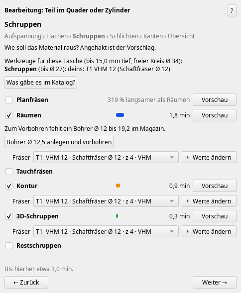
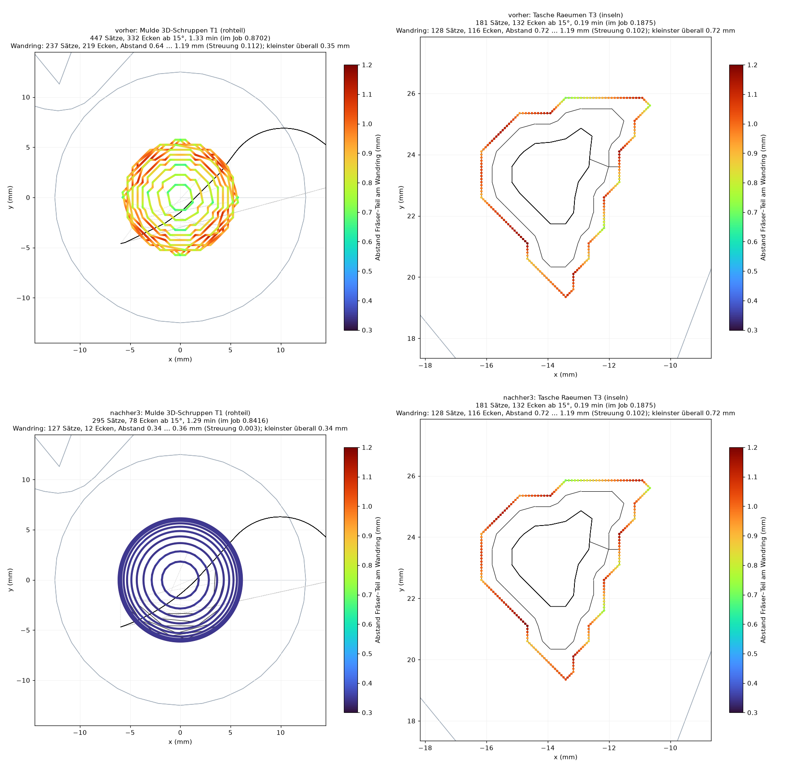
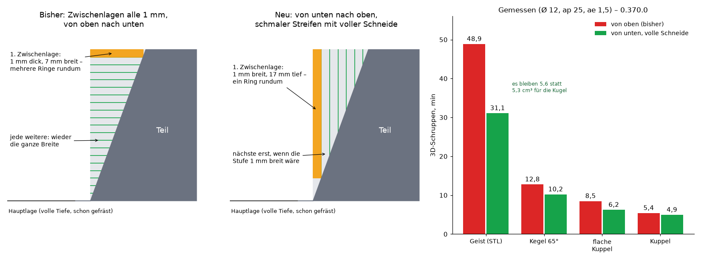
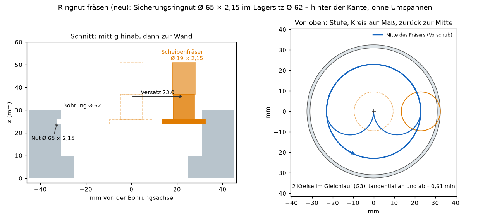
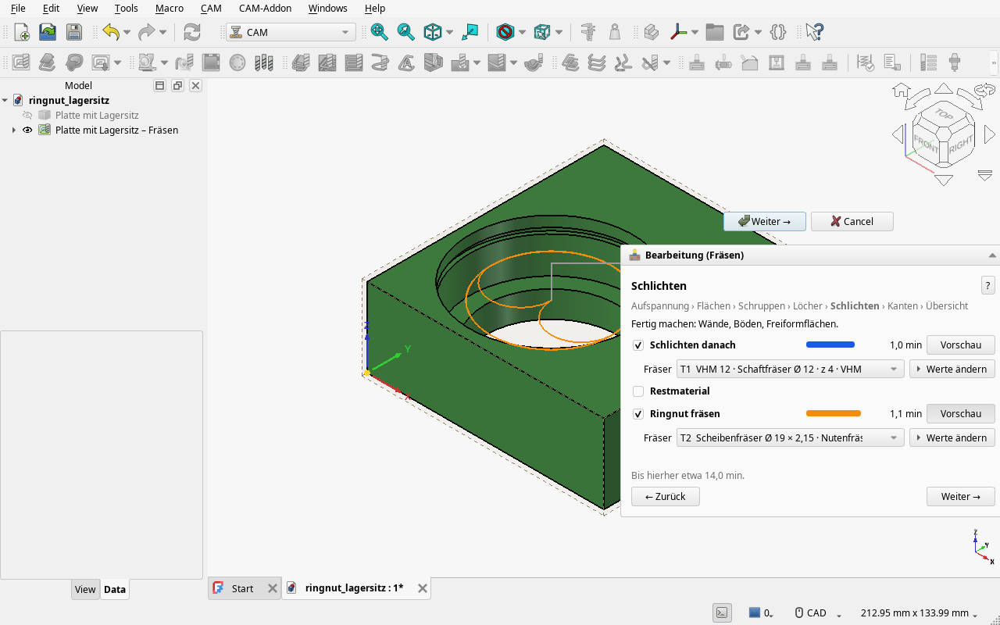
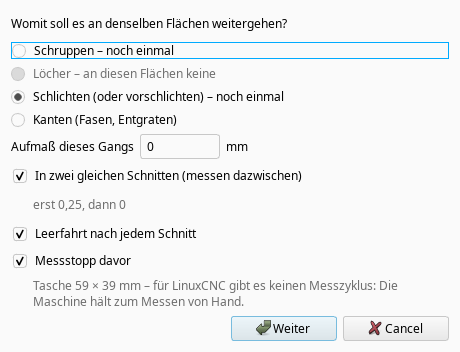
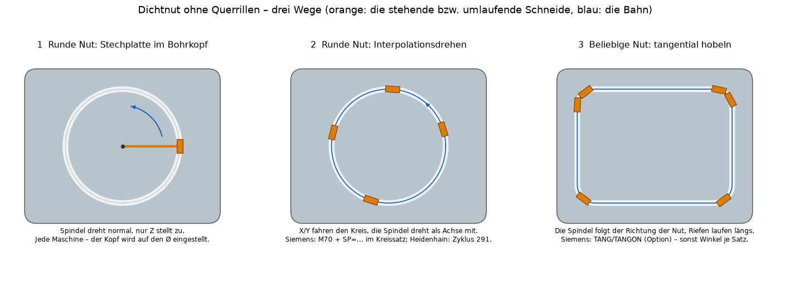

# Wochen-Update: zeigen statt sagen, schnelleres 3D-Schruppen, Ringnuten hinter der Kante, Messen mit Leerfahrten (0.373.0)

*2026-11-15*

Aktuelle Version 0.373.0 („Nach Updates schauen“ bietet sie an). **Wer eine Version von 0.348.2 bis 0.366.1 nutzt, sollte aktualisieren** – siehe „Sicherheit“.

## Zeigen statt sagen
Die Fenster hatten zu viel Text. Jetzt zeigt der Assistent, statt zu erklären: die Wege farbig im Teil, unfertige Flächen orange, die Zeit je Operation als Balken, Platte und Schraubstock im 3D. Die Fragen („Wie soll das Material raus?“, „Wände unter dem Rand“) zeigen je Weg ein Bild. „Programm schreiben“ ging von rund 2000 auf 160 Wörter. Was fehlt, ist ein Knopf: „Bohrer Ø 12,5 anlegen und vorbohren“, „T3 auf 35 mm ausspannen“ statt eines Satzes, was zu tun wäre. Beim Prüfen auf der Maschine steht am roten Achsbalken, wie weit es fehlt, und ein Klick fährt hin.

Jeder Weg durch die Schritte endet in einer Übersicht – „Anlegen“ gibt es nur dort; „Alles vorschlagen →“ springt direkt hin.

## 3D-Schruppen: runde Ringe statt Treppen
Die Ringe an der Wand kamen aus einem 0,5-mm-Raster und liefen in kleinen Treppen. Jetzt folgt der Ring der wirklichen Fläche: In der Mulde meines Testteils liegt er 0,34 bis 0,36 mm vor dem Teil statt 0,64 bis 1,19 (Aufmaß 0,3), mit 78 statt 332 Ecken. Dasselbe beim Räumen in spitzen Taschenecken: 0,30 statt 0,72 bis 1,19 mm.

**Zwischenlagen von unten mit voller Schneide** (neuer Haken, angehakt): Nach jeder Lage mit voller Tiefe fuhr das 3D-Schruppen Zwischenlagen alle 1 mm von oben nach unten – jede eine dünne Scheibe über die ganze Breite. An einem steilen Teil ist das fast nur Weg: an meinem Geist-STL 31,6 von 48,9 min. Jetzt laufen sie von unten nach oben, jede ein schmaler Streifen an der Wand mit der ganzen Schneide, und eine Lage kommt erst, wo die Stufe sonst breiter als 1 mm würde. Geist 31,1 statt 48,9 min, flache Kuppel 6,2 statt 8,5. Gespeicherte Jobs bleiben beim alten Weg.

Das gilt auch, wenn davor schon plangefräst oder geräumt wurde: Das Addon rechnet dann beide Reihenfolgen und für die Lage mit voller Tiefe zwei Wege (Ringe um das Teil oder vom Rand des stehenden Materials) und nimmt die schnellste Bahn. Kuppel nach dem Planfräsen 5,0 statt 6,3 min; Kuppel mit geräumter Tasche daneben 4,8 statt 5,8 min, bei Eingriff 2,0 statt 5,8 ae.

## Neu: Ringnut fräsen
Sicherungsring- und O-Ring-Nuten in einer Bohrung liegen hinter der Kante – von oben kommt kein Schaftfräser hin, und bisher blieben sie unbearbeitet. Jetzt erkennt der Assistent sie und fräst sie mit einem Scheiben-/T-Nutenfräser, ohne Umspannen: mittig in die fertige Bohrung, tangential an die Wand, Kreise im Gleichlauf, ein Kreis auf Maß, zurück zur Mitte. Der Vorschub der Fräsermitte ist am Innenkreis zurückgenommen, damit er an der Schneide stimmt. Passt kein Fräser aus der Werkzeugliste, steht da, womit es ginge – mit einem Knopf, der ihn anlegt; fehlt einem vorhandenen nur ein Maß (Halslänge, Breite), öffnet der Knopf ihn. Beispiel: Sicherungsringnut Ø 65 × 2,15 in einem Lagersitz Ø 62 mit einem Ø 19 in 0,6 min.

Ein Haken im Schritt „Schlichten“, abwählbar – wer die Nut lieber auf der Drehmaschine sticht, nimmt ihn heraus. Gebaut von einem Unteragenten und von zwei weiteren gegengeprüft, jeder mit einer eigenen Nachrechnung gegen das Dreiecksnetz des Teils: 16 Funde, alle behoben, drei davon gefährlich (eine nur geschätzte Halslänge, ein Eilgang, der die Bohrungswand nicht sah, einer bis auf den Boden einer Nut am Grund). Dabei behoben: Wer bisher die Wand so einer Nut anklickte, bekam „Bohrung fräsen“ bis auf den Nutdurchmesser angeboten – der Sitz darüber wäre aufgefräst worden. Noch nicht dabei: Nuten mit Radien im Grund, Außennuten, T-Nuten, rückwärts senken.

## Messen: zwei gleiche Schnitte und Leerfahrten
„Weiter bearbeiten“ → Schlichten hat zwei neue Haken:
- **In zwei gleichen Schnitten (messen dazwischen):** erst mit dem halben Aufmaß, dann derselbe Schnitt auf das Aufmaß im Feld – gleicher Fräser, gleiche Tiefe, gleicher Vorschub. Der Fräser wird beide Male gleich weit abgedrängt: Was nach dem ersten gemessen wird, gleicht der zweite aus. Angehakt, sobald davor höchstens 1 mm steht.
- **Leerfahrt nach jedem Schnitt:** derselbe Schnitt gleich noch einmal, ohne Zustellung – er nimmt, was die Abdrängung stehen ließ.

„Anlegen“ legt dann an: Schnitt → Leerfahrt → Messstopp → derselbe Schnitt auf Maß → Leerfahrt. Alle Aufmaße sind frei (0,5 → 0,25 → 0 geht genauso). Mit Messtaster und Zyklus der Steuerung misst die Maschine selbst und korrigiert den Schlichtfräser. Gilt für Wände und Böden („Schlichten danach“) und das 3D-Schlichten; „Bohrung fräsen“ und Nuten kommen noch.

## Planfräsen
- Hinter dem Rohteil und im Wendebogen kein Arbeitsvorschub mehr; neben einer Insel kommt der Planfräser aus der Luft statt senkrecht ins Material.
- Neuer Haken „Zeilen von beiden Seiten, wo es schneller ist“ (angehakt): alle Zeilen im Gleichlauf. Mit dem Plan 50 an einer Platte 200 × 200: 17,7 statt 23,7 min. Der Gewinn kommt aus der Zeilenzahl – mit einem kleinen Fräser und vielen schmalen Zeilen bleibt es bei hin und her.

## Programm
Kurze Geraden werden zu Bögen gefasst: Das Räumen an meinem Testteil hat 4 616 statt 19 623 Sätze. „Bohrung fräsen“ beginnt am Material (0,23 statt 0,47 min).

## Sicherheit
Ich lasse die Bahnen jetzt gegenprüfen: je Änderung ein Prüfer, je Fund ein zweiter, der ihn mit einer eigenen Prüfung nachstellen muss. Das hat in dieser Woche gut zwanzig Fehler gefunden, einige davon gefährlich und zum Teil seit Wochen drin:
- Freiwege (seit 0.348.2): ein Weg „unten“ quer durch eine fertige Rippe; ein Schlichtzug am Wandaufmaß im Freivorschub.
- Planfräsen (seit Oktober): Der Wendebogen schwenkte in einem Sonderfall in einen Zapfen.
- Bohrung fräsen (0.364.0): Eilgang am Wandaufmaß entlang.
- 3D-Schruppen: Stand das Rohteil über dem Teil, fiel die oberste Lage aus, und die nächste begann im Eilgang im Material.
- Kontur: in einer Nut, kaum breiter als der Fräser, Eilgang ins Rohteil; 0,06 mm in einer fertigen Nachbarwand.
- Räumen: Mit einem Zeilenabstand über dem halben Fräserradius blieb in der Mitte ein Zapfen stehen.
- **3D-Schlichten unter dem Teilboden:** Reichte eine Fläche bis an die Unterkante des Teils, rollte die Kugel über die Kante – die Spitze neben dem Teil bis 1,4 mm (Ø 6) bzw. 3,0 mm (Ø 12) unter dem Boden, wo Backen und Unterlagen stehen. Jetzt endet jede Zeile am Boden; an der Unterkante bleibt ein Rest. Das Fertigteil und alles darunter geht vor.
- Ein Absturz: Ein dünner runder Stift (bis Ø 2) in einer Tasche ließ OpenCascade beim Versatz abstürzen und riss FreeCAD mit. Das Addon rechnet solche Kreise jetzt selbst.

Alles behoben, je mit einer Prüfung, die den Fall festhält.

## Kleineres
- Kleine Taschen: Eine Tasche, kaum größer als der Fräser, hieß „der Fräser passt nicht hinein“ (mit Ø 6 alles unter 9,5 mm). Jetzt wird sie mit einer Rampe rundum geräumt.
- Nach „Anlegen“ steht der Job nicht mehr als „geändert“ im Baum.
- Fehlen für kleine Bohrungen Bohrer, steht der Knopf „Bohrer Ø … anlegen“ jetzt auch in der Übersicht.
- 4-Achs-Assistent: eingeklappt, 149 statt 436 Wörter.
- Sandvik-Wendeplattenbohrer sind in den Katalogen.
- Es bleibt ein Addon auf FreeCADs Job – keine eigene Workbench. Fürs Drehen gibt es bewusst kein CAM: Rundes dreht man an der Maschine schneller.

## Als Nächstes: Dichtnut hobeln
Eine Dichtnut im Deckel, gefräst, hat am Grund Riefen quer zum O-Ring – die dichten schlecht. Gehobelt (ein stehendes Werkzeug, die Spindel folgt der Richtung der Nut) laufen die Riefen längs. Das gibt es als Verfahren (Hobeln, bei runden Nuten Interpolationsdrehen), aber in keinem CAM, das ich finden konnte, für eine beliebig verlaufende Nut. Geplant: jede gezeichnete Nut mit Rundungen, ausgegeben als X, Y, Z und Spindelwinkel je Satz in kleinen Schritten für alle Steuerungen; dazu als Option die Funktionen der Steuerungen (Siemens TANG, Interpolationsdrehen, Heidenhain Zyklus 291).

## Geprüft
Mit FreeCAD 27.1 dev, Wochen-Build 2026.11.11: auf 0.372.0 alle 148 Prüfdateien (eine Prüfdatei selbst berichtigt) und alle 189 Oberflächen-Szenarien grün; die Änderungen danach je mit ihrer Prüfung und ihrem Szenario.
