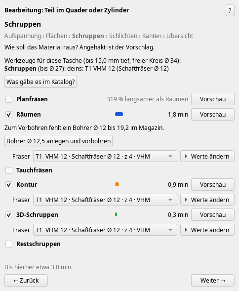
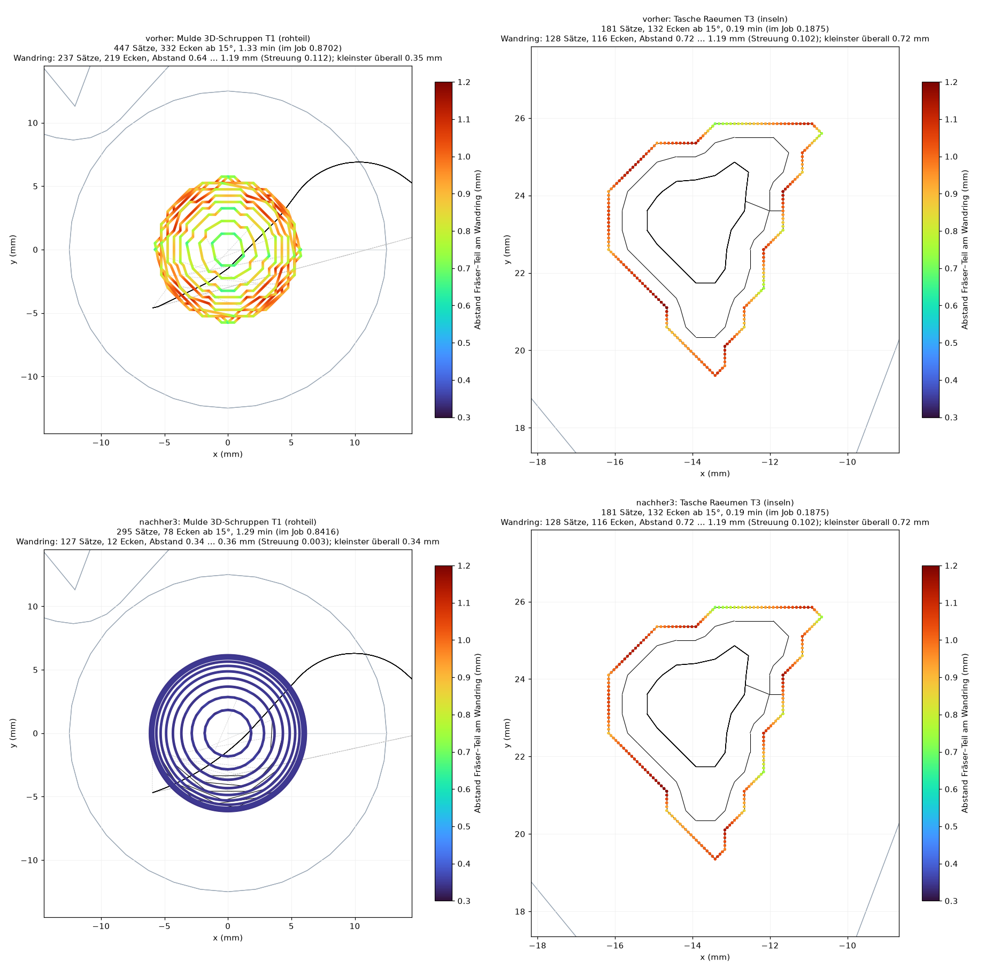
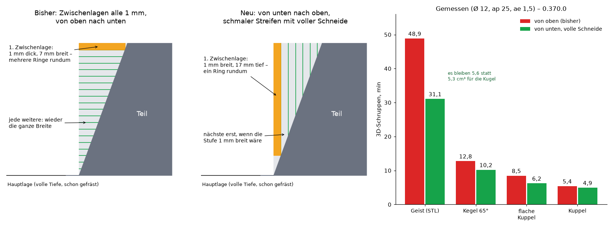
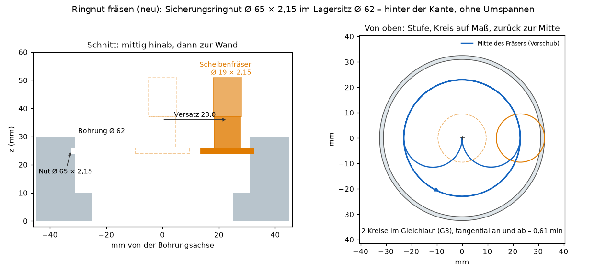
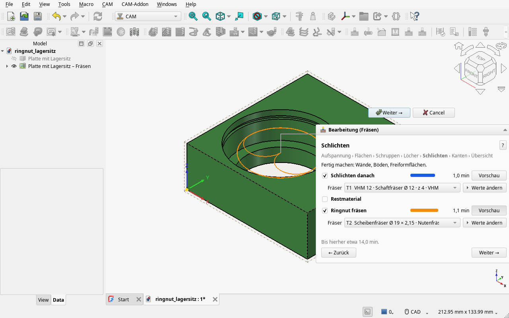
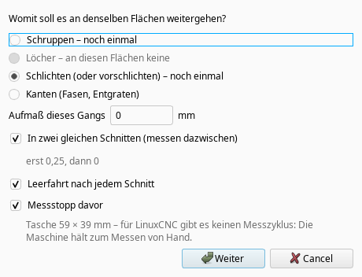
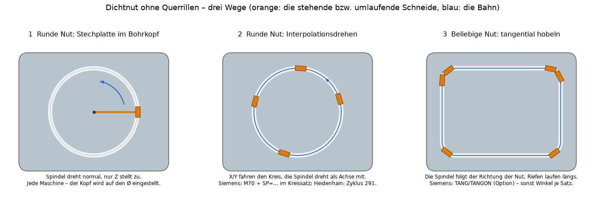

# Weekly update: show instead of tell, faster 3D roughing, ring grooves behind the edge, measuring with spring passes (0.373.0)

*2026-11-15*

Current version 0.373.0 (“Check for updates” offers it). **If you are on any version from 0.348.2 to 0.366.1, please update** – see “Safety”.

## Show instead of tell
The windows had too much text. The wizard now shows instead of explaining: the toolpaths in colour on the part, unfinished faces in orange, the time per operation as a bar, plate and vise in 3D. The questions (“How should the material come out?”, “Walls under the rim”) show a picture for each way. “Write program” went from about 2000 to 160 words. Whatever is missing is a button: “Create Ø 12.5 drill and pre-drill”, “Extend T3 to 35 mm” instead of a sentence about what to do. When checking on the machine, the red axis bar says how far it is short, and one click moves there.

Every way through the steps ends in an overview – “Create” only exists there; “Suggest everything →” jumps straight to it.

## 3D roughing: round rings instead of stairs
The rings along the wall came from a 0.5 mm grid and ran in little stairs. Now the ring follows the real surface: in the hollow of my test part it sits 0.34 to 0.36 mm off the part instead of 0.64 to 1.19 (allowance 0.3), with 78 instead of 332 corners. Same for pocket clearing in sharp pocket corners: 0.30 instead of 0.72 to 1.19 mm.

**Intermediate layers from below with the full flute** (new checkbox, ticked): after every full-depth layer, 3D roughing used to run intermediate layers every 1 mm from the top down – each one a thin slice across the whole width. On a steep part that is almost nothing but travel: 31.6 of 48.9 min on my ghost STL. They now run from the bottom up, each one a narrow strip along the wall using the whole flute, and a layer only comes where the step would otherwise get wider than 1 mm. Ghost 31.1 instead of 48.9 min, shallow dome 6.2 instead of 8.5. Saved jobs keep the old way.

This also holds when the stock has already been faced or cleared before: the add-on then computes both orders and, for the full-depth layer, two ways (rings around the part, or from the edge of the remaining stock) and takes the fastest path. Dome after facing 5.0 instead of 6.3 min; dome with a cleared pocket next to it 4.8 instead of 5.8 min, with engagement 2.0 instead of 5.8 ae.

## New: ring groove milling
Circlip and O-ring grooves inside a bore sit behind the edge – no end mill reaches them from above, and until now they simply stayed unmachined. The wizard now recognises them and mills them with a slitting/T-slot cutter, without re-clamping: down the centre of the finished bore, tangentially onto the wall, climb-milling circles, one circle to size, back to the centre. The feed of the cutter centre is reduced on the inner circle so that it is right at the cutting edge. If no cutter in the tool list fits, it says what would work – with a button that creates it; if an existing one only lacks a dimension (neck length, width), the button opens it. Example: circlip groove Ø 65 × 2.15 in a bearing seat Ø 62 with a Ø 19 cutter in 0.6 min.

It is a checkbox in the “Finishing” step and can be unticked – if you would rather plunge the groove on the lathe, take it out. Built by one sub-agent and cross-checked by two more, each with its own recalculation against the triangle mesh of the part: 16 findings, all fixed, three of them dangerous (a neck length that was only estimated, a rapid move that did not see the bore wall, one down onto the bottom of a groove at the floor of a blind bore). Fixed along the way: clicking the wall of such a groove used to offer “Mill bore” out to the groove diameter – the seat above it would have been milled away. Not included yet: grooves with radii in the bottom, external grooves, T-slots, back spot-facing.

## Measuring: two equal cuts and spring passes
“Continue machining” → Finishing has two new checkboxes:
- **In two equal cuts (measure in between):** first with half the allowance, then the same cut down to the allowance in the field – same cutter, same depth, same feed. The cutter deflects by the same amount both times: what is measured after the first cut is what the second one compensates. Ticked as soon as at most 1 mm is left.
- **Spring pass after every cut:** the same cut again right away, without infeed – it takes what deflection left behind.

“Create” then creates: cut → spring pass → measuring stop → the same cut to size → spring pass. All allowances are free (0.5 → 0.25 → 0 works just as well). With a probe and the control's cycle, the machine measures by itself and corrects the finishing cutter. This works for walls and floors (“Finish afterwards”) and for 3D finishing; “Mill bore” and grooves will follow.

## Face milling
- No more cutting feed behind the stock and in the turnaround arc; next to an island the face mill comes in from the air instead of plunging into the material.
- New checkbox “Rows from both sides where faster” (ticked): all rows in climb milling. With the Ø 50 face mill on a 200 × 200 plate: 17.7 instead of 23.7 min. The gain comes from the number of rows – with a small cutter and many narrow rows it stays back and forth.

## Program
Short lines are merged into arcs: pocket clearing on my test part has 4,616 instead of 19,623 blocks. “Mill bore” starts at the material (0.23 instead of 0.47 min).

## Safety
I now have the toolpaths cross-checked: one checker per change, and for every finding a second one who has to reproduce it with a check of their own. This week that found a good twenty bugs, some of them dangerous and some there for weeks:
- Free moves (since 0.348.2): a path “below” straight through a finished rib; a finishing pass along the wall allowance at free feed.
- Face milling (since October): in a special case the turnaround arc swung into a boss.
- Mill bore (0.364.0): rapid move along the wall allowance.
- 3D roughing: with stock above the part the top layer was dropped, and the next one started with a rapid move into the material.
- Contour: in a groove barely wider than the cutter, a rapid into the stock; 0.06 mm into a finished neighbouring wall.
- Pocket clearing: with a stepover above half the cutter radius, a pin was left standing in the middle.
- **3D finishing below the part bottom:** if a surface reached down to the bottom edge of the part, the ball rolled over the edge – the tip next to the part up to 1.4 mm (Ø 6) or 3.0 mm (Ø 12) below the bottom, where jaws and parallels sit. Now every row stops at the bottom; a small rest stays at the lower edge. The finished part and everything under it come first.
- A crash: a thin round pin (up to Ø 2) in a pocket made OpenCascade crash during offsetting and took FreeCAD with it. The add-on now computes such circles itself.

All fixed, each with a check that pins the case down.

## Smaller things
- Small pockets: a pocket barely larger than the cutter was reported as “the cutter does not fit” (with Ø 6 everything below 9.5 mm). It is now cleared with a ramp all around.
- After “Create”, the job no longer shows as “modified” in the tree.
- If drills are missing for small holes, the “Create drill Ø …” button now also appears in the overview.
- 4-axis wizard: collapsed, 149 instead of 436 words.
- Sandvik indexable drills are in the catalogues.
- It stays an add-on on FreeCAD's Job – no workbench of its own. Deliberately no CAM for turning: round parts are quicker programmed at the lathe.

## Next: planing a seal groove
A milled seal groove in a cover has tool marks across the O-ring at its bottom – they seal poorly. Planed (a stationary tool, the spindle following the direction of the groove), the marks run lengthwise. The process exists (planing; for round grooves interpolation turning), but no CAM I could find does it for a groove of any shape. Planned: any drawn groove with rounded corners, output as X, Y, Z and spindle angle per block in small steps for every control; plus, as options, the controls' own functions (Siemens TANG, interpolation turning, Heidenhain cycle 291).

## Tested
With FreeCAD 27.1 dev, weekly build 2026.11.11: on 0.372.0 all 148 test files (one test file itself corrected) and all 189 GUI scenarios green; the changes after that each with their own test and scenario.
