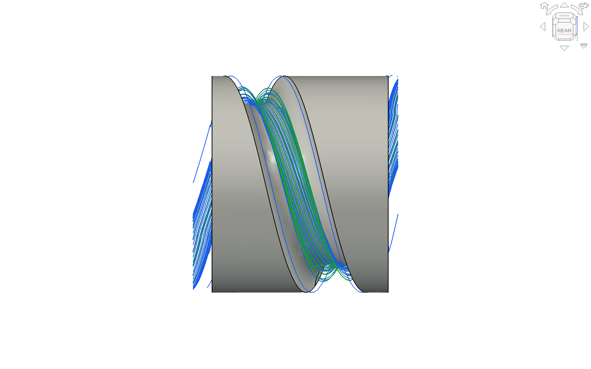
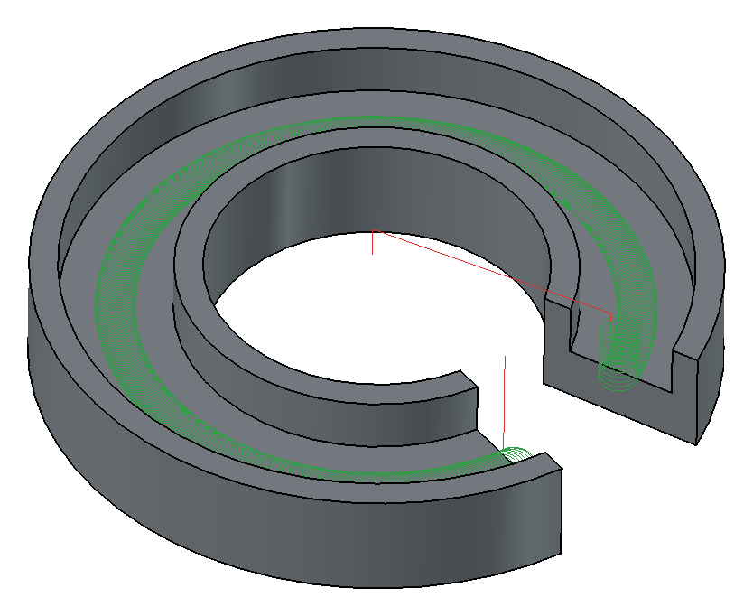
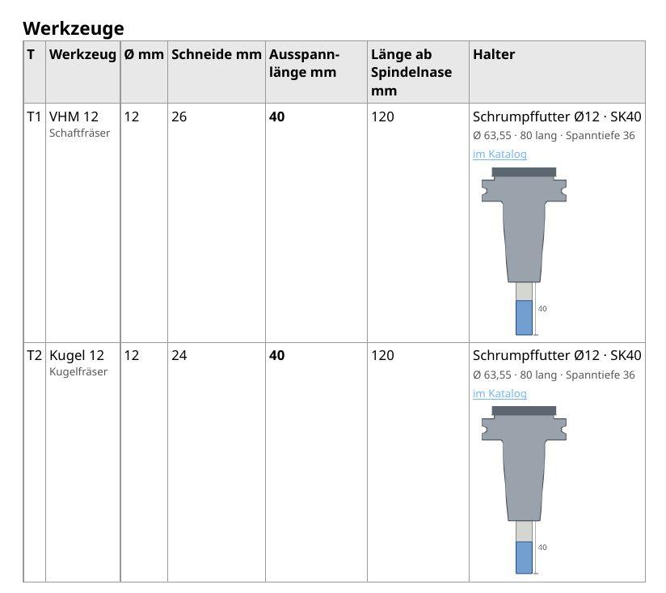

# Wochen-Update 2026-10-18

Kurzes Update zur Woche – aktuelle Version 0.266.1 („Nach Updates schauen“ bietet sie an).

## Neu
– **4 Achsen: der Wendelnut nach.** Der Assistent erkennt eine Wendelnut (Steigung, Gänge, rechts/links) und schlägt vor, ihr nach zu fahren – Bahn neben Bahn quer über die Nut, C dreht dabei immer in dieselbe Richtung. Die Bahnen liegen so dicht, dass die eingestellte Kammhöhe am wirklichen Profil der Nut gilt. Auch das Schruppen fährt der Nut nach und nur in ihr – ist das Rohteil so dick wie das Teil, fräst es nicht mehr über den fertigen Durchmesser. Testteil Ø 80 mit runder Nut R 11, Steigung 60: Schlichten 11,6 statt 14,2 min, überall 0,02 Kammhöhe (die Spirale ließ an den Flanken bis 0,06); Schruppen ohne Luft (vorher 3,1 von 3,8 m über dem Ø 80). Im Bild die Bahnen des Schlichtens.

– **Vorschlichten als Haken:** Nimmt die Kugel nach dem Schruppen stellenweise zu viel, ist „Vorschlichten“ angehakt – dieselbe Kugel auf 0,3 Aufmaß, nur auf dem Stück, wo es nötig ist.  
– **Offene Nuten in D-Bögen:** Ist eine Nut an einem Ende offen, kommt der Fräser von außen aus der Luft und fährt Bögen statt Zickzack – an der Fräse (C-Ring) wie an der Drehmaschine (Schlitze in einem Ring, C steht).

– **Rohteil als Quader mit Maßen:** Länge, Breite, Höhe eintragen, Aufmaß oben oder unten; passt das Teil nicht hinein, steht es rot da.  
– **Schruppen – messen – schlichten:** Messstopp zwischen Schruppen und Schlichten (auf Wunsch).  
– **Stirnseite der Drehmaschine:** Nut oder Tasche auf der Stirn wie an der Fräse, mit Y oder polar.  
– **Einrichtblatt** je Job: Werkzeuge mit Ausspannlänge und Halter, je Schritt S, F, vc, fz, ap, ae und Eintauchwinkel – zum Eintippen an der Maschine; der Nullpunkt so, wie gewählt („Mitte oben des Rohteils“), mit Koordinatensystem im Bild der Aufspannung.

– **Abfahren:** Maschine durchsichtig (Grad einstellbar) oder ausgeblendet.

## Was besser geht
– **Alle Kerne:** Vorschauen, Hüllflächen, Kollisionsprüfung und Bahnen wie die Wendel rechnen in eigenen Hintergrund-Prozessen, je Kern einer – das Fenster bleibt dabei bedienbar. (FreeCAD CAM rechnet eine Operation meist in einem Prozess.) Wendel 6,7 → 1,7 s, Kollision an einer Freiform 307 → 54 s.  
– Kammhöhe: Eingetragen bestimmt sie die Schrittweite, die Anzeige rechnet beim Tippen mit.  
– „Auf der Maschine prüfen“ hängt nicht mehr bei großen 4- und 5-Achs-Jobs; „Kollision prüfen“ an STL-Teilen verrennt sich nicht mehr.  
– Weniger Zickzack: von außen aus der Luft, sonst Helix.

Wie immer: Rückmeldungen, Testteile und Bilder von dem, was schiefgeht, sind sehr willkommen.

Manuel
