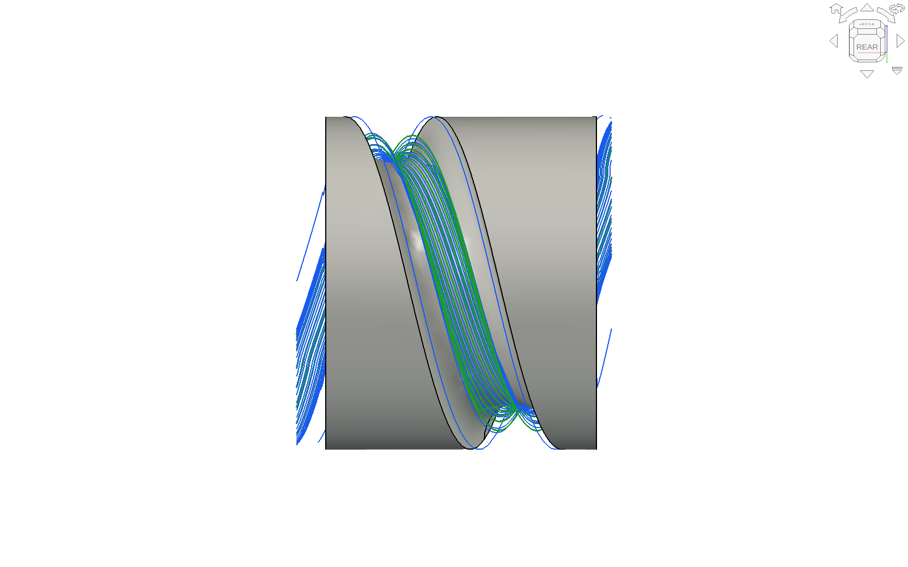
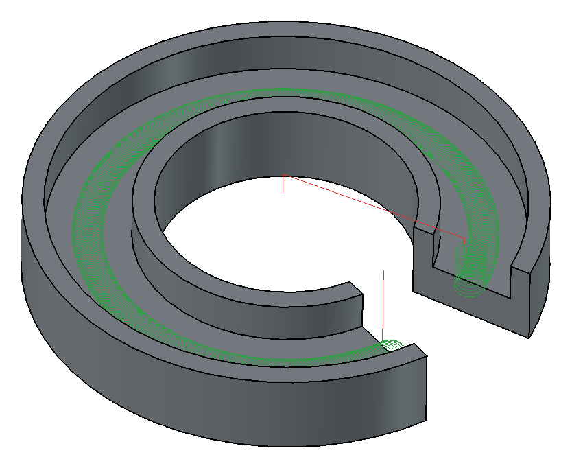
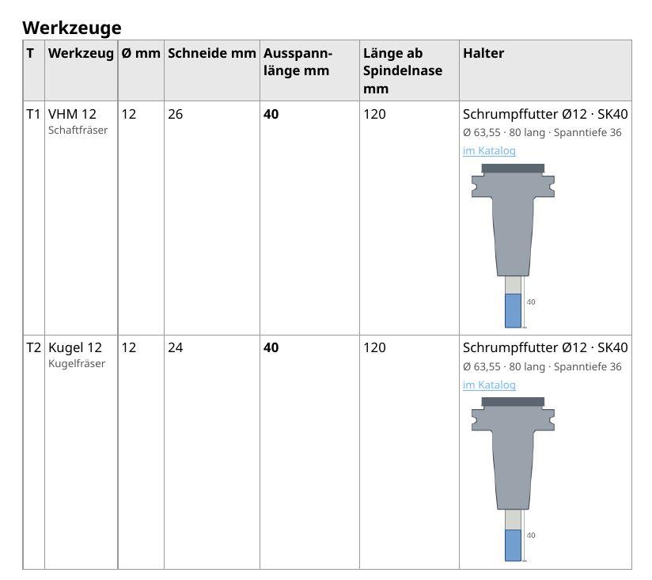

# Weekly update 2026-10-18

A short update on the week – current version 0.266.1 ("Check for updates" offers it).

## What is new
– **4 axes: along a helical groove.** The assistant recognises a helical groove (lead, starts, right/left hand) and suggests following it – pass beside pass across the groove, C always turning the same way. The passes are spaced so that the scallop height you set holds on the real profile of the groove. Roughing follows the groove too, and only inside it – if the stock is as thick as the part, it no longer mills above the finished diameter. Test part Ø 80 with a round groove R 11, lead 60: finishing 11.6 instead of 14.2 min, 0.02 scallop everywhere (the spiral left up to 0.06 on the flanks); roughing without air (before: 3.1 of 3.8 m above Ø 80). The picture shows the finishing passes.

– **Semi-finishing as a tick box:** if the ball would take too much in places after roughing, "Semi-finishing" is ticked – the same ball to 0.3 allowance, only on the stretch where it is needed.  
– **Open slots in D-arcs:** if a slot is open at one end, the cutter comes in from outside through the air and runs arcs instead of zigzag – on the mill (C-ring) as on the lathe (slots in a ring, C standing still).

– **Stock as a box with dimensions:** enter length, width, height and the allowance at top or bottom; if the part does not fit, it says so in red.  
– **Rough – measure – finish:** an optional measuring stop between roughing and finishing.  
– **Front face of the lathe:** a slot or pocket on the face as on a mill, with Y or polar.  
– **Setup sheet** per job: tools with stick-out and holder, per step S, F, vc, fz, ap, ae and plunge angle – to type in at the machine; the zero point as chosen ("top centre of the stock"), with the coordinate system in the setup picture.

– **Replay:** machine transparent (degree adjustable) or hidden.

## What works better
– **All cores:** previews, envelopes, collision checks and paths like the helix run in their own background processes, one per core – the window stays usable. (FreeCAD CAM mostly computes an operation in one process.) Helix 6.7 → 1.7 s, collision on a free-form part 307 → 54 s.  
– Scallop height: when entered it sets the stepover; the display updates while typing.  
– "Check on machine" no longer hangs on large 4- and 5-axis jobs; "Check collisions" on STL parts no longer gets stuck.  
– Less zigzag: from outside through the air, otherwise a helix.

As always: feedback, test parts and pictures of what goes wrong are very welcome.

Manuel
