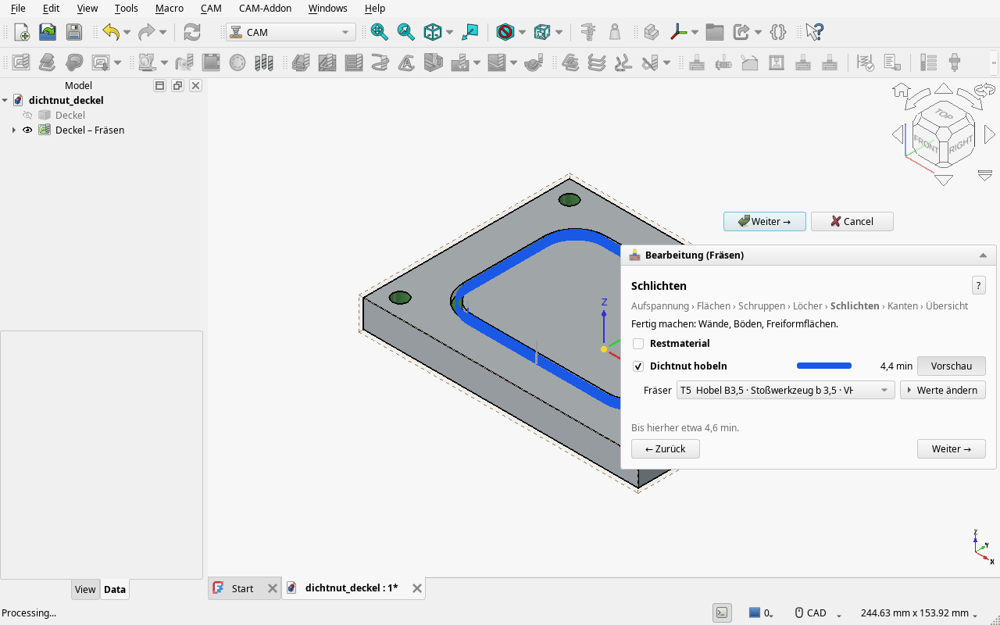
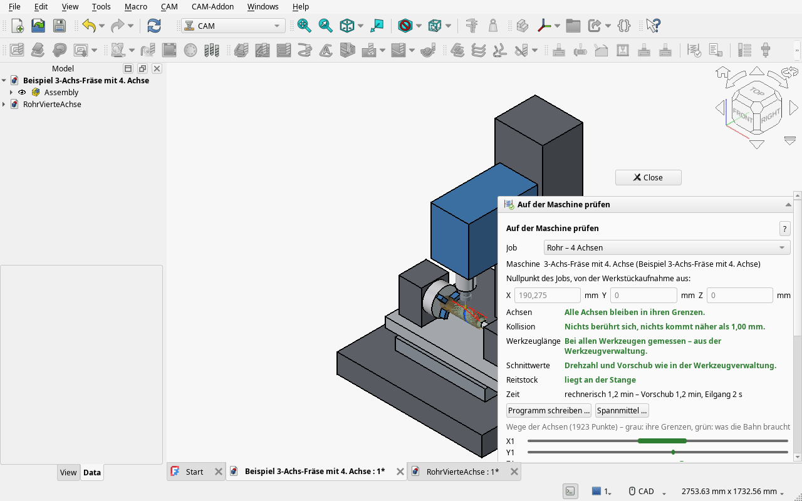
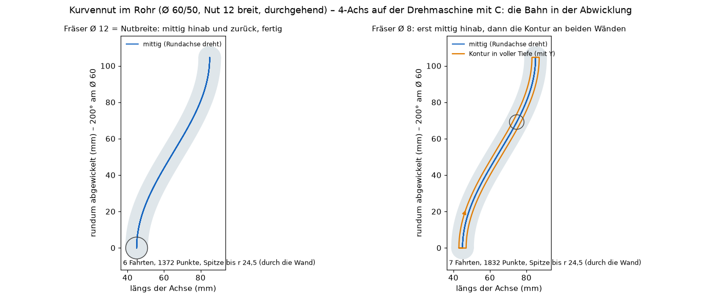

# Wochen-Update: Dichtnut hobeln, 4. Achse an der 3-Achs-Fräse, Kurvennut im Rohr, Nullpunkte wie in der Werkstatt (0.389.0)

*2026-11-21*

Aktuelle Version 0.389.0 („Nach Updates schauen“ bietet sie an). Diesmal kurz – diese Woche war wenig Zeit, das meiste stammt vom letzten Wochenende und von heute.

## Neu: Dichtnut hobeln mit stehendem Werkzeug
Eine Dichtnut im Deckel dichtet besser, wenn sie gehobelt statt gefräst ist: Das Werkzeug dreht nicht, die Spindel wird Satz für Satz so gestellt, dass die Klinge längs der Nut zeigt, und die Riefen laufen längs. Der Assistent bietet „Dichtnut hobeln“ jetzt für jede gezeichnete, geschlossene Nut an (sie braucht Rundungen – in einer spitzen Ecke kann sich die Klinge nicht drehen).

- Aus dem Vollen, ohne vorher zu fräsen. Die Klinge fährt flach ein: senkrecht nur bis 0,3 mm über das Material, dann auf einem geraden Stück in Richtung der Nut und von dort mit stetigem Gefälle durch die Nut – 0,08 mm je Umlauf als Vorgabe, vom Werkzeug.
- Eine Klinge, die schmaler ist als die Nut, fährt mehrere Spuren, jede von oben bis auf Tiefe.
- Jede Steuerung bekommt den Spindelwinkel je Satz in ihren Worten: Siemens `SPOS`, Heidenhain Zyklus 13, LinuxCNC/Haas `M19 R`, Fanuc/Mach4 `M19 S`. GRBL und woodWOP können es nicht, das Fenster sagt es.
- Neu diese Woche: Klingen, die auf einer Seite rund geschliffen sind (Axial-Einstechplatten wie Horn Supermini 105). Radius der runden Seite und die Seite eintragen; das Addon wählt daraus die Fahrtrichtung, sodass die runde Seite zur Außenwand zeigt, und so eine Klinge darf so breit sein wie die Nut. Horn Speed-Forming P105 und Supermini LA105 stehen in der Herstellerliste.

Ein unabhängiger zweiter Agent hat 74 Kombinationen aus Nut und Klinge mit eigenem Klingenumriss gegen die echten Wände nachgerechnet: höchstens 0,0024 mm in der Wand, mit ± 0,5° Spindelfehler. Er fand außerdem fünf Dinge, die behoben sind – das schlimmste: Eine Freiform-Nut ergab eine unbrauchbare Bahn statt einer Ablehnung.

## 4. Achse an der 3-Achs-Fräse und Rohr im Futter auf dem Rundtisch
- Eine 3-Achs-Fräse mit Teilapparat längs X ist jetzt eine eigene Maschine: Dreibackenfutter, Reitstock als Haken (die Prüfung sagt, ob er an die Stange reicht), Anfahrt nach dem Werkzeugwechsel von oben.
- Ein Rohr, das im Dreibackenfutter auf dem Rundtisch einer 5-Achs-Maschine Tisch/Tisch steht („C, A −90°“).
- Nullpunkte, wie man in der Werkstatt einrichtet: An der 4. Achse zählt das Programm Z jetzt vom Mantel oben (das Einrichtblatt sagt, was zu tun ist, wenn die Stange nicht genau das Maß hat).
- Für das Rohr auf dem Rundtisch gibt es den neuen Haken „Rohr ungeschwenkt einrichten“ (X 0 Y 0 mittig im Rohr, Z 0 oben, dann CYCLE800 / PLANE SPATIAL). Er ist vorbelegt **aus**: Eine unabhängige Prüfung fand, dass er sich darauf verlässt, dass die Steuerung den geschwenkten Rahmen stehen lässt, während C dreht – das hat noch niemand an einer echten Maschine bestätigt. Als Nächstes werden diese Sätze stattdessen unter TRAORI / M128 geschrieben, damit die Steuerung die Kinematik selbst rechnet – dann geht auch ein Rohr, das nicht genau mittig gespannt ist.

## Kurvennut im Rohr
Eine gewundene Nut durch die Wand eines Rohrs (jemand hat so eine im Discord gezeigt): Klick auf die Randkante der Nut. Mit einem Fräser so breit wie die Nut läuft er mittig; mit einem kleineren fährt er danach beide Wände ab, auf Wunsch mit Aufmaß und Leerdurchfahrten.

## Kleineres
- Bohrung fräsen in zwei Schnitten mit Messstopp dazwischen; Stopp und zweiter Schnitt stehen direkt hinter der Bohrung, vor Senken und Gewinde.
- Restschlichten an der Unterkante wird von selbst angehakt, wenn dort Rest bleibt und eine passende kleinere Kugel im Magazin ist.
- Die Spindel als Rundachse (C1) für Steuerungen, die es so wollen.
- Alle Kerne nutzen: Der Klick auf eine Kurvennut ging von 8,6 s auf 0,3 s, das Räumen rechnet auf den Nebenrechnern (Hauptprozess an meinem Testteil 4,3 → 0,7 s).
- 3D-Schlichten: neuer Haken „Zum Schluss eine Runde auf dem Teilboden“ (vorbelegt aus). Die Kugel fährt einmal um die Unterkante, Spitze auf dem Boden: Rest am Fuß einer Kuppel R 40 mit Kugel Ø 6 0,82 → 0,53 mm für +0,34 min. Eine unabhängige Prüfung fand, dass das Eintauchen 0,28 mm in eine nicht gewählte Wand direkt dahinter schneiden konnte – vor der Freigabe behoben.

## Ein FreeCAD-Fehler, der euch begegnen kann
Mit dem aktuellen Wochen-Build (2026.11.18) kann FreeCAD in Part Design einfrieren, wenn man in einem Aufgabenfenster einen Wert ändert, während eine lange Rechnung noch läuft (bei mir: abziehende Wendel). Es ist die neue Vorschau, die in die laufende Rechnung hineinstartet – nicht das Addon. Ausweg: im Aufgabenfenster „Vorschau-Überlagerung anzeigen“ abhaken. Einzelheiten und der Stapel: https://github.com/FreeCAD/FreeCAD/issues/31457#issuecomment-7059528076

## Geprüft
Mit FreeCAD 27.1 dev, Wochen-Build 2026.11.18. Heute lief jede Änderung mit ihrer Prüfdatei und ihrem Szenario (dazu unabhängige Gegenprüfungen der runden Klinge, der Nullpunkte und der Bodenrunde). Der letzte volle Lauf war vor einer Woche: alle 154 Prüfdateien und alle 196 Oberflächen-Szenarien grün auf 0.383.1.
