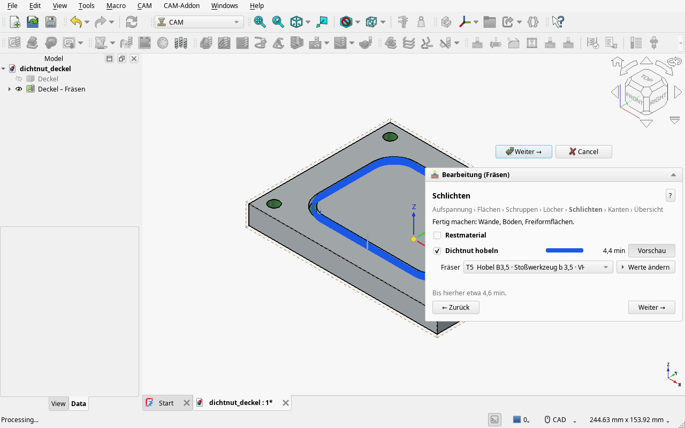
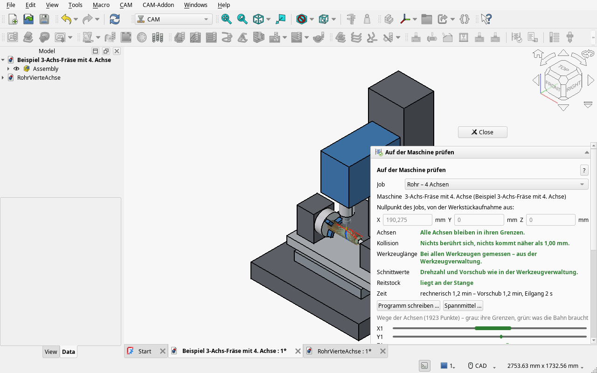
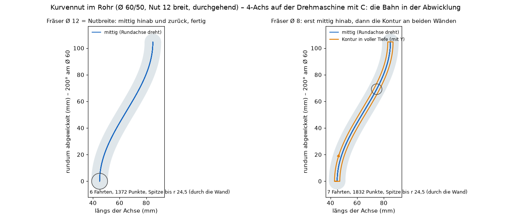

# Weekly update: planing seal grooves, 4th axis on a 3-axis mill, cam grooves in a tube, shop-style zero points (0.389.0)

*2026-11-21*

Current version 0.389.0 (“Check for updates” offers it). A short one – not much time this week, most of this is from last weekend and today.

## New: planing a seal groove with a standing tool
A seal groove in a cover gets a better sealing face when it is planed instead of milled: the tool does not turn, the spindle is oriented block by block so the blade always points along the groove, and the marks run lengthwise. The wizard now offers “Plane seal groove” for any closed groove you have drawn (it needs rounded corners – a blade cannot turn in a sharp one).

- From the solid, no milling first. The blade enters flat: straight down only to 0.3 mm above the material, then along a straight piece of the groove, and from there in one steady slope around the groove – 0.08 mm per lap by default, taken from the tool.
- A blade narrower than the groove runs several tracks, each from the top to full depth.
- Every controller gets the spindle angle per block in its own words: Siemens `SPOS`, Heidenhain cycle 13, LinuxCNC/Haas `M19 R`, Fanuc/Mach4 `M19 S`. GRBL and woodWOP cannot do it, and the window says so.
- New this week: blades that are ground round on one side (face-grooving inserts such as Horn Supermini 105). Enter the radius of the round side and which side it is; the addon then picks the direction of travel so the round side faces the outer wall, and such a blade may be as wide as the groove. Horn Speed-Forming P105 and Supermini LA105 are in the manufacturer list.

An independent second agent recomputed 74 groove/blade combinations with its own blade outline against the real walls: at most 0.0024 mm into a wall, including a ±0.5° spindle error. It also found five things, now fixed – the worst: a free-form groove returned a useless path instead of a refusal.

## 4th axis on a 3-axis mill, and a tube in a chuck on the rotary table
- A 3-axis mill with a dividing head along X is now a machine of its own: three-jaw chuck, tailstock as a checkbox (the check says whether it reaches the bar), approach from above after the tool change.
- A tube standing in a three-jaw chuck on the rotary table of a table/table 5-axis machine (“C, A −90°”).
- Zero points the way they are set up in the shop: on the 4th axis the program now counts Z from the top of the bar (the setup sheet tells you what to do if the bar is not exactly on size).
- For the tube on the rotary table there is a new checkbox “Set up the tube untilted” (X0 Y0 in the middle of the tube, Z0 on top, then CYCLE800 / PLANE SPATIAL). It is **off** by default: an independent check found that it relies on the controller keeping the tilted frame fixed while C turns, which nobody has confirmed on a real machine. Next step is to write those blocks under TRAORI / M128 instead, so the controller does the kinematics itself – then a tube that is not clamped exactly on centre works too.

## Cam groove in a tube
A wound groove through the wall of a tube (someone showed one on Discord): click the edge of the groove. With a cutter as wide as the groove it runs down the middle; with a smaller one it follows both walls afterwards, with stock to leave and spring passes if you want.

## Smaller things
- Bore milling in two cuts with a measuring stop in between; the stop and the second cut sit directly behind the bore, before countersinking and threads.
- Rest finishing at the lower edge is ticked on its own when rest remains there and a suitable smaller ball is in the magazine.
- The spindle as a rotary axis (C1) for controllers that want it that way.
- Using all cores: clicking a cam groove went from 8.6 s to 0.3 s, pocket clearing computes on the helper processes (main process on my test part 4.3 → 0.7 s).
- 3D finishing: new checkbox “One last lap on the part floor” (off by default). The ball runs once around the lower edge with its tip on the floor: rest at the foot of a dome R 40 with a Ø 6 ball 0.82 → 0.53 mm for +0.34 min. An independent check found that its plunge could cut 0.28 mm into an unselected wall right behind it – fixed before release.

## A FreeCAD bug you may run into
With the current weekly (2026.11.18) FreeCAD can freeze in Part Design when a value is changed in a task panel while a long boolean is still running (I hit it with a subtractive helix). It is the new preview starting inside the running computation – not the addon. Workaround: untick “Show preview overlay” in the task panel. Details and a backtrace: https://github.com/FreeCAD/FreeCAD/issues/31457#issuecomment-7059528076

## Tested
With FreeCAD 27.1 dev, weekly 2026.11.18. Today each change ran with its own test file and scenario (plus independent counter-checks of the round blade, the zero points and the floor lap). The last full run was a week ago: all 154 test files and all 196 GUI scenarios green on 0.383.1.
