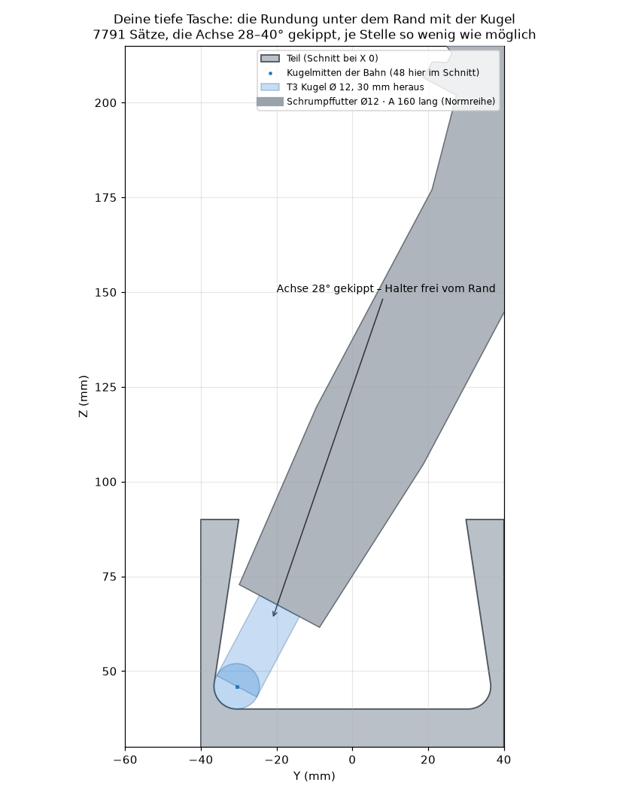
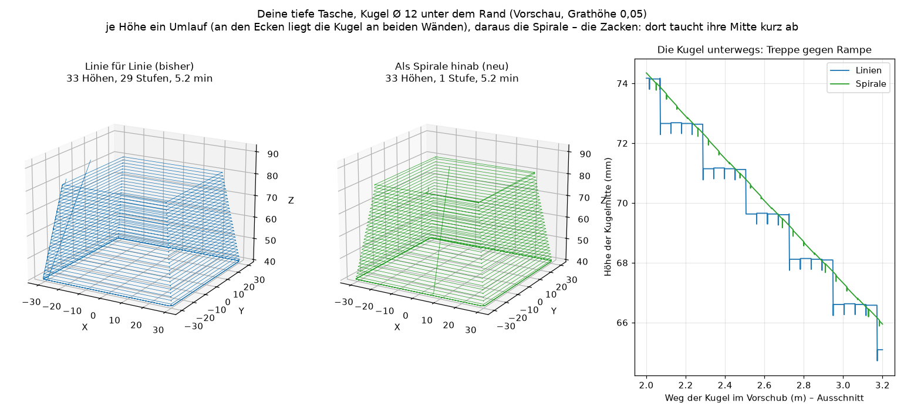
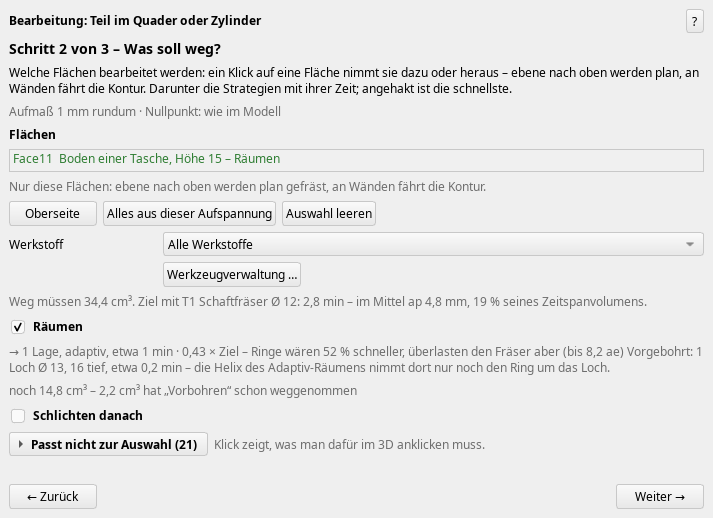
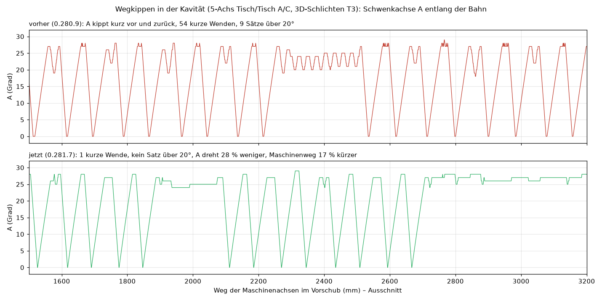
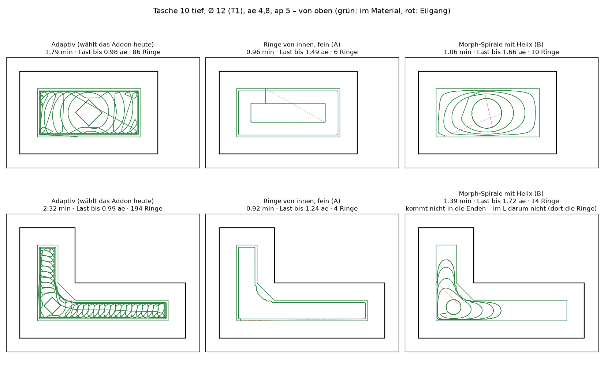
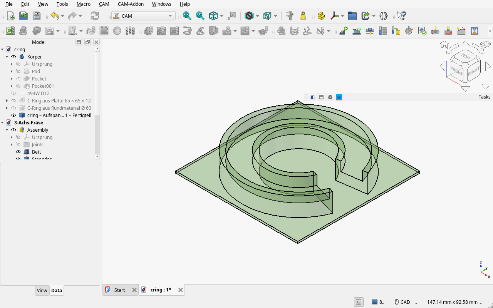

# Wochen-Update 2026-10-25

Eine Woche 5 Achsen – aktuelle Version 0.288.0 („Nach Updates suchen“ bietet sie an). Seit meinem letzten Update (0.266.1) gab es rund 130 Änderungen; hier die, auf die es ankommt.

## 1. Eine tiefe Tasche mit überhängenden Wänden – mit 5 Achsen, Schritt für Schritt
Mein neues Testteil: eine 50 mm tiefe Tasche, die Wände um etwa 8° nach innen geneigt (unten breiter als an der Öffnung), Rundung R 7 zum Boden, auf einer 5-Achs-Maschine mit waagerechter Spindel (GROB G550). Der Assistent baut jetzt die ganze Kette:  
– **Räumen von oben** unter der Öffnung, in Ringen von innen nach außen (etwa 2 statt 3 min).  
– **Flanke** der schrägen Wände mit der Seite des Schaftfräsers, Umläufe von innen zur Wand – und nur, wo Material steht: 64 → 48 Umläufe, 3,6 → 2,8 min.  
– **Kugel unter dem Rand:** Höhenlinien von oben nach unten, die Achse an jeder Stelle nur so weit gekippt wie nötig, damit Schaft *und Halter* frei vom ganzen Teil bleiben. In den Ecken, wo zwei Wände überhängen, kippt sie schräg in die Ecke.  
– **Restschlichten** mit einer kleineren Kugel nur in den Ecken, Ecke für Ecke: 24,7 → 1,1 min (vorher sprang es im Vorschub von Ecke zu Ecke).  
– An der G550 fährt das Programm vor und nach dem Schwenk jetzt *längs der Spindel* zurück – vorher in Z, und das ist an dieser Maschine quer zur Spindel.  
– „Kollision prüfen“ über die ganze Kette fand noch ein paar Stellen, alle behoben: An den Ecken taucht die Flanke nicht mehr durch die überhängende Nachbarwand ein, und beim Ein- und Austauchen hält sie 0,5 mm Abstand.

## Neu von heute: die Wände als Spirale, und Vorbohren
– **Die Kugel unter dem Rand als Spirale hinab:** statt Linie für Linie einmal rundum oben, dann je Umdrehung eine Linie tiefer – ohne Absatz von Linie zu Linie, die Achse weiter an jeder Stelle nur so weit gekippt wie nötig. In den Ecken, in die die Kugel nicht passt, treffen sich zwei Bahnen fast an derselben Stelle (die Kugel liegt an beiden Wänden an), so wird jede Höhe ein geschlossener Umlauf. An meiner Tasche: eine Spirale über alle 79 Höhen, und es bleiben weniger Stellen aus als mit Linien.

– **Vorbohren fürs Räumen:** Wo das Räumen ins volle Material eintauchen muss, bietet das Addon an, mit einem Bohrer aus dem Magazin vorzubohren (Ø des Fräsers bis 1,6 × davon). Fehlt einer, nennt es den Bohrer, der ginge, und legt ihn auf Klick an. FreeCADs Bohren kommt vor das Räumen, und das Räumen taucht dann senkrecht ins Loch ein. Genauso bei geschlossenen Nuten: Jede Nut bekommt den größten Bohrer, der hineinpasst, und taucht senkrecht ein statt mit Helix oder Rampe.

## 2. „Mit deinem Magazin geht es nicht – aber so ginge es“
Stößt der Halter ans Teil und reicht weiter Ausspannen nicht, sucht das Addon eine Kombination, mit der es geht – auch mit Haltern und Fräsern, die du noch nicht hast: andere Halter aus deiner Bibliothek, Halter aus Normreihen, längere Fräser derselben Art. Es empfiehlt die steifste (kürzeste Länge ab Spindelnase), und „So einrichten“ trägt sie in die Werkzeugverwaltung ein. Das geht beim Schlichten mit der Kugel und bei der Flanke, und es rechnet im Hintergrund – das Fenster bleibt bedienbar.

Für die engen Ecken nennt es die größte Kugel, die hineinpasst. Gibt es keine in der Bibliothek, schlägt es eine vor (etwa Kugelfräser Ø 6 × 60 im ER11-Futter, 35 mm heraus), legt sie auf Wunsch an und hakt das Restschlichten an.

## 3. Halter und Magazine
– Halter → „Neu“ → „Normreihen“: Schrumpffutter Ø 3–32 von A 80 bis „extra lang“ (A 300), ER11–ER40-Spannzangenfutter von A 70 bis 250, Weldon- und Hydrodehnfutter – an jeder Aufnahme (SK, BT, HSK, Capto, KM). Die Konturen sind aus typischen Normmaßen gerechnet, nicht aus einem Katalog abgezeichnet – bitte mit dem eigenen Halter vergleichen. Der gewählte Abschnitt ist im Bild hervorgehoben.  
– Magazine je Maschine: Magazin wählen, derselbe Fräser darf auf zwei Plätzen stecken, und jeder Platz weiß, wie weit der Fräser herausschaut.

## 4. 5 Achsen ohne Zappeln
Zwischen zwei Punkten pendeln die Rundachsen nicht mehr hin und her, und muss das Werkzeug wegkippen, tut es das in einem Zug statt in kurzem Vor und Zurück: in der Kavität meines 5-Achs-Beispiels 54 kurze Wenden → 1, A dreht 28 % weniger, der Maschinenweg ist 17 % kürzer. Doppelte Sätze und Eilgänge ohne Bewegung sind auch weg.

## 5. Taschen: Ringe und Morph-Spirale gegen Adaptiv
Für eine Tasche rechnet das Addon jetzt auch Ringe von innen nach außen und eine Morph-Spirale mit Helix und nimmt die schnellere – solange die Last am Fräser in seiner Grenze bleibt. An meinen Testtaschen: 1,8 → 1,0 min (Rechteck), 2,3 → 0,9 min (L-Form). Dazu sieht der Adaptiv-Kern die Inseln wieder ganz: am 3-Achs-Testteil 11,1 → 10,4 min, Last 2,4 → 1,2 ae.

## 6. Eine Aufspannung nach der anderen
– Am Ende von „Auf der Maschine prüfen“: „Fertigteil als Rohteil …“ – das Ergebnis einer Aufspannung wird das Rohteil der nächsten, an der Stange, an der Fräse und für 3+2-Ebenen. Die nächste Aufspannung fräst dann nur, was wirklich noch steht.  
– Fasen: Eine angeklickte Fase fräst der Schaftfräser in Stufen; steht ein Fasenfräser in der Bibliothek, bietet der Assistent ihn an („T6 nehmen?“). Senkungen mit dem Fasenfräser, wenn kein Kegelsenker da ist – und fehlt ein Werkzeug, sagt er, welches, mit Knopf zur Werkzeugverwaltung.  
– Ringnuten an der Drehmaschine: Helix, Wellen, beide Flanken geschlichtet.  
– STL mit mehreren Körpern in einer Datei: je Körper ein Solid.

## 7. Schneller, und das Fenster atmet
– Mehr Arbeit auf allen Kernen: Freiwege beim Räumen am Testteil 1,65 → 0,28 s, STL → Körper am Geist 7,2 → 4,7 s, „Anlegen“ beim Räumen 11 → 7 s.  
– Bei langen Rechnungen zeichnet sich das Fenster zwischendurch neu; Fenster wie das Magazin merken sich Größe und Lage.  
– Windows und macOS: Die Nebenrechner lesen den freien Speicher jetzt auch dort und laufen nicht mehr hinein. Getestet hat das noch niemand – wer Windows oder macOS hat, bitte ausprobieren.

## 8. Klar sagen, was das ist
Im README steht jetzt deutlich, was das Addon ist (ein Werkstatt-Addon auf FreeCAD CAM, nicht von den CAM-Entwicklern), woher die Werkzeugdaten der Hersteller kommen und wie man Fehler meldet – für GitHub-Issues gibt es jetzt Vorlagen. Mehr dazu im bearbeiteten ersten Beitrag dieses Threads.

Wie immer: Rückmeldungen, Testteile und Bilder von dem, was schiefgeht, sind sehr willkommen.

Manuel
