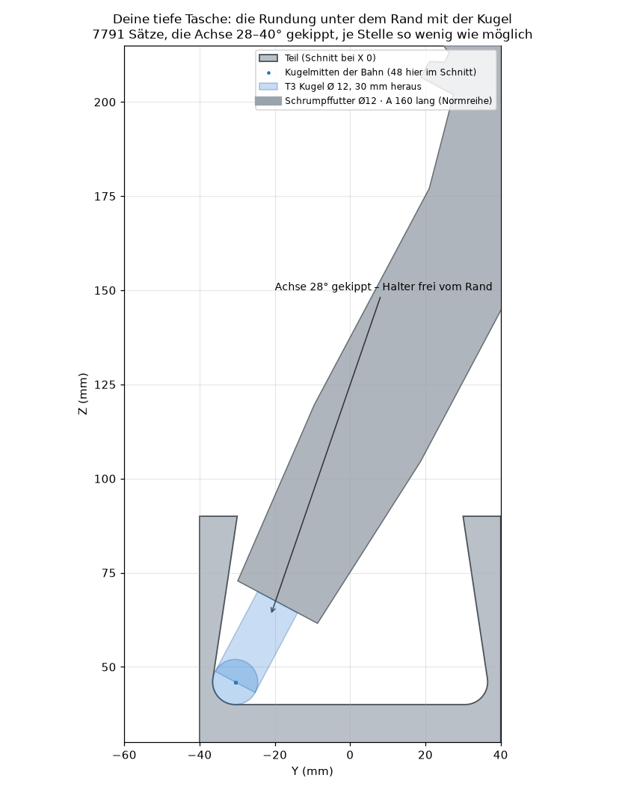
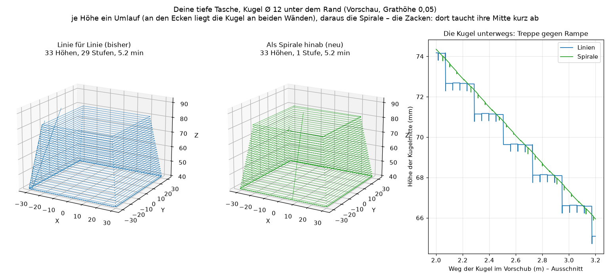
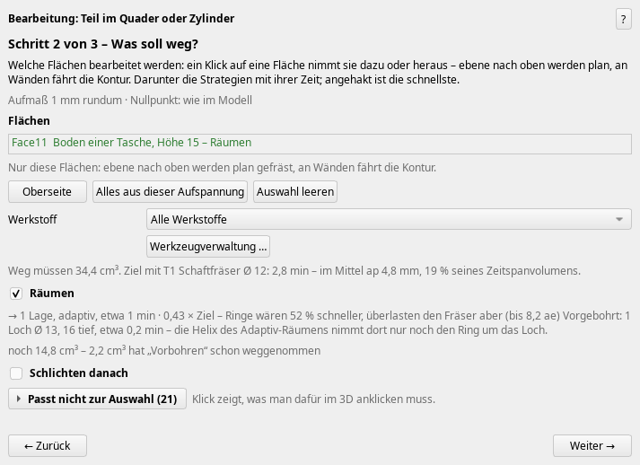
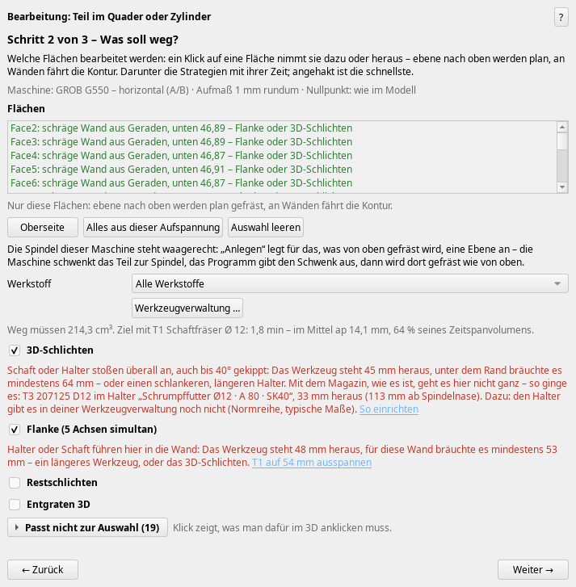
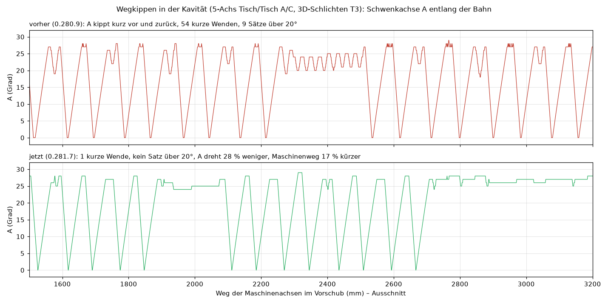
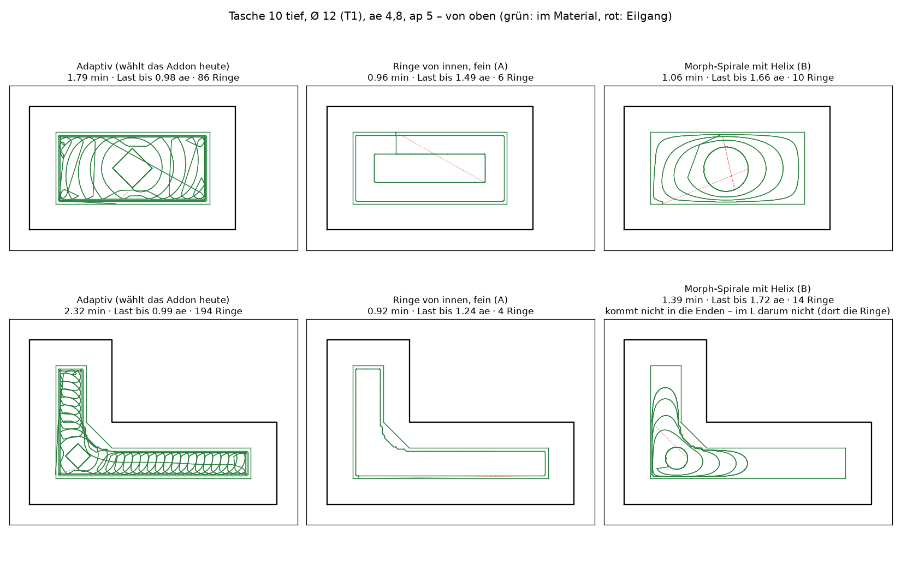
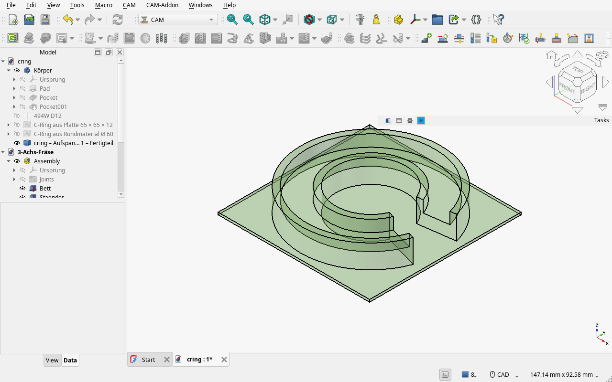

# Weekly update 2026-10-25

A week of 5 axes – current version 0.288.0 ("Check for updates" offers it). Since my last update (0.266.1) there were about 130 changes; here are the ones that matter.

## 1. A deep pocket with overhanging walls – on 5 axes, step by step
My new test part: a pocket 50 mm deep whose walls lean in by about 8° (wider at the bottom than at the opening), fillet R 7 to the floor, on a 5-axis machine with horizontal spindle (GROB G550). The assistant now builds the whole chain:  
– **Clearing from above** under the opening, in rings from the inside out (about 2 instead of 3 min).  
– **Flank milling** of the leaning walls with the side of the end mill, passes from the inside towards the wall – and only where there is material: 64 → 48 passes, 3.6 → 2.8 min.  
– **Ball nose under the rim:** contour lines from top to bottom, the axis tilted at every point only as much as needed, so that the shank *and the holder* stay clear of the whole part. In the corners, where two walls overhang, it tilts diagonally into the corner.  
– **Rest finishing** with a smaller ball only in the corners, corner by corner: 24.7 → 1.1 min (before it jumped from corner to corner at feed rate).  
– On the G550 the program now retracts *along the spindle* before and after swivelling – before, it retracted in Z, which on this machine is across the spindle.  
– "Check for collisions" on the whole chain found a few more spots, all fixed: at the corners the flank no longer plunges through the neighbouring overhanging wall, and it keeps 0.5 mm clear when going in and out.

## New today: the walls as a spiral, and pre-drilling
– **Ball nose under the rim as a spiral downwards:** instead of contour by contour, the ball goes round once at the top, then one contour lower per turn – no step from contour to contour, the axis still tilted at every point only as far as needed. In the corners, where the ball does not fit, two passes meet almost at the same spot (the ball touches both walls), so every height becomes one closed turn. On my pocket: one spiral over all 79 heights, and fewer spots left out than with contours.

– **Pre-drilling for clearing:** wherever clearing has to plunge into solid material, the add-on offers to pre-drill with a drill from the magazine (Ø of the cutter up to 1.6 × it). If there is none, it names the drill that would do and creates it on one click. FreeCAD's Drilling is created before the clearing, and the clearing then plunges straight into the hole. The same for closed slots: each slot gets the largest drill that fits, and the slot plunges straight in instead of a helix or a ramp.

## 2. "With your magazine it doesn't work – but like this it would"
If the holder hits the part and sticking the tool out further isn't enough, the add-on searches for a combination that works – also with holders and cutters you don't have yet: other holders from your library, holders from standard series, longer cutters of the same kind. It recommends the stiffest one (shortest length from the spindle nose), and "Set it up" enters it into the tool manager. This works for ball nose finishing and for flank milling, and it runs in the background – the window stays usable.

For the tight corners it names the largest ball that fits. If there is none in the library, it proposes one (e.g. ball end mill Ø 6 × 60 in an ER11 chuck, 35 mm stick-out), adds it on request and ticks rest finishing.

## 3. Holders and magazines
– Holders → "New" → "Standard series": shrink-fit chucks Ø 3–32 from A 80 up to "extra long" (A 300), ER11–ER40 collet chucks from A 70 to 250, Weldon and hydraulic chucks – for every spindle taper (SK, BT, HSK, Capto, KM). The contours come from typical dimensions of the standards, not from a catalogue – please compare with your own holder. The selected section is highlighted in the picture.  
– Magazines per machine: pick the magazine, the same tool can sit in two pockets, and every pocket knows how far the tool sticks out.

## 4. 5 axes without jitter
Between two points the rotary axes no longer swing back and forth, and when the tool has to tilt away it does so in one go instead of short back-and-forth moves: in the cavity of my 5-axis example 54 short reversals → 1, A turns 28 % less, the machine path is 17 % shorter. Duplicate blocks and rapids without movement are gone too.

## 5. Pockets: rings and morph spiral against adaptive
For a pocket the add-on now also computes rings from the inside out and a morph spiral with helix, and takes the faster one – as long as the load on the cutter stays within its limit. On my test pockets: 1.8 → 1.0 min (rectangle), 2.3 → 0.9 min (L shape). The Adaptive kernel also sees the islands completely again: on the 3-axis test part 11.1 → 10.4 min, load 2.4 → 1.2 ae.

## 6. One setup after the other
– At the end of "Check on machine": "Finished part as stock …" – the result of one setup becomes the stock of the next one, on the bar, on the mill and for 3+2 planes. The next setup then only machines what is really left.  
– Chamfers: a clicked chamfer is milled with the end mill in steps; if there is a chamfer mill in the library, the assistant offers it ("Take T6?"). Countersinks with the chamfer mill if there is no countersink – and if a tool is missing, it says which one, with a button to the tool manager.  
– Ring grooves on the lathe: helix, waves, both flanks finished.  
– STL with several bodies in one file: one solid per body.

## 7. Faster, and the window keeps breathing
– More of the work runs on all cores: free moves when clearing on the test part 1.65 → 0.28 s, STL → solid on the ghost 7.2 → 4.7 s, "Create" for clearing 11 → 7 s.  
– During long calculations the window redraws in between; windows like the magazine remember their size and position.  
– Windows and macOS: the worker processes now read the free memory there too, so they no longer run out of it. Nobody has tested that yet – if you are on Windows or macOS, please try it.

## 8. Clear about what this is
The README now says plainly what the add-on is (a workshop add-on on top of FreeCAD CAM, not from the CAM developers), where the manufacturer tool data come from, and how to report bugs – there are templates for GitHub issues now. More on that in the edited first post of this thread.

As always: feedback, test parts and pictures of what goes wrong are very welcome.

Manuel
