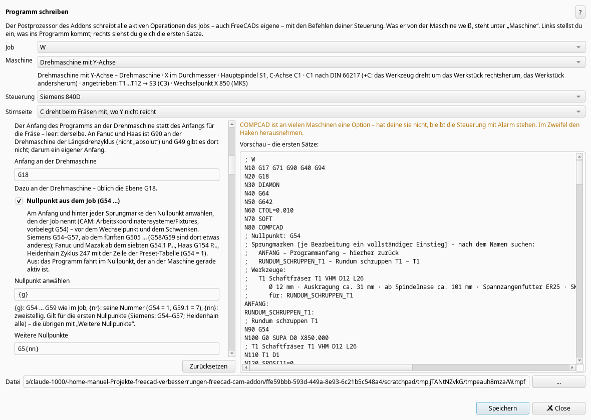

# Update: die Postprozessoren (0.301.0 … 0.312.0)

*2026-10-25*
Diese Woche ging es um die Programme selbst. Jedes Programm, das das Addon schreibt, wird jetzt wieder eingelesen und Satz für Satz mit den Bahnen im Job verglichen, bei jeder Steuerung und mit jedem Haken einzeln umgeschaltet, an Fräse und Drehmaschine, auch in geschwenkten Ebenen. Dazu kommen über 30 000 Zufallsprogramme. Dabei kamen ein paar stille Fehler heraus, die jetzt behoben sind:

- Siemens: Nach CYCLE800() blieben die Rundachsen schräg stehen. Folgte eine Bearbeitung ohne Ebene, wäre schräg weitergefräst worden. Jetzt geht es erst zum Wechselpunkt, dann CYCLE800(), dann die Rundachsen auf 0.
- Bohren an der Drehmaschine: Siemens kennt G81 nur im ISO-Modus, Fanuc-Drehmaschinen gar nicht. Jetzt ist es ausgeschrieben.
- Ein winziger Bogen (Sehne unter 0,001 mm) stand gerundet mit Anfang = Ende da, und die Steuerung hätte einen Vollkreis gefahren. Jetzt wird er eine Gerade.
- woodWOP (Homag/Weeke): Kreise stehen dort mit Radius, die Maschine rechnet die Mitte daraus. Der Radius war aufgerundet, und ein Vollkreis Ø 100 lief so bis 0,32 mm neben der Bahn. Jetzt in Vierteln: unter 0,001 mm.
- G94 im Programmkopf, Satznummern höchstens fünfstellig.

**Neu einstellbar** im Fenster „Programm schreiben“ (je Steuerung):

- Werkzeugliste im Kopf (Ø, Auskragung, Länge ab Spindelnase, Halter, für welche Bearbeitung) und Sprungmarken mit ANFANG, bei jeder Steuerung
- nächstes Werkzeug vorwählen, warten bis die Spindel läuft
- Nullpunkt aus dem Job (G54 …, Siemens ab dem fünften G505, Heidenhain Zyklus 247)
- Programmnummer je Job (Fanuc, Mazak, Haas), Wörter ohne Leerzeichen, Kommentare in Großbuchstaben
- Gewindebohren synchron oder mit Ausgleichsfutter, eigene Befehle vor/nach dem Werkzeugwechsel, Meldung beim Messstopp
- neu: GRBL und Mazak (EIA/ISO), Fanuc G68.2 für 3+2, Heidenhain-Schraubenlinien als CP
- Siemens-Drehmaschine: die Stirnseite auf Wunsch mit TRANSMIT – die Steuerung rechnet C, Bögen bleiben Bögen, das Programm wird viel kürzer

Ohne Maschine kann ich die Programme nur nach den Handbüchern und mit dieser Gegenprobe prüfen. Wer eine der Steuerungen hat (besonders Fanuc, Haas, Mazak, Heidenhain), darf gern ein kleines Programm in der Simulation der Steuerung ansehen und mir sagen, was sie meint. Ein Programmierhandbuch für Okuma oder Brother würde mir helfen, die beiden fehlen noch.

Gruß Manuel
