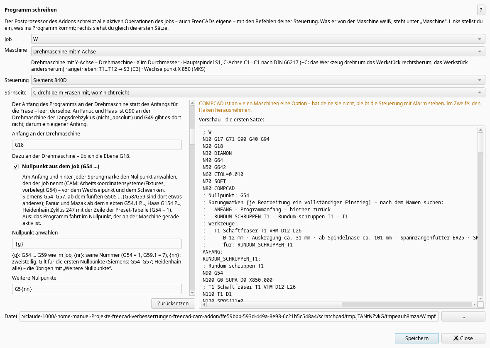

# Update: the post processors (0.301.0 … 0.312.0)

*2026-10-25*
This week was about the programs themselves. Every program the addon writes is now read back and compared block by block with the toolpaths in the job – for every control, with every option switched on and off one at a time, on mills and lathes and in tilted planes – plus more than 30 000 random programs. Each feed move must match in position, feed, spindle (speed and direction), coolant, tool, tool length offset (G43 H) and feed mode (G93/G94). That turned up a few silent bugs, now fixed:

- Siemens: after CYCLE800() the rotary axes stayed tilted. If an operation without a plane followed, it would have cut with a tilted tool. Now: tool change point first, then CYCLE800(), then the rotary axes to 0.
- Drilling on a lathe: Siemens knows G81 only in ISO mode, Fanuc lathes don't have it at all. It is now written out as G0/G1.
- A tiny arc (chord below 0.001 mm) ended up with start = end after rounding, and the control would have cut a full circle. It is now a line.
- woodWOP (Homag/Weeke): arcs are written with a radius there, and the machine computes the centre from it. The radius was rounded up, so a full circle Ø 100 ran up to 0.32 mm off the path. Now in quarters: below 0.001 mm.
- G94 in the program header, block numbers at most five digits.

**New options** in “Write program” (per control):

- tool list in the header (Ø, stick-out, length from the spindle nose, holder, which operations) and jump labels with ANFANG, for every control
- preselect the next tool, wait for the spindle to reach speed
- work offset from the job (G54 …, Siemens G505 from the fifth on, Heidenhain cycle 247)
- program number per job (Fanuc, Mazak, Haas), words without spaces, comments in capitals
- synchronous tapping or with a floating holder, own commands before/after the tool change, a message at the measuring stop
- new: GRBL and Mazak (EIA/ISO), Fanuc G68.2 for 3+2, Heidenhain helices as CP
- Siemens lathe: the face optionally with TRANSMIT – the control computes C, arcs stay arcs, the program gets much shorter

Without a machine I can only check the programs against the manuals and with this cross-check. If you have one of these controls (especially Fanuc, Haas, Mazak, Heidenhain), please run a small program in the control's simulation and tell me what it says. A programming manual for Okuma or Brother would help – those two are still missing.

Manuel
